# 툭 (Tuk) — Flutter 앱

> 친한 친구끼리 **거절 걱정 없이 "지금 볼래?"를 던지는** 즉흥 만남 앱.
> 백엔드(Spring Boot) 리포: [pyosunyoung/tuk-server](https://github.com/pyosunyoung/tuk-server)
> **전체 정리(기획 · 구조 · 부딪힌 문제 · 운영 · 타임라인)**: [docs/OVERVIEW.md](docs/OVERVIEW.md)

단톡방에 "오늘 저녁 누구 시간 돼?"를 던지고 읽씹당하는 경험에서 시작했습니다.
**지금 한가한 친한 친구만 보여주고, 한 탭으로 부르고, 거절은 아무에게도 보이지 않습니다.**

- **릴리스 APK 1.0.1** · 지인에게 직접 배포(카톡) · 서버는 운영 중(Vultr + Caddy HTTPS)
- **테스트 61개** · Android 실기기로 기능마다 검증

## 실사용 — 지인 3명과 1주 (2026-10-22 ~ 25)

친구 1명 · 부모님과 실제 폰 4대로 운영 서버에 붙여 썼습니다. **다른 사람의 이름 · 사진 · 초대 코드는 가렸습니다.**

| 가입 | 친구 관계 | 던진 툭 | 합류 | 툭 받고 합류까지 | 서버 ERROR 로그 |
|---|---|---|---|---|---|
| 5 | 4 | 9 | 12 | **평균 1~2분** | **0** |

**시작 → 친구**

| 랜딩 | 인트로 | 카톡으로 받은 초대 | 코드 입력 | 친구 신청 받기 | 친구 목록 |
|---|---|---|---|---|---|
| 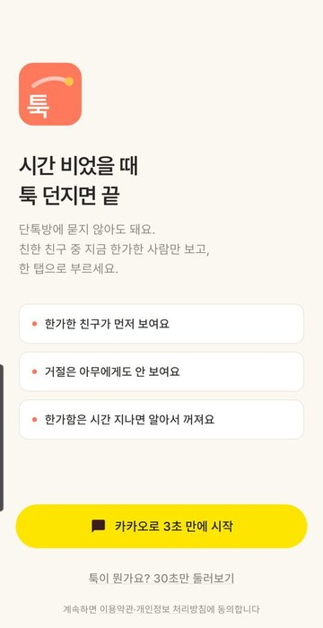 | 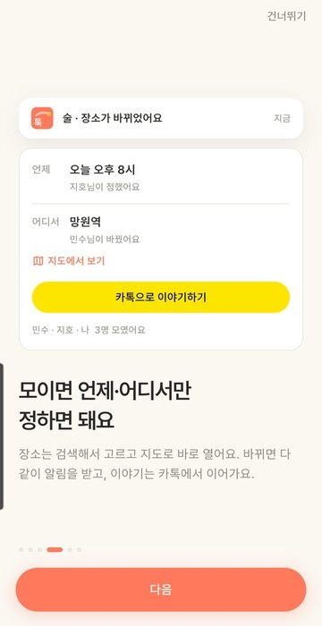 | 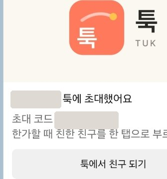 | 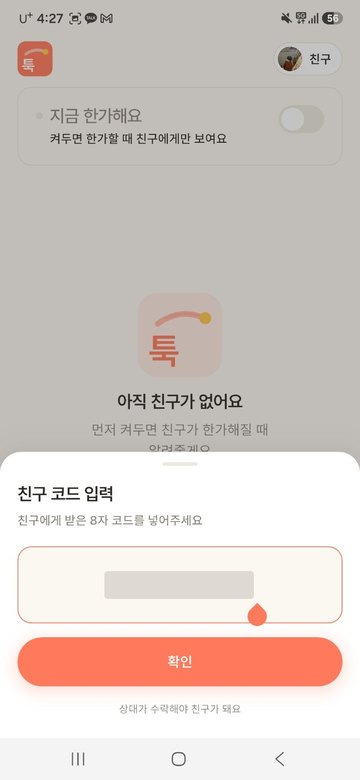 | 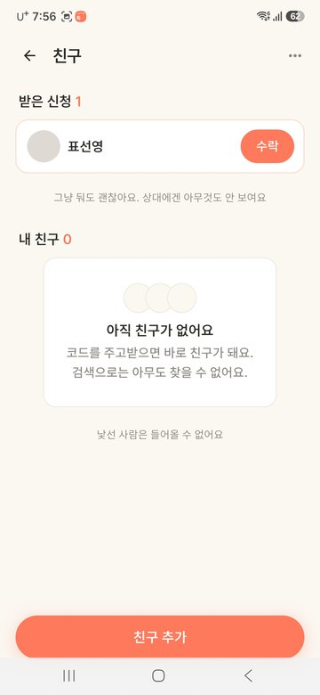 | 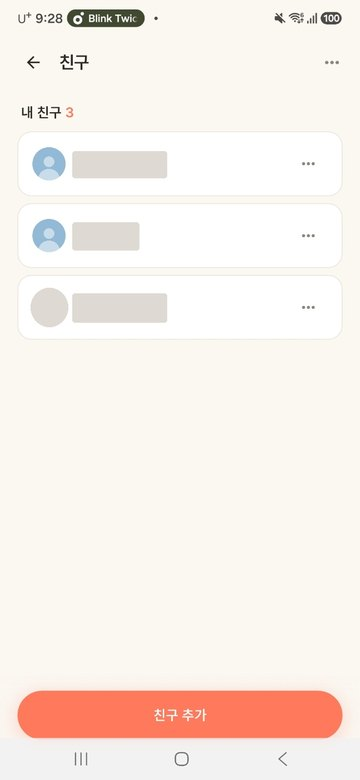 |

**한가함 → 툭 → 모임**

| 한가함 켜기 | 지금 한가한 친구 | 툭 던지기 | 툭이 온 홈 | 받은 툭 · 합류 | 모임방 |
|---|---|---|---|---|---|
| 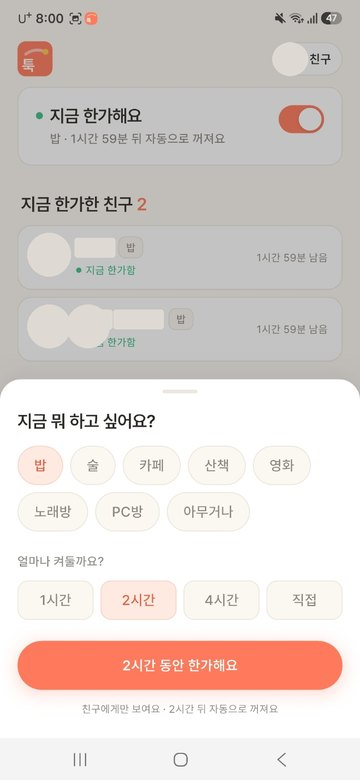 | 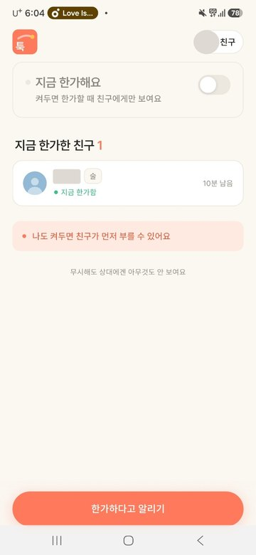 |  |  | 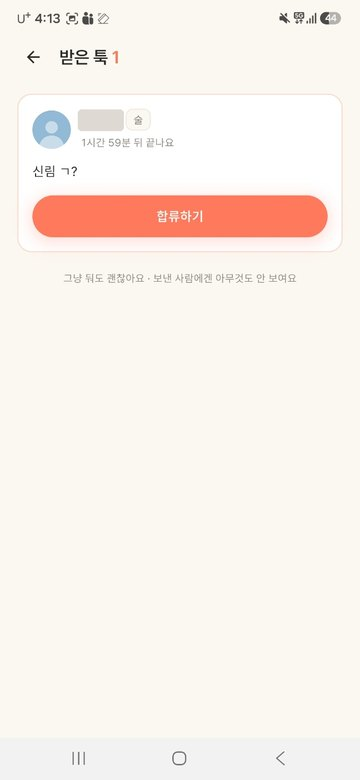 | 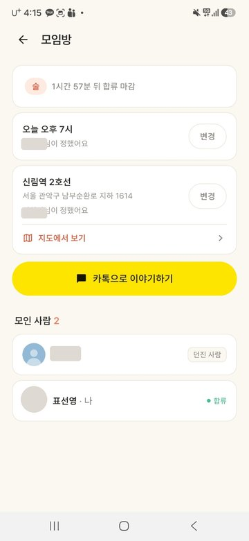 |

| 지도 앱으로 | 카톡방에 올린 모임 카드 | 진행 중인 모임 4개 | 합류 마감 뒤에도 약속은 그대로 |
|---|---|---|---|
| 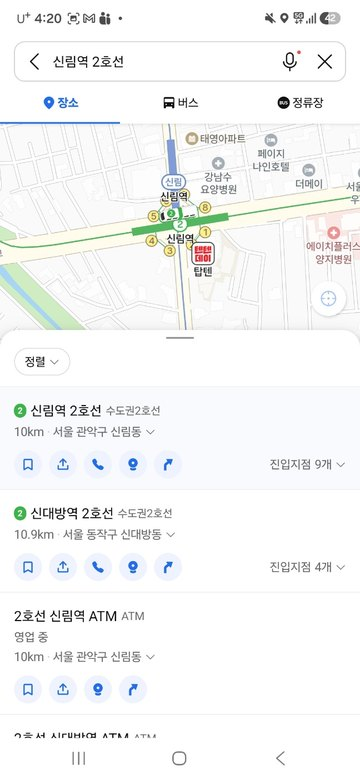 | 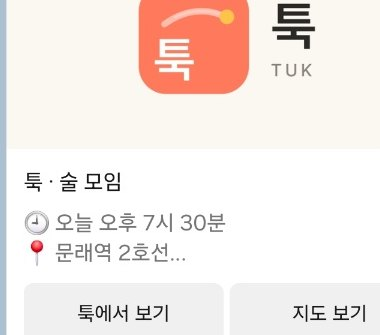 | 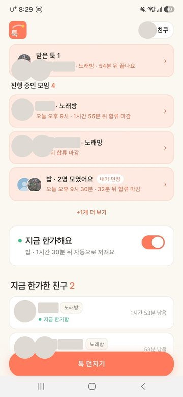 | 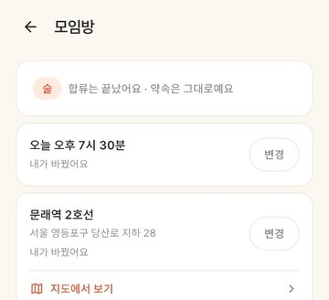 |

**실제 잠금화면 알림** — 친구 신청 · 수락 · 새 툭 · 합류 · 약속 시간 / 장소 변경(누가, 무엇에서 무엇으로)

| | |
|---|---|
|  |  |
|  |  |
|  |  |

**실사용 의견 → 1.0.1 (10-27)**

의견 보내기(앱 버전 · 기기가 자동으로 붙는 메일)로 3통을 받았고, 그중 2건을 고쳐 바로 배포했습니다.

| 받은 의견 | ⋯ 버튼 1.0.0 → 1.0.1 | 1.0.0 사용자에게 뜬 안내 |
|---|---|---|
| 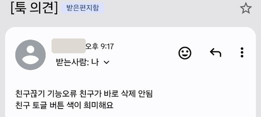 | <br> | 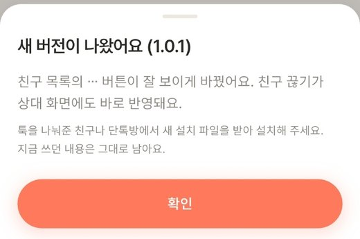 |

- **"친구 끊기가 바로 안 지워져요"** — 끊긴 쪽에 알리지 않으려고 아무 신호도 보내지 않아, 상대는 앱을 다시 열 때까지 끊은 사람을 봤다. 서버가 커밋 뒤 `/user/queue/friends` 로 **조용한 갱신 신호**만 보내고 앱은 목록을 다시 불러온다(토스트 · 푸시 없음)
- **"⋯ 이 희미해요"** — 아이콘이 카드 테두리와 같은 색이었다. 보조 글자색 · 터치 영역 44px
- 배포: 단톡방에 APK → 서버 `app-version.json` 한 줄 → 1.0.0 사용자에게 **한 번** 안내
- "모임 쫓아내기" 요청은 거절이 드러나게 돼 만들지 않았다

---

## 이 프로젝트에서 봐주셨으면 하는 것

### 1. 실시간을 두 경로로 받고, 앱 생명주기에 맞춰 끊는다

같은 사건(새 툭, 합류, 장소·시간 변경, 친구 신청)이 **앱이 켜져 있으면 STOMP, 꺼져 있으면 FCM** 으로 온다. 서버가 접속 여부로 나눠 보낸다.

- **앱을 내리면(`paused`) STOMP 를 끊는다.** 처음엔 백그라운드에서도 연결이 살아 있어 서버가 "접속 중"으로 보고 FCM 을 안 보냈다 → 새 툭 알림까지 놓칠 수 있던 버그. 다시 켜지면(`resumed`) 재연결하고 그사이 바뀐 것을 다시 불러온다
- 알림을 누르면 그 화면으로 간다. 이미 열려 있으면 **새로 쌓지 않고 그 화면으로 돌아간다** — 여는 곳이 여러 군데라 화면이 스스로 "열려 있음"을 등록하게 했다(`core/open_routes.dart`)
- 앱을 보는 중 방 밖에 있으면 같은 사건을 토스트로("밥 · OO님이 합류했어요")

### 2. 토큰 재발급을 single-flight 로 처리한다

앱 시작 시 여러 목록을 **동시에** 요청한다. access 가 만료돼 있으면 401 이 동시에 터지는데, 각자 refresh 하면 rotation 특성상 하나만 성공하고 나머지는 세션이 끊긴다. `ApiClient` 가 진행 중인 refresh 를 하나로 합치고 끝나면 각 요청을 1회 재시도한다.
서버처럼 rotation 하고 옛 토큰엔 401 을 주는 가짜 서버로 테스트한다 — 합치기를 빼면 동시 요청 3개 중 2개가 401 로 실패한다.

### 3. 스토어 없이 배포하는 데 필요한 것을 직접 만들었다

APK 를 직접 나눠주면 스토어가 해 주던 일이 없다.

| 스토어에선 | 대신 만든 것 |
|---|---|
| 업데이트 알림 | 서버 `/app-version.json` 을 켤 때 읽어 안내. **같은 버전은 한 번만**(재촉하지 않음), `minBuild` 아래면 매번 |
| 비정상 종료 보고 | Firebase Crashlytics(화면·비동기 오류, 개발 빌드는 수집 안 함) |
| 리뷰·문의 | "의견 보내기" — 메일 앱에 앱 버전·기기를 미리 채움 |

릴리스는 별도 키로 서명하고 카카오 콘솔에 키 해시를 추가했다. R8 축소 빌드로 운영 서버에 붙여 다시 검증했다(SDK 가 릴리스에서만 깨지는 경우가 있어서).

### 4. 한글이 단어 중간에서 끊기지 않게

Flutter 는 한글을 글자마다 줄을 나눌 수 있는 곳으로 본다("알려줄/게요"). 글자 사이에 보이지 않는 U+2060 을 끼우는 `keepWords()` 를 만들어 **앱의 모든 `Text` 184곳**에 적용했다. 이모지 옆은 건너뛴다(👍🏻 같은 조합 이모지가 깨지므로).

### 5. 실패를 어디까지 보여줄지 구분한다

- 카카오 로그인 **취소**는 조용히, 실패만 알린다
- 오류 문구는 사용자 말투로("지금 연결이 안 돼요. 인터넷 연결을 확인해 주세요")
- 탈퇴·친구 끊기는 **낙관적으로 먼저 지우지 않는다** — 되돌리기 어려운 행동이라 서버가 끝낸 뒤 목록을 바꾼다
- 빨간색을 쓰지 않는다 — 재촉하지 않는 앱이라 경고색은 "빨리 안 하면 큰일 나는" 느낌이 된다

---

## 주요 기능

| 영역 | 기능 |
|---|---|
| 시작 | 카카오 로그인 · 6컷 인트로 · 약관/처리방침 |
| 한가함 | "지금 한가해요" 켜기(활동 · 유지 시간) · 한가한 친구 먼저 보기 · 시간 지나면 자동으로 꺼짐 |
| 툭 | 친구 모두/골라서 던지기(한가한 친구 표시) · 예약 · 받은 툭 · 합류 |
| 모임방 | 약속 시간 · 장소 검색(카카오 로컬, 서버 프록시) · 카카오맵/네이버 지도로 열기 · 카톡 공유 카드 · 장소·시간 변경 알림 |
| 친구 | 초대 코드로만 친구(검색 없음) · 신청/수락 알림 · 보낸 신청 취소 · 친구 끊기 |
| 계정 | 의견 보내기 · 로그아웃 · 탈퇴(카카오 연결 끊기) |

## 기술 스택

- **Flutter** / Dart, **Provider + MVVM**
- **dio**(JWT 자동 첨부 + refresh single-flight) · **stomp_dart_client** · **flutter_secure_storage**
- **firebase_messaging** + **flutter_local_notifications** · **firebase_crashlytics**
- **kakao_flutter_sdk_user**(로그인) · **kakao_flutter_sdk_share**(카카오톡 공유) · **url_launcher**(지도 앱) · **package_info_plus**

## 구조 (`lib/`)

```
core/          설정 · 디자인 토큰 · 지도 링크 · open_routes · keep_words
models/        서버 응답 모델
services/      api_client(dio+refresh) · stomp_service · push_service · update_checker · token_storage
repositories/  엔드포인트별 호출
viewmodels/    화면 상태와 규칙 (auth · presence · friend · flash)
views/         화면 · 시트
widgets/       공용 UI
```

상태는 **ViewModel 이 소유**하고 화면은 그리기만 한다. 모임이 언제까지 보이는지 같은 규칙은 앱이 정하지 않고 **서버가 내려준 값(`visibleUntil`)만 따른다** — 앱과 서버가 각자 계산하다 "서버엔 있는데 화면에서 사라지는" 버그를 두 번 겪은 뒤 정한 원칙.

## 실행

```bash
flutter pub get
flutter run                                   # 에뮬레이터 → 로컬 서버(10.0.2.2:8080)
flutter build apk --release                   # 릴리스 → 운영 서버, android/key.properties 로 서명
```

실기기에서 로컬 서버에 붙일 땐 USB 터널:

```bash
adb -s <시리얼> reverse tcp:8080 tcp:8080
flutter run -d <시리얼> --dart-define=API_HOST=localhost
```

카카오 로그인은 콘솔에 패키지명(`com.tuk.app`)과 **사용하는 서명 키의 해시**가 등록돼 있어야 한다. FCM 은 `android/app/google-services.json` 이 필요하다.

> 개발 빌드에선 랜딩 로고를 길게 눌러 dev 로그인(임의 문자열)을 쓴다. 릴리스 빌드에선 숨겨진다.

## 테스트

```bash
flutter test      # 61개 — 동시 401 의 refresh 합치기 · 모임 수명 규칙 · 지도 링크 · 업데이트 안내 판단 · keepWords · 약속 시간 후보 등
```

순수 규칙(언제 보이고 언제 안내하는지)은 함수로 빼서 테스트하고, 화면 흐름은 실기기로 확인했다.

## 문서

기능 단위 정리본 — **배경 → 선정 이유 → 구현 → Before/After(캡처·수치) → 테스트 → 남은 과제**:

| 기간 | 문서 |
|---|---|
| 07-30 ~ 08-18 | [초기 MVP — 로그인 · 한가함 · 친구 · 툭](docs/FEATURE_NOTES_2026-07-30_08-18.md) |
| 08-30 ~ 09-10 | [카카오 로그인 · 이름 통일 · FCM · 앱 아이콘 · README](docs/FEATURE_NOTES_2026-08-30_09-10.md) |
| 09-15 ~ 09-18 | [운영 배포 · CI/CD · 지도 보기 · 장소 검색](docs/FEATURE_NOTES_2026-09-15_09-18.md) |
| 09-22 ~ 09-29 | [카톡 공유 카드 · 약속 시간 · 홈 여러 모임 · 모임 수명 규칙 · 변경 알림](docs/FEATURE_NOTES_2026-09-22_09-29.md) |
| 09-30 ~ 10-07 | [탈퇴 · 친구 끊기 · 알림 다듬기 · 릴리스 APK · 외부 백업 · 모니터링](docs/FEATURE_NOTES_2026-09-30_10-07.md) |

백엔드 정리본(07월 MVP, 배포 준비)은 서버 리포 `docs/`. 시간순 개발 기록은 [docs/DEV_LOG.md](docs/DEV_LOG.md) — 잘된 것뿐 아니라 **잘못 짚었던 진단과 그 정정**도 함께 적었다.
