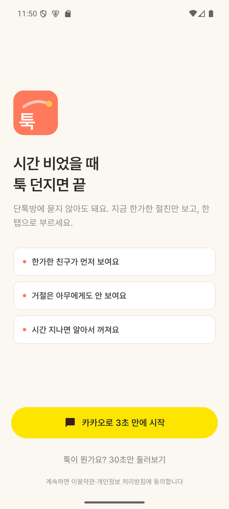
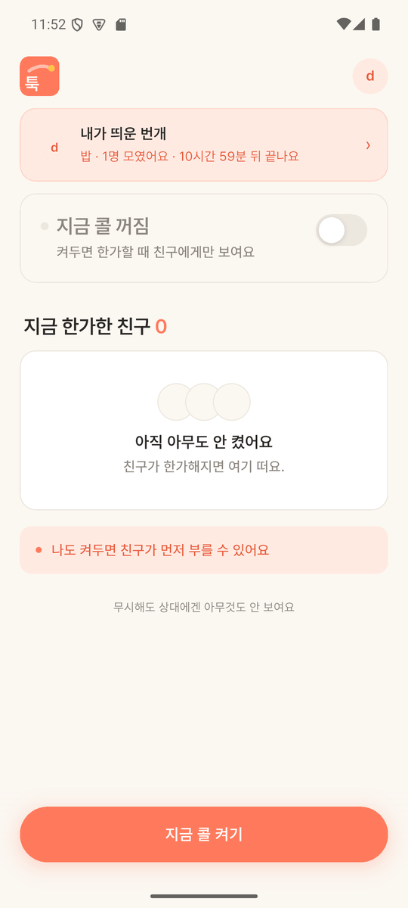
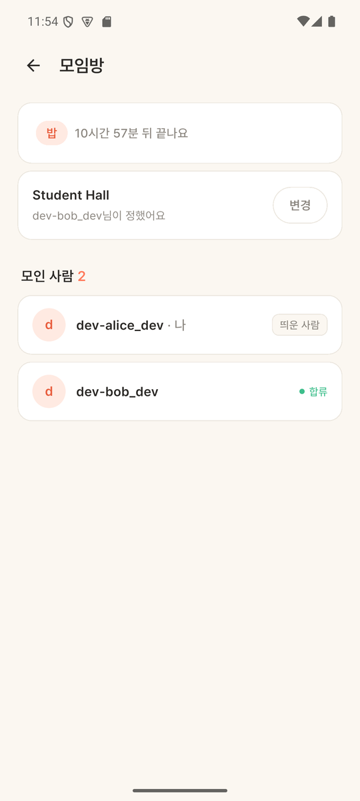

# 툭 (Tuk) — Flutter 앱

> 친한 친구끼리 **거절 걱정 없이 "지금 볼래?"를 띄우는** 즉흥 만남 앱.
> 백엔드(Spring Boot) 리포: [pyosunyoung/tuk-server](https://github.com/pyosunyoung/tuk-server)

단톡방에 "오늘 저녁 누구 시간 돼?"를 던지고 읽씹당하는 경험에서 시작했습니다.
**지금 한가한 절친만 보여주고, 한 탭으로 부르고, 거절은 아무에게도 보이지 않습니다.**

| 랜딩 | 홈 | 모임방 |
|---|---|---|
|  |  |  |
| 카카오 로그인<br>(로고 롱프레스 = 숨은 dev 로그인) | 내가 띄운 번개 배너 · 콜 on/off<br>· 지금 한가한 친구 | 장소·참여자 실시간<br>('나' 표시, 장소 정한 사람) |

---

## 이 프로젝트에서 봐주셨으면 하는 것

### 1. 실시간을 두 경로로 나눠 받는다

같은 사건(번개 도착, 친구 합류)이 **앱이 켜져 있으면 STOMP, 꺼져 있으면 FCM** 으로 옵니다.
서버가 접속 여부로 분기하고, 앱은 양쪽을 모두 처리합니다.

- STOMP(`stomp_dart_client`): 프레즌스 등장/사라짐, 새 번개, 합류 알림을 즉시 반영
- FCM: 앱이 꺼져 있어도 알림 → **탭하면 해당 화면으로 라우팅**(새 번개 → 받은 번개, 합류 → 그 모임방)
- 기기토큰은 **로그인 후 등록하고 로그아웃 때 해제**합니다. 안 그러면 로그아웃한 기기로 남의 알림이 갑니다

### 2. 토큰 재발급을 single-flight 로 처리한다

앱 시작 시 프레즌스·친구·번개 목록을 **동시에** 요청합니다. access 토큰이 만료돼 있으면 401 이 여러 개 동시에 터지는데,
각자 refresh 를 호출하면 rotation 특성상 하나만 성공하고 나머지는 세션이 끊깁니다.

`ApiClient` 가 진행 중인 refresh 를 하나로 합치고(single-flight), 완료 후 각 요청을 1회 재시도합니다.

### 3. 실패를 어디까지 사용자에게 보여줄지 구분한다

- 카카오 로그인 **취소**는 토스트를 띄우지 않습니다(사용자가 스스로 나간 것). 실패만 알립니다
- `/users/me` 가 실패해도 세션을 유지합니다(아바타가 이니셜로 나올 뿐). 단 **404 면 세션을 정리**합니다 — 토큰은 유효한데 유저가 없다는 뜻이라 그대로 두면 이후 요청이 전부 깨집니다
- 푸시 초기화가 실패해도 앱은 그대로 동작합니다(앱 안 배너는 STOMP 로 계속 옵니다)

---

## 기술 스택

- **Flutter** / Dart, **Provider + MVVM**
- **dio** (인터셉터로 JWT 자동 첨부 + refresh rotation)
- **stomp_dart_client** (WebSocket 실시간)
- **firebase_messaging** + **flutter_local_notifications** (푸시)
- **kakao_flutter_sdk_user** (카카오 로그인)
- **flutter_secure_storage** (토큰 보관)

## 구조 (`lib/`)

```
core/          설정(config)·디자인 토큰·타이포·테마
models/        서버 응답 모델 (Flash, Friend, Presence, Me ...)
services/      api_client(dio+refresh) · stomp_service · push_service · token_storage
repositories/  엔드포인트별 호출 (auth · friend · presence · flash · user)
viewmodels/    화면 상태와 규칙 (auth · presence · friend · flash)
views/         화면
widgets/       공용 UI (로고·아바타·버튼·토스트)
```

상태는 **ViewModel 이 소유**하고 화면은 그리기만 합니다.
예: `AuthViewModel` 이 세션과 `me` 를 함께 들고 있어 로그인/로그아웃 lifecycle 과 정확히 일치시킵니다.

## 실행

```bash
flutter pub get
flutter run                     # 에뮬레이터 (백엔드는 10.0.2.2:8080)
```

실기기에서 로컬 백엔드에 붙일 때는 `10.0.2.2`(에뮬 전용 주소)에 닿지 못하므로 USB 터널을 씁니다:

```bash
adb -s <시리얼> reverse tcp:8080 tcp:8080
flutter run -d <시리얼> --dart-define=API_HOST=localhost
```

카카오 로그인을 쓰려면 `core/config.dart` 의 네이티브 앱 키와,
카카오 콘솔에 패키지명(`com.tuk.app`)·키 해시가 등록돼 있어야 합니다.
FCM 은 `android/app/google-services.json` 이 필요합니다.

> 개발 중 계정 전환은 **랜딩 화면 로고를 길게 눌러** 숨은 dev 로그인을 씁니다(임의 문자열로 로그인).

## 검증 상태

- **카카오 로그인**: 카카오계정(웹)·카카오톡 앱 로그인 **양쪽 실기기 검증** (Galaxy S25 / Android 16)
- **FCM**: 앱을 완전히 종료한 상태에서 번개 수신 → 배너 도착 → 탭 → 해당 화면 진입까지 실기기 검증
- **STOMP 실시간**: 에뮬레이터 2대(발신·수신)로 프레즌스 등장/사라짐, 번개 도착, 합류 반영 확인
- 개발 기록은 [docs/DEV_LOG.md](docs/DEV_LOG.md) — 기능별로 개요·결정·검증·한계를 남겼습니다

## 개발 방식

기능 하나를 끝낼 때마다 **리뷰 → 커밋 → 푸시**하고 `docs/DEV_LOG.md` 에 정리했습니다.
그 문서에는 잘된 것뿐 아니라 **잘못 짚었던 진단과 그 정정**도 함께 적혀 있습니다.
