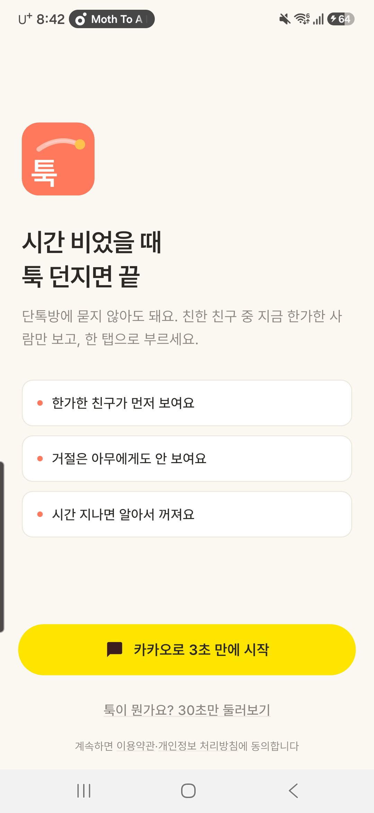
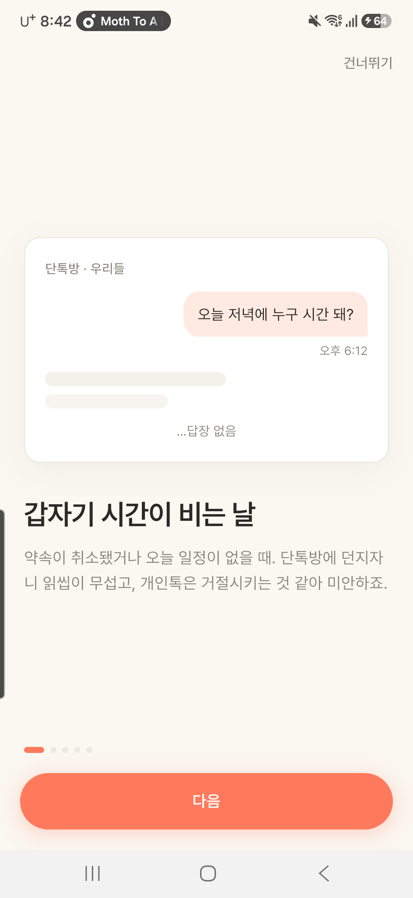
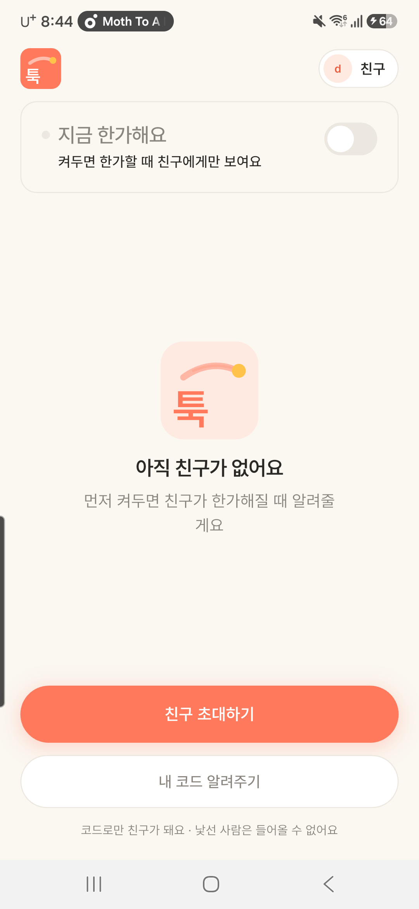
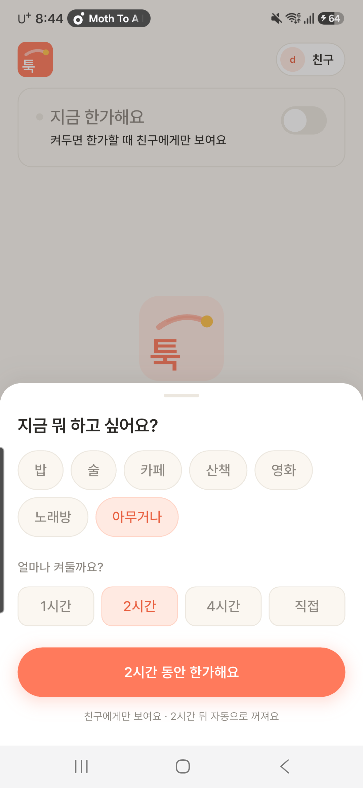
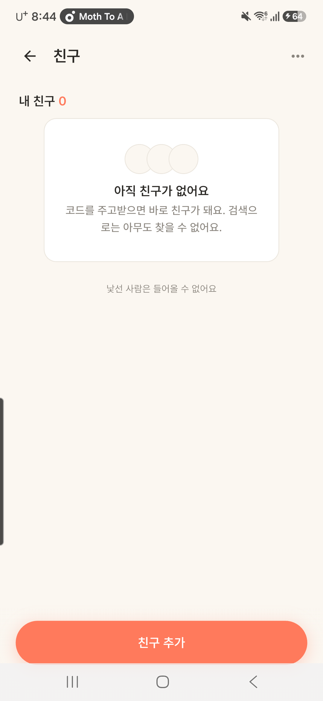
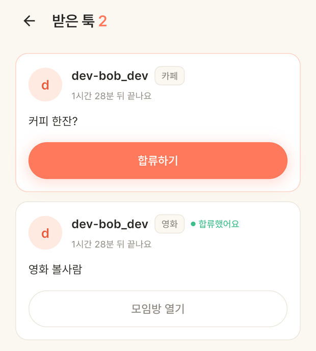
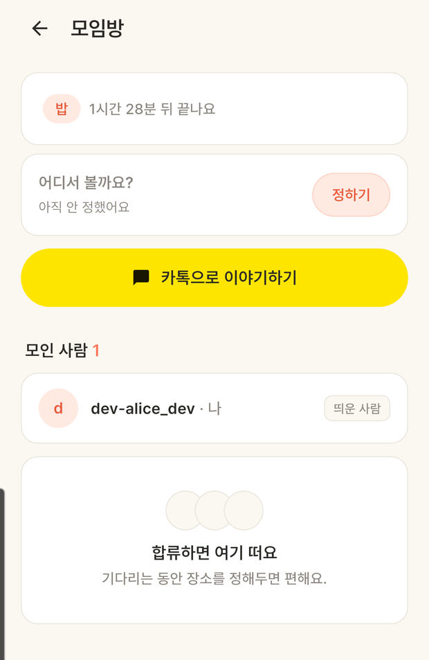
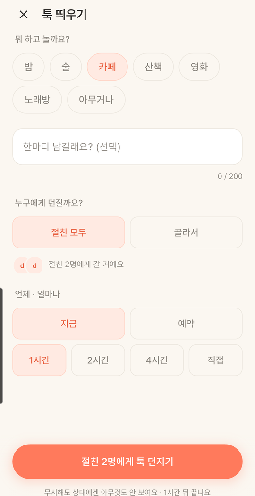

# 기능 정리본 — 2026-07-30 ~ 08-18 (초기 MVP)

앱의 뼈대를 처음 세운 네 기능(**로그인 · 프레즌스 · 친구 · 번개**)을 기능 단위로 정리한다.
시간순 개발 기록은 [`DEV_LOG.md`](DEV_LOG.md)에 있고, 이 문서는 **배경 → 선정 이유 → 구현 → Before/After → 테스트 → 남은 과제** 구조로 다시 묶은 것이다.
다음 기간(08-30 ~ 09-10, 카카오 로그인 · 이름 통일부터)은 [`FEATURE_NOTES_2026-08-30_09-10.md`](FEATURE_NOTES_2026-08-30_09-10.md).

- 범위: 앱 `tuk-app` — 로그인(4커밋) · 프레즌스(2) · 친구(1) · 번개(2) + 서버 `GET /api/flashes/sent`
- **이름/용어 주의**: 이 시기 코드네임은 `bungae`(→ 2026-08-30 `tuk`으로 통일), 사용자 문구도 "번개 / 띄우다 / 절친"이었다(→ 2026-10-01 "툭 / 던지다 / 친한 친구"로 정리). **아래 캡처는 그 정리까지 반영된 현재 완성 UI**다. 네 기능 모두 **신규(그린필드) 구현이라 "Before"가 존재하지 않아** 대표 상태 화면으로 대신한다.
- 캡처: `docs/images/`. 실기기(갤럭시) + dev 계정(`alice`/`bob`/`carol`)
- 아키텍처: Provider + MVVM. `core`(디자인시스템) · `widgets` · `views` · `viewmodels` · `services` · `repositories` · `models`
- `![TODO: …]` 는 아직 없는 캡처 자리

> 분류 표기: 🆕 신규 기능 · 🧭 설계/선정 · ⚙️ 개선 · 🐞 오류 해결 · 🧪 테스트

---

## 1. 로그인 플로우 — 첫 진입부터 홈까지 🆕 🧭

### 배경/문제
앱이 처음부터 끝까지 **아무것도 없는 상태**였다. 디자인 핸드오프(`design_handoff_tuk_auth`)를 받아
스플래시 → 랜딩 → 인트로 → 로그인 → 홈 콜드스타트까지 첫 진입 전 구간을 세워야 했다.
카카오 SDK는 앱키·네이티브 설정 부담이 커서, 흐름부터 완성하고 실제 로그인은 뒤로 미뤘다.

### 선정 이유
| 결정 | 이유 |
|---|---|
| 디자인 주도(토큰값만 Flutter 재현, HTML/CSS 미복사) | 핸드오프 픽셀 정밀도. 색·타이포·간격·반경을 위젯 토큰으로 |
| 카카오 버튼 → **dev 로그인에 배선** | SDK 설정 전에 플로우부터 완성. 숨은 dev 경로 = 랜딩 로고 롱프레스(멀티계정 테스트) |
| STOMP를 `AuthViewModel`에서 분리 | 실시간은 프레즌스 소유. 인증이 웹소켓까지 쥐면 과결합 |
| 명령형 `Navigator` | 로그인 순간 선언형 게이트와 pushed 라우트 충돌 회피, 디자인 네비맵과 일치 |
| Pretendard 번들(OFL) | 픽셀 정밀도엔 실제 폰트 필요 |

### 구현/해결 내용
- **디자인 시스템**: `core/tokens`(코랄 팔레트·4배수 간격·radius), `core/typography`(Pretendard 스케일), `core/theme`(M3 ColorScheme), `widgets/logo`(툭 로고 CustomPaint 3변형), `widgets/primitives`(`PillButton`·`SummaryCard`), `widgets/toast`.
- **화면**: `views/splash_screen` · `landing_screen` · `intro_screen`(인트로 컷·인디케이터·건너뛰기) · `home_coldstart_screen`.
- **인증 배관(재사용)**: `services/token_storage`(secure storage) · `services/api_client`(dio, **401→refresh rotation single-flight**) · `repositories/auth_repository` · `viewmodels/auth_view_model` · `models/auth_tokens`. + Pretendard 3종 번들.

### Before / After
그린필드라 Before 없음 — 현재 완성 화면(대표).

| 랜딩 | 인트로(1컷) |
|---|---|
|  |  |

### 테스트
- `flutter analyze` 클린, 위젯 테스트(로고/테마) 통과.
- 에뮬 E2E: 스플래시 → 랜딩 → 인트로(스와이프/다음/건너뛰기/인디케이터) → dev 로그인 → 홈 콜드스타트(콜 토글 켜짐↔꺼짐)까지 실제 동작.

### 남은 과제
카카오 실제 로그인(→ 2026-08-30), 프로필 아바타 실제 정보(→ `GET /users/me`), 콜 토글 실제 API(→ 프레즌스).

> Git: `3e63968` 기초 세팅 · `9b6f8ee` 로그인(1) 디자인시스템+스플래시+랜딩+인증배관 · `da3d787` 로그인(2) 인트로 · `a542175` 로그인(3) 홈 콜드스타트

---

## 2. 프레즌스 — "지금 한가해요" + 한가한 친구 + 실시간 🆕 🧭 ⚙️

### 배경/문제
로그인 직후 홈이 콜드스타트뿐이었다. **"지금 누가 한가한지"를 보여주고 내 상태를 켜는** 핵심 화면이 필요했고,
거절·초읽기 압박이 없는 **무부담 원칙**을 화면에 반영해야 했다. 로그인에서 뗀 웹소켓도 여기서 붙인다.

### 선정 이유
| 결정 | 이유 |
|---|---|
| STOMP 연결 수명을 `PresenceViewModel`이 소유 | 실시간의 첫 소비자가 관리. `main`에서 auth 상태로 start/stop |
| 로컬 카운트다운(만료시각 앵커·1분 tick) | 서버 재폴링 없이 남은시간 표시. tick은 **문구만** 갱신, 리스트 재정렬 안 함(오탭 방지) |
| 정렬 = 여유 많은 순 | 곧 꺼질 친구를 위에 두면 초읽기 압박. 무부담 원칙 |
| `AnimatedList` 대신 userId 키 래퍼 | AnimatedList는 기존 항목을 리빌드 안 해 카운트다운이 멈춤 → 키 래퍼로 신규만 애니메이션, 기존은 상태 유지+텍스트 갱신 |

### 구현/해결 내용
- `widgets/presence`: `NowCallCard`(켜짐/꺼짐/방금켠 강조)·`FriendPresenceCard`·`ActivityChip`·`CallToggle`.
- `viewmodels/presence_view_model`: 내 콜·한가한 친구·친구 수, 로컬 카운트다운, 정렬, 실시간 add/remove, `turnOn/turnOff`(낙관적), **STOMP lifecycle 소유**.
- `views/home_screen`: 친구 0명 → 콜드스타트 / 있음 → 프레즌스 홈(9a 콜켜짐·9b 콜꺼짐+유도배너·9c 0명). 하단 CTA.
- `views/call_on_sheet`(활동 7칩 + 시간 프리셋 1/2/4/직접 휠), `views/friend_preview_sheet`.
- **부수 작업**: 백엔드 `application.yml` 기본 활성 프로필을 `dev`로 → IntelliJ/gradle 어느 쪽으로 켜도 dev 로그인 동작(운영은 env override).

### Before / After
그린필드라 Before 없음 — 현재 완성 화면(대표).

| 프레즌스 홈 | 콜 켜기 시트 |
|---|---|
|  |  |

### 테스트
에뮬 실검증(alice 로그인, 친구 bob): 9b(콜꺼짐+친구) → 콜 켜기 시트(카페+1시간) → 9a(콜켜짐·만료문구·CTA 전환·토스트).
bob 콜을 REST로 on/off → **STOMP 실시간 등장/사라짐**(→ 9c 빈 상태), **미리보기 시트 오프라인 전환**(CTA 비활성) 확인.

### 남은 과제
"툭 던지기"(→ 번개), 콜드스타트 콜 토글 서버 연동(→ 2026-09-15), 아바타 실제 정보(→ `GET /users/me`).

> Git: `4cd43dd` 프레즌스(1) 홈+콜 켜기 시트 · `7b87e30` 프레즌스(2) 미리보기 시트+실시간 등장/사라짐

---

## 3. 친구 — 초대코드 교환 · "거절 안 보임" 🆕 🧭

### 배경/문제
절친을 추가할 방법이 필요했다. 다만 **전체검색·연락처는 "닫힌 절친" 원칙과 충돌**하고,
백엔드에 검색 API도 없었다. 받은 신청을 처리하되 거절이 상대에게 드러나지 않아야 했다.

### 선정 이유
| 결정 | 이유 |
|---|---|
| 초대코드만, 검색 UI 없음 | "닫힌 절친" 원칙 + 백엔드에 검색 API 없음 |
| 거절 버튼·보낸 신청 목록·읽음 **없음** | **"거절 안 보임"** — 무시가 상대에게 전달되지 않는 게 핵심 |
| 하단 탭 대신 홈 아바타 진입 | 목적지 2개뿐, 친구는 저빈도. 아바타에 신청 배지 |
| redeem 결과를 enum으로 분류 | accepted/pending → 시트 닫기, 나머지 → 유지+토스트(빨강·다이얼로그 없이) |
| 코드 입력은 8칸 분할 대신 단일 `TextField` | 붙여넣기·IME 안정. 자동 대문자+영숫자만+8자 제한 |
| `share_plus` 추가 | 내 코드 시스템 공유 |

### 구현/해결 내용
- `viewmodels/friend_view_model`: friends/requests/inviteCode, load, accept(낙관적·상대이름 반환), redeem(결과 분류).
- `views/friends_screen`(10a/10b): 받은 신청(수락만)+안심문구, 내 절친(가나다), 빈 상태, 친구 추가 CTA, ⋯ 로그아웃.
- `views/friend_add_sheet`(10c/10d): 내 코드(monospace 블록+복사+공유) / 코드 입력(8자 커스텀 필드), 같은 시트 크로스페이드 전환.
- `widgets/avatar`(재사용 이니셜 아바타), `main`·`home_screen`·`home_coldstart_screen` 배선 + 신청 배지.

### Before / After
그린필드라 Before 없음 — 현재 완성 화면(대표).

| 친구 화면 — 코드로만 친구가 됨 |
|---|
|  |

### 테스트
에뮬 실검증(alice): 홈 아바타 신청 배지 1 → 친구 화면(10a). carol 수락(→ 내 절친·토스트).
내 코드 표시. dave 코드 입력 → PENDING 토스트("신청을 보냈어요"). **보낸 신청 목록이 안 생기는 것**까지 확인("거절 안 보임").

### 남은 과제
아바타 실제 정보(→ `GET /users/me`), 새 신청 실시간 배지(FCM, → 2026-09-03).

> Git: `8834178` 친구: 초대코드 기반 친구 기능(10a~10e)

---

## 4. 번개(툭 던지기) — 발송 · 받은 툭 · 모임방 · 실시간 🆕 🧭

### 배경/문제
앱의 **핵심 행동**. 발송 → 수신 → 합류 → 모임방을 실시간으로 잇는다.
여기서 **"거절 안 보임"이 가장 강하게 적용**된다: 합류만 가능, 무응답자·응답률 노출 금지,
참여자 목록은 **보낸 사람 + 합류자**만.

### 선정 이유
| 결정 | 이유 |
|---|---|
| 발송은 전체화면, 콜 켜기는 시트 | 입력 5개+키보드. "사람 부르는 행동"과 "가벼운 상태 변경"의 위계 구분 |
| recipientCount 0도 방 열림 | 발송 실패 아님. "지금 받을 절친이 없어요 · 방은 열어뒀어요" |
| 서버가 비절친 제외해 수가 줄어도 차이 설명 안 함 | 거절 안 보임 |
| 배너 배지 = 미합류(PENDING)만 | 합류하면 배지에서 빠짐 |
| 백엔드 `GET /api/flashes/sent` 신설 | 발송자는 `NEW_FLASH`를 안 받으므로, 앱 재시작 후에도 "내가 띄운 번개" 배너가 유지되게 |
| `MEMBER_JOINED` → `reloadSent` | 내가 띄운 배너의 "N명 모였어요"를 실시간으로 |

### 구현/해결 내용
- `core/flash_format`: '끝나요' 만료 문구 + 예약 시각(오늘/내일/시간대) 포맷.
- `viewmodels/flash_view_model`: send/room/setPlace/join + 받은/내가띄운 목록·정렬·1분 tick·STOMP(`NEW_FLASH`/`MEMBER_JOINED`)·events 스트림.
- `views/flash_compose_screen`(11a): 전체화면(아래→위), 활동·한마디(≤200)·대상(절친모두/골라서)·지금/예약·유효시간, prefill(친구/홈 CTA).
- `views/room_screen`(11c): 정보·장소카드·참여자(띄운사람/합류)·빈 상태·종료방·다시띄우기·`MEMBER_JOINED` 실시간.
- `views/place_sheet`(11e), `views/received_flashes_screen`(11b), `home_screen`(11d) 상단 배너 2종.
- **백엔드**: `FlashController` `GET /sent`, `FlashService.getSentFlashes`, `SentFlashResponse` DTO, 전용 레포 쿼리.

### Before / After
그린필드라 Before 없음 — 현재 완성 화면(대표).

| 받은 툭 목록 | 모임방 |
|---|---|
|  |  |

### 테스트
에뮬 실검증(alice/bob/carol, 실 STOMP): bob → alice 번개 → 홈 받은 배너 → 목록(11b) → 합류 → 모임방(2명).
합류 후 배지 사라짐(미합류만). alice 발송 + carol 합류(REST) → alice 홈에 **"내가 띄운 번개 · 1명 모였어요"** 배너 실시간 반영.
(만료 시각은 에뮬레이터 타임존 아티팩트 — KST 폰에선 정확)

### 남은 과제
참여자 '나' 표시·"장소 정한 사람"(→ `GET /users/me` + 모임방 응답 확장), flash 만료 tz-aware,
`MEMBER_JOINED` 방 밖 토스트·FCM 푸시(→ 2026-09-03).

> Git: `8706410` 번개(1) 발송+모임방+장소 시트 · `1ddae0b` 번개(2) 받은 번개+홈 배너+실시간 (백엔드 `GET /sent` 포함)

---

## 경력기술서용 요약 (초기 MVP)

형식: **문제 → 한 행동 → 결과**. (신규 구축이라 수치형 Before/After는 없고, 아키텍처·실시간·검증 중심)

- **로그인·온보딩이 0인 상태** → 디자인 핸드오프를 토큰 단위로 Flutter 재현하고 dio **401→리프레시 로테이션 single-flight** 인증 배관을 구축 → 스플래시~홈 전 구간 E2E 통과, `flutter analyze` 클린.
- **실시간 상태 공유 수단 부재** → STOMP 연결 수명을 소비 ViewModel이 소유하고 **만료시각 앵커 로컬 카운트다운**으로 서버 재폴링을 없앰 → 3개 계정 실 STOMP로 등장/소멸 실시간 검증.
- **지인 추가에 검색이 필요했지만 "닫힌 관계"와 충돌** → **거절이 드러나지 않는 초대코드 단방향 교환**만 설계(거절 API·보낸 신청 목록 의도적 제외) → PENDING이 상대에게 노출되지 않음을 검증.
- **모임 호출 수단 부재** → 발송→합류→모임방 실시간 플로우 + **발송자 지속 조회용 `GET /sent`** 신설 → 합류 시 "N명 모였어요" 배너가 재시작 후에도 실시간 반영.

---

## 수정·생성한 파일 (요약)

**앱** (`tuk-app/lib`)
- `core/`: tokens · typography · theme · flash_format
- `widgets/`: logo · primitives · toast · presence · avatar
- `views/`: splash · landing · intro · home_coldstart · home · call_on_sheet · friend_preview_sheet · friends · friend_add_sheet · flash_compose · room · place_sheet · received_flashes
- `viewmodels/`: auth · presence · friend · flash
- `services/`: token_storage · api_client · stomp_service
- `repositories/`: auth · friend · flash · presence
- `models/`: auth_tokens · flash(SentFlash 포함) · friend · presence · activity · realtime_event
- `main.dart` (의존성 배선 + auth→VM lifecycle), `pubspec.yaml`(share_plus, Pretendard), `assets/fonts`

**백엔드** (`tuk-server`)
- `flash/controller/FlashController`(`GET /sent`), `flash/service/FlashService`(`getSentFlashes`), `flash/dto/SentFlashResponse`, 레포 쿼리
- `application.yml`(기본 `dev` 프로필)

**문서/캡처**
- 이 파일 + `docs/images/`에 신규 5장(`login-landing`·`login-intro`·`presence-home`·`presence-callsheet`·`friends-list`) 추가, 기존 2장(`received-list`·`share-room-after`) 재사용, 1장 TODO(`flash-compose`)

> 커밋: 앱 `3e63968`·`9b6f8ee`·`da3d787`·`a542175`·`4cd43dd`·`7b87e30`·`8834178`·`8706410`·`1ddae0b`
