# 기능 정리본 — 2026-08-30 ~ 09-10

로컬 dev 로그인으로만 돌던 툭에 **진짜 카카오 로그인 · "나"를 아는 화면 · 앱이 꺼져 있어도 오는 푸시**를 붙이고, 배포 직전까지 무엇을 먼저 할지 판단한 작업을 기능 단위로 정리한다.
시간순 개발 기록은 [`DEV_LOG.md`](DEV_LOG.md)에 있고, 이 문서는 **배경 → 선정 이유 → 구현 → Before/After → 테스트** 구조로 다시 묶은 것이다.
같은 기간 서버 운영 쪽(Flyway · 운영 프로필 · 배포처 선정 · Docker · Caddy)은 서버 리포 [`docs/OPS_NOTES_2026-09.md`](https://github.com/pyosunyoung/tuk-server/blob/main/docs/OPS_NOTES_2026-09.md)에 따로 정리했다.
다음 기간(09-15 ~ 09-18, 운영 배포부터)은 [`FEATURE_NOTES_2026-09-15_09-18.md`](FEATURE_NOTES_2026-09-15_09-18.md).

- 범위: 앱 `tuk-app` 17커밋(문서 커밋 6개 포함) + 서버 `tuk-server` 7커밋(이 문서 몫. 나머지 5커밋은 OPS_NOTES)
- 테스트: 서버 78 → **82개**, 앱 1개(이 기간에 앱 테스트는 늘지 않음) — 각 커밋에서 `@Test` / `test(` 개수를 다시 센 값
- 기기: 에뮬레이터(dev 계정 alice · bob) + 실기기 갤럭시 S25(Android 16)
- 캡처: `docs/images/`. **당시 작업하며 찍어 둔 화면(08-30 ~ 09-06)** 을 대화 기록에서 꺼내 썼다. 다른 사람의 메시지 · 위치 · 실계정 프로필 사진 · 이메일은 잘라내거나 모자이크했다
- `![TODO: …]` 는 아직 없는 캡처 자리, **확인 필요** 는 기록이 남아 있지 않아 지어내지 않은 부분

> 분류 표기: 🆕 신규 기능 · 🧭 설계/선정 · ⚙️ 개선 · 🐞 오류 해결 · 🧪 테스트

---

## 1. 카카오 로그인 — 네이티브 SDK 연동 🆕 🧭

### 배경/문제
랜딩의 "카카오로 3초 만에 시작" 버튼이 **dev 로그인 stub** 이었다. 서버에는 이미 카카오 토큰 검증(`KakaoClient` → `kapi.kakao.com/v2/user/me`)이 있어서, 남은 건 앱이 카카오 SDK 로 토큰을 받아 서버에 넘기는 부분이었다.
```
카카오 SDK(앱) → access token → POST /api/auth/login {provider:"kakao", token}
                              → 서버가 카카오에 검증 → 툭 JWT 발급
```

### 선정 이유
| 결정 | 고려한 것 | 고른 이유 |
|---|---|---|
| `isKakaoTalkInstalled()` → 톡 / 계정 분기 | SDK v2 의 `loginWithKakao(context)` 브릿지 시트 | 브릿지 시트는 카카오가 그린 바텀시트라 툭 랜딩 디자인과 맞지 않는다 |
| 톡 로그인 실패 시 계정 로그인으로 폴백, **취소는 폴백 안 함** | 실패든 취소든 폴백 | 카톡은 깔렸는데 로그인 안 된 상태는 구제하되, 사용자가 스스로 나간 건 다시 띄우지 않는다 |
| **취소는 토스트 없음** | 모든 실패에 토스트 | 취소 신호가 세 갈래(`ClientErrorCause.cancelled` · `PlatformException('CANCELED')` · `AuthErrorCause.accessDenied`)라 셋 다 "취소"로 묶었다. 서비스 함수는 취소 = `null`, 실패 = 예외 |
| 로그아웃 때 `UserApi.logout()` 도 호출 | 툭 토큰만 삭제 | 안 하면 다음 로그인이 계정 선택 없이 통과해 계정 전환(테스트 포함)이 안 된다 |
| 네이티브 앱 키를 소스에 둠 | 빌드 비밀값으로 숨김 | 배포 APK 에 어차피 들어가는 값이다. 실제 보호는 콘솔에 등록한 **키 해시(Android) / 번들 ID(iOS)** |

### 구현/해결 내용
- 앱(`a743f7a` · `67d451a`): `kakao_flutter_sdk_user` · `services/kakao_auth_service.dart`(SDK 래퍼) · `AuthViewModel.loginWithKakao()` — 토큰 교환은 `_exchange()` 로 빼서 dev 로그인과 공유 · `KakaoSdk.init()`(키가 없으면 건너뛰고 나머지는 동작) · Android 인텐트 필터 `kakao{앱키}://oauth` · iOS `LSApplicationQueriesSchemes`
- 랜딩만 고쳤다가 **인트로 마지막 컷의 "카카오로 시작하기"** 가 여전히 dev 로그인인 걸 발견해 같은 배선으로 연결(`67d451a`)

### Before / After
| | Before | After |
|---|---|---|
| 카카오 버튼 | dev 로그인 stub | 카카오톡 있으면 톡, 없으면 카카오계정 웹 로그인 |
| 취소 | (경로 없음) | 토스트 없이 원래 화면, 로딩 안 걸림 |

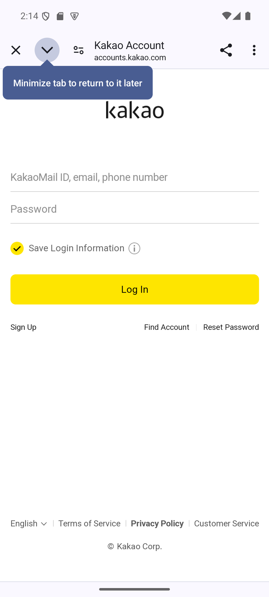

### 테스트 🧪
- 서버 `./gradlew test` 78개 통과, 앱 `flutter analyze`(변경분 에러 0) · `flutter test` · `build apk` 성공
- 에뮬레이터 E2E: 카카오 버튼 → 카카오계정 웹 로그인 → 실계정 로그인 → 앱 복귀 → 홈 진입. 로그로 리다이렉트 확인(`cmp=com.tuk.app/com.kakao.sdk.flutter.auth.AuthCodeHandlerActivity`). 기존 카카오 유저와 **재매칭, 중복 생성 없음**(DB 확인)
- 인트로 경로 · 취소 경로(커스텀 탭 닫기) 각각 확인
- 카카오톡 앱 경로는 에뮬레이터에 카톡이 없어 §5 에서 실기기로 확인

### 남은 과제
- 카카오 프로필(닉네임 · 사진)은 **최초 가입 때만** 반영. 재로그인해도 갱신하지 않는다
- 카카오 버튼 아이콘이 당시 자리표시자였다 — 이후 교체됐는지 **확인 필요**

---

## 2. 이름 통일 — 코드네임 `bungae` → 제품명 `tuk` ⚙️ 🐞

### 배경/문제
제품명은 "툭"으로 정했는데 코드 · 패키지 · DB · 폴더가 전부 개발 코드네임 `bungae` 였다. 사용자가 직접 요청했다 — "폴더 이름이 번개로 되어있는데 … 다 tuk으로 바꿔줄 수 있나?"

### 선정 이유
| 결정 | 이유 |
|---|---|
| **카카오 로그인과 같은 날** 진행 | 카카오 콘솔에 Android 패키지명을 등록해야 한다. 이름을 나중에 바꾸면 **두 번 등록**해야 한다 |
| applicationId `com.tuk.app` | `com.tuk.tuk` 보다 읽기 좋다 |
| 한글 "번개"는 그대로 | 그때 "번개"는 제품명이 아니라 **기능 이름(Flash)** 이었다. 바꾼 건 코드네임뿐(문구는 10-01 에 따로 정리 — [FEATURE_NOTES_2026-09-30_10-07 §8](FEATURE_NOTES_2026-09-30_10-07.md)) |

### 구현/해결 내용
- 서버(`8038704`): 자바 패키지 `com.bungae` → `com.tuk`(`git mv`, **106개 파일**) · `TukServerApplication` · gradle group · `spring.application.name` · Swagger 제목 · DB `bungae` → `tuk`(`ALTER DATABASE`, 데이터 유지)
- 앱(`1c793a1`): dart 패키지 · applicationId/번들 ID `com.bungae.bungae` → `com.tuk.app` · Kotlin `MainActivity` 경로 · 런처 라벨 "툭"
- 로컬 폴더: IDE · Claude Code 세션이 폴더를 잡고 있으면 이름 변경이 막혀서, **폴더가 풀릴 때까지 기다렸다 바꾸는 PowerShell 스크립트**로 처리
- 사용자에게 보이는 기본 닉네임 `"번개유저"` → `"툭유저"` 는 이때 놓쳤다가 다음 날 §3 에서 고쳤다
- 카카오 동의 화면에 **콘솔에 등록된 앱 이름 `bungae`** 가 그대로 노출 → 사용자가 콘솔에서 직접 변경(09-01)

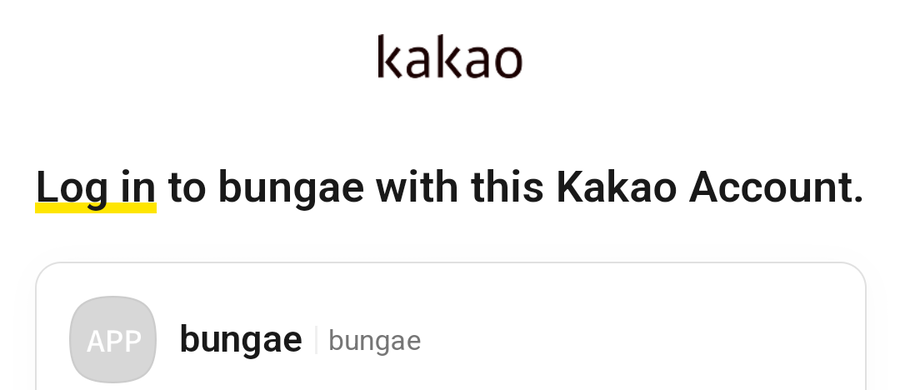

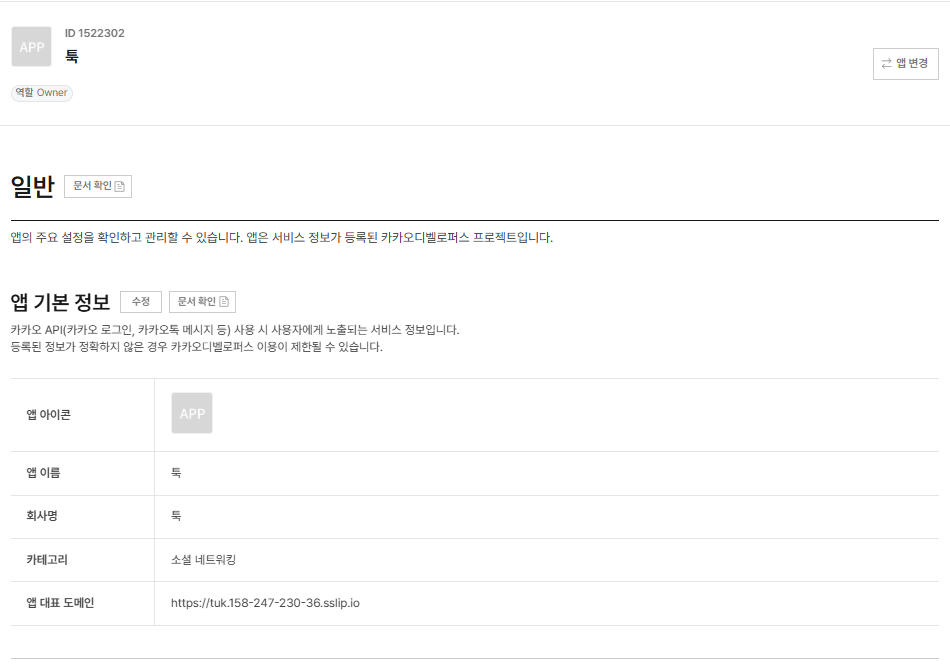

### 오류 해결 🐞 — `sed` 가 바이너리를 깨뜨림
추적 파일 전체에 `sed -i` 로 문자열을 바꾸다가 **`gradle/wrapper/gradle-wrapper.jar`(바이너리)** 까지 건드려 깨뜨렸다. `git diff --numstat` 에 바이너리 변경(`- -`)으로 드러나 `git checkout --` 으로 복구하고 다시 검증했다. 교훈: **치환은 텍스트 파일 목록으로 한정한다.**

### Before / After
| | Before | After |
|---|---|---|
| 자바 패키지 | `com.bungae.*` | `com.tuk.*` |
| applicationId | `com.bungae.bungae` | `com.tuk.app` |
| DB | `bungae` | `tuk` (users 13 · friendships 5 · flashes 7 **그대로**) |

### 테스트 🧪
서버 테스트 78개 통과 · 디버그 APK 의 패키지명 `com.tuk.app` 확인 · DB 이름 변경 후 행 수 비교.

### 남은 과제
없음. (Claude Code 메모리는 폴더 경로를 키로 써서, 새 경로로 복사해 이어 썼다)

---

## 3. 내 정보 — `GET /api/users/me` 🆕 🧭

### 배경/문제
앱이 **"이게 나"를 판단할 근거**가 없었다. 홈 프로필 아바타는 하드코딩 `나`, 모임방 참여자 목록에서는 내가 누군지 표시할 수 없었다. 서버 `user` 패키지는 controller/service 자리가 `.gitkeep` 으로 비어 있었다.

### 선정 이유
| 결정 | 이유 |
|---|---|
| `me` 를 **`AuthViewModel` 이 소유** | 세션 범위의 정보라 로그인/로그아웃 시점과 정확히 같아야 한다. 별도 ViewModel 이면 두 곳에서 비우는 걸 잊기 쉽다 |
| `/users/me` 가 실패해도 **세션 유지** | 일시적 네트워크 실패로 로그아웃시키는 건 과하다. 아바타가 이니셜로 나올 뿐이다 |
| 단, **404 면 세션 정리** | 토큰은 유효한데 유저가 없다 = 탈퇴 또는 DB 초기화. 그대로 두면 이후 요청이 전부 깨진다 |
| `inviteCode` 는 응답에서 뺌 | `GET /api/friendships/invite-code` 가 이미 있다. 한 화면에서만 쓰는 값을 공용 응답에 얹지 않는다 |

### 구현/해결 내용
- 서버(`9af85ad`): `MeResponse { userId, nickname, profileImage }` · `UserService.getMe()`(없으면 404) · `UserController` · API 계약서 갱신 · 기본 닉네임 `"번개유저"` → `"툭유저"`
- 앱(`5c1d3c5`): `Me` 모델 · `UserRepository` · 로그인 성공/앱 시작 후 로드, 로그아웃 시 `null` · 홈 아바타 · 모임방 내 행에 `· 나`

### Before / After
| Before (08-30) | After (08-31) | After — 모임방 |
|---|---|---|
| 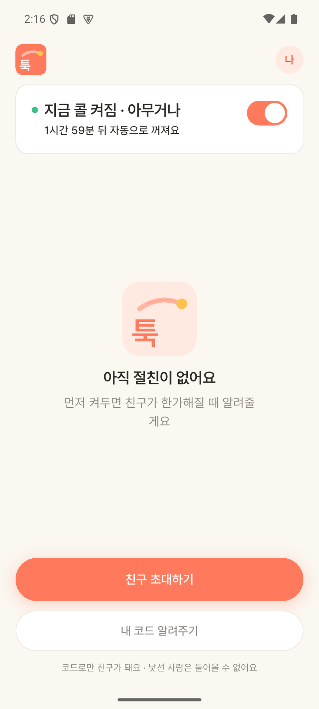 | 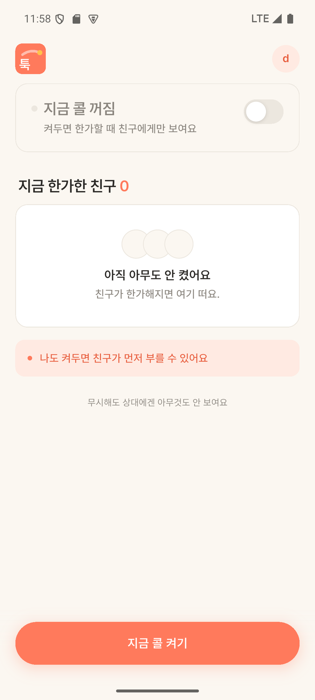 | 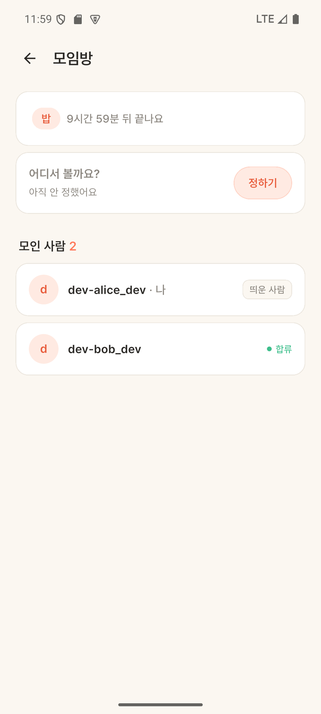 |

> Before 캡처는 친구 0명용 화면(콜드스타트)이다. 이 화면만 고치는 걸 빠뜨린 사실은 §5 에서 드러났다.

### 테스트 🧪
- 서버 78 → **80개**(`UserServiceTest` 2개). 실서버 호출 200, 무인증 401
- 에뮬레이터 E2E: alice 로그인 → 아바타 `나` → `d` · alice 번개 발송 + bob 합류 → 홈 "1명 모였어요" 배너(STOMP) → 모임방 `dev-alice_dev · 나` + `띄운 사람`

### 남은 과제
- "장소 정한 사람"은 `/users/me` 만으론 불가 → §4
- `me` 는 세션 중 갱신하지 않는다(프로필 수정 기능이 없어서 문제 없음)

---

## 4. 모임방 "장소 정한 사람" 🆕 ⚙️

### 배경/문제
모임방에 장소만 보이고 **누가 정했는지** 알 수 없었다. §3 에서 "서버 응답에 필드가 필요하다"고 남겨 둔 항목.

### 선정 이유
| 결정 | 이유 |
|---|---|
| 닉네임을 **이미 만든 members 목록에서** 찾음 | 장소를 정한 사람은 항상 멤버다. 추가 쿼리 **0개** |
| FK 는 `getReferenceById` 로만 기록 | 설정자 User 를 select 할 이유가 없다(닉네임은 위에서 해결) |
| **마지막에 바꾼 사람**으로 덮음 | 장소는 멤버 누구나 다시 정한다. "처음 정한 사람"은 현재 상태와 어긋난다 |
| 모르면 `장소가 정해졌어요` | 이 필드가 생기기 전의 방(`place_set_by = null`)도 깨지지 않게 |

### 구현/해결 내용
- 서버(`4a10440`): `MeetupRoom` 에 `@ManyToOne(LAZY) User placeSetBy` + `setPlace(..., User setter)` · 응답에 `placeSetById` · `placeSetByNickname`
- 앱(`eb7a96d`): 장소 아래 한 줄 — `내가 정했어요` / `OO님이 정했어요` / `장소가 정해졌어요`

### Before / After
| 장소 미정 | 내가 정함 | 친구가 정함 |
|---|---|---|
| 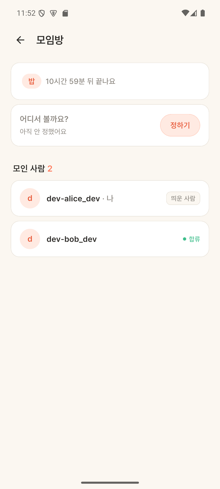 | 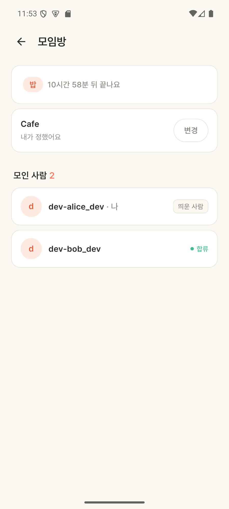 | 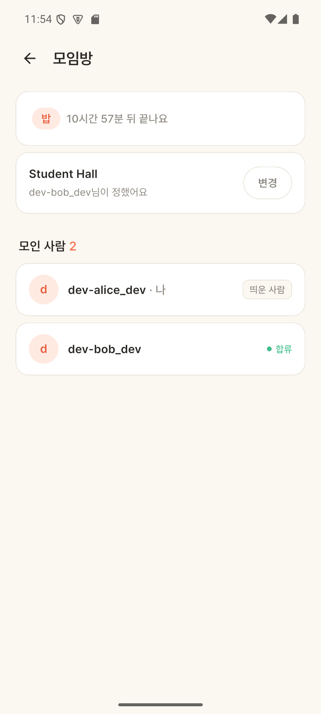 |

> 고치기 전 상태(장소만 있고 정한 사람이 없는 화면)의 캡처는 남아 있지 않다. 대체 자료: 위 서버 · 앱 커밋 diff.

### 테스트 🧪
- 서버 80 → **82개** — 보낸 사람이 정함(기존 테스트 확장) / 합류자가 정함(신규) / 아무도 안 정함(신규)
- 에뮬레이터: alice 가 앱에서 설정 → `내가 정했어요` / bob 이 REST 로 변경 → 방 재진입 시 `dev-bob_dev님이 정했어요`

### 남은 과제
- 장소 변경이 **실시간으로 반영되지 않았다**(방을 다시 열어야 보임) → 09-29 장소·시간 변경 알림에서 해결([FEATURE_NOTES_2026-09 §13](FEATURE_NOTES_2026-09-22_09-29.md))

---

## 5. 카카오톡 앱 로그인 실기기 검증 + 콜드스타트 아바타 🧪 🐞

### 배경/문제
에뮬레이터에는 카카오톡이 없어 **카톡 앱 로그인 경로**를 한 번도 타지 않았다. 실기기가 필요했는데, 실기기는 에뮬레이터 전용 주소 `10.0.2.2` 로 개발 PC 서버에 닿지 못한다.

### 선정 이유
| 결정 | 고려한 것 | 고른 이유 |
|---|---|---|
| **`adb reverse tcp:8080 tcp:8080`** | PC 의 LAN IP + 방화벽 인바운드 규칙 | USB 하나로 끝. 같은 Wi-Fi 조건 · 방화벽 설정이 필요 없다 |
| `API_HOST` 를 `--dart-define` 으로 덮기 | 기본값 변경 | 커밋되는 기본 동작(에뮬레이터)은 그대로 두고 필요할 때만 바꾼다 |

### 구현/해결 내용 (`a8b96ee`)
- `core/config.dart`: `API_HOST` 덮어쓰기. 실행은 `flutter run -d <기기> --dart-define=API_HOST=localhost`
- **콜드스타트 아바타 버그**: 실기기에서 아바타가 계속 `나` 로 남았다. 처음엔 세션 문제를 의심했지만 원인은 단순했다 — **친구 0명일 때만 나오는 `home_coldstart_screen.dart` 를 §3 에서 안 고쳤다.** dev 계정은 친구가 있어 이 화면을 한 번도 보지 않아 놓쳤다

### Before / After
| Before — 실기기, 아바타 `나` | After — 실기기, 카카오 프로필 사진 |
|---|---|
| 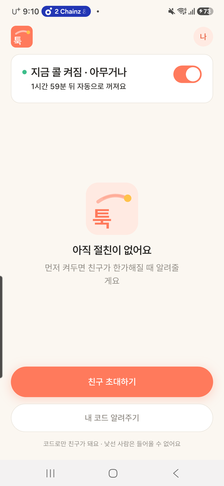 | 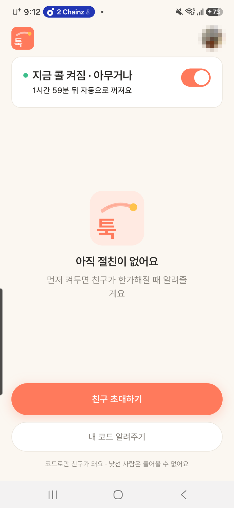 |

### 테스트 🧪
- **카카오톡 앱 로그인 성공** — 버튼 → `TalkAuthCodeActivity`(카톡 경로) → 이미 동의한 계정이라 동의 화면 없이 바로 앱 복귀 → 홈
- **프로필 이미지가 처음으로 렌더됨** — dev 계정은 `profileImage` 가 null 이라 그동안 이니셜 경로만 봤다
- 같은 기기에서 아바타 수정 전/후 비교(위 캡처)

### 남은 과제
- iOS 실기기는 Mac + Xcode 필요 — 이 환경(Windows)에선 불가
- 신규 계정의 **카카오 동의 화면**은 이번에 지나가지 않았다(이미 동의한 계정)
- 09-06 에 "카톡 로그인이 왜 안 되지" 가 다시 나왔는데, 원인은 **폰을 다시 꽂으면 `adb reverse` 가 풀리는 것**이었다. 재연결 때마다 다시 걸어야 한다

---

## 6. FCM 푸시 알림 🆕 🧭

### 배경/문제
**앱이 꺼져 있으면 번개가 와도 몰랐다.** "지금 볼래?"를 띄우는 앱인데 꺼진 앱에 알림이 안 가면 제품의 절반이 빠진다. 서버는 이미 준비돼 있었다(`PushSender` 인터페이스 + `FcmPushSender`, `fcm.enabled` 토글). 남은 건 앱 배선과 Firebase 프로젝트.

### 선정 이유
| 결정 | 이유 |
|---|---|
| **배포보다 먼저** | 배포처를 못 정한 상태였는데, 푸시는 `서버 → FCM → 기기` 경로라 **서버가 공개 URL 이 아니어도 검증된다**(`adb reverse` 그대로). Firebase 프로젝트는 무료라 결제 고민도 없다 → §11 |
| 기기 토큰은 **로그인 후 등록, 로그아웃 때 해제** | 안 그러면 로그아웃한 기기로 다른 사람의 번개 알림이 간다 |
| 포그라운드 알림은 앱이 직접 표시 | 앱이 떠 있으면 시스템이 띄워 주지 않는다 |
| 푸시 초기화 실패는 로그만 | 알림 권한을 거절해도 앱은 써야 한다(앱 안 알림은 STOMP 로 계속 옴) |
| 기본 채널 `tuk_flash` | 지정하지 않으면 "기타" 채널로 떠서 사용자가 끄기 쉽다 |
| `google-services.json` 은 커밋, **서비스 계정 키는 gitignore** | 앞의 것은 APK 에 들어가는 공개 값(없으면 빌드 불가). 서비스 계정 키는 유출되면 남이 툭 이름으로 푸시를 보낼 수 있다 |

### 구현/해결 내용
- 앱(`7b2f7d7`): `services/push_service.dart` — 권한 → 토큰 → 서버 등록 → 토큰 갱신 · 포그라운드 표시 · **알림 탭 라우팅**(새 번개 → 받은 번개, 합류 → 그 모임방) · Android 13+ `POST_NOTIFICATIONS` · `flutter_local_notifications` 가 요구하는 **core library desugaring**
- 서버(`4b39068`): `FcmPushSender` 가 죽은 토큰 외의 실패를 조용히 버리고 성공도 남기지 않았다 → **실패 · 성공 로그 추가** · 서비스 계정 키 파일 패턴을 `.gitignore` 에
- Firebase 프로젝트 이름은 영문 4자 이상이라 `tuk-app` 으로 생성

### Before / After
| 알림 서랍에 도착(09-03) | 탭 → 받은 번개 화면 |
|---|---|
| 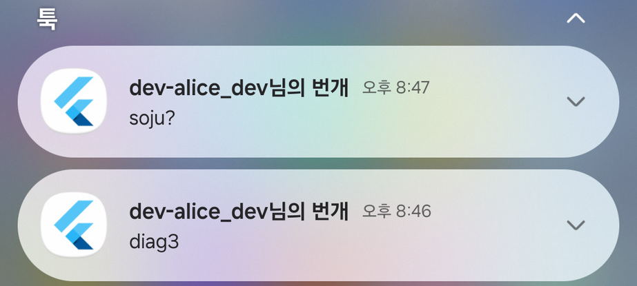 | 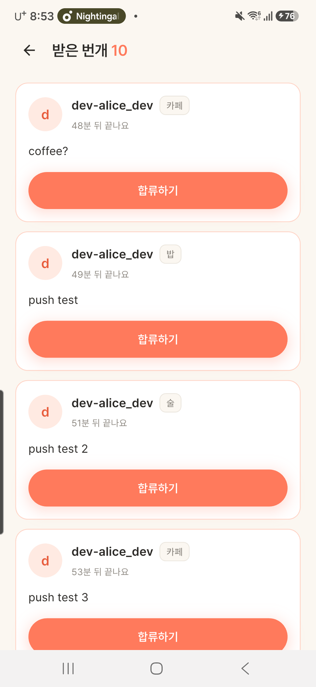 |

### 테스트 🧪
- 실기기: 앱 백그라운드 → alice 가 번개 발송 → `dev-alice_dev님의 번개 / soju?` 도착(`channel=tuk_flash`) → 탭 → 받은 번개 화면
- 가는 길에 **세 번 헛짚었다** — §8 에 정리

### 남은 과제
- iOS 는 APNs 키 + Mac 필요 → 미적용(이후 iOS 빈틈 메우기, [FEATURE_NOTES_2026-09 §2](FEATURE_NOTES_2026-09-22_09-29.md))
- 알림 아이콘이 Flutter 기본 로고 → §9
- 다른 앱을 쓰는 중엔 **화면 위에 뜨지 않음** → §7

---

## 7. 알림이 화면 위에 안 뜸 — HIGH 우선순위 🐞

### 배경/문제
사용자 보고(09-06): "다른 앱에 들어가 있을 때 카톡처럼 알림창이 딱 떠야 하는데 … 상단 사이드바를 내려야 알림이" 보인다.
원인: 서버가 FCM 메시지에 **`AndroidConfig` 를 넣지 않아** 기본(normal) 우선순위로 나갔다. 안드로이드는 우선순위가 낮은 알림의 **화면 위 배너(heads-up)를 생략**하고 서랍에만 쌓는다.

### 선정 이유
번개는 "지금" 보는 알림이다. 서랍을 내려 봐야 아는 알림이면 의미가 없다.

### 구현/해결 내용 (서버 `8fb2dff`)
```java
.setAndroidConfig(AndroidConfig.builder()
    .setPriority(AndroidConfig.Priority.HIGH)
    .setNotification(AndroidNotification.builder()
        .setChannelId(ANDROID_CHANNEL_ID)              // "tuk_flash"
        .setPriority(AndroidNotification.Priority.HIGH)
        .setDefaultSound(true).setDefaultVibrateTimings(true).build())
    .build())
```

### Before / After
| Before — 서랍을 내려야 보임 | After — 다른 화면 위에 바로 뜸 |
|---|---|
|  | 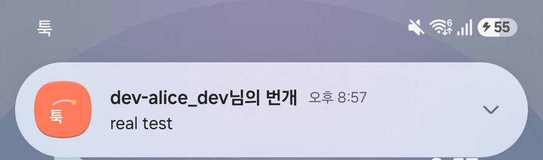 |

### 테스트 🧪
실기기 — 홈 화면에 있을 때 번개 발송 → 화면 위 배너. 사용자 보고부터 수정 커밋까지 약 6분(보고 20:35 → 커밋 20:41, KST).

### 남은 과제
- 배너가 카드형이 아니라 알약형인 건 삼성 **알림 팝업 스타일 = 간략히** 설정 때문(앱과 무관)
- 알림 전용 흑백 아이콘(small icon)은 만들지 않았다 — 순정 안드로이드에선 실루엣으로 나올 수 있다

---

## 8. 푸시 "안 옴" 오진 정정 + STOMP heartbeat 🐞 🧭 ⚙️

### 배경/문제
§6 테스트 중 푸시가 안 오는 경우가 반복됐고, 그때 **"클라이언트가 비정상 종료되면 서버가 죽은 WebSocket 을 온라인으로 착각해 푸시를 건너뛴다"** 고 단정해 DEV_LOG 에 적었다.

### 구현/해결 내용
진단을 확인하려고 서버에 로그부터 붙였다(`9dff68e`): `WebSocketSessionRegistry` 연결 · 해제, `FlashPushListener` 온라인 · 오프라인 분기.
그랬더니 **세션 해제는 `am kill` 후 2초 만에 정상 감지**되고 있었다. 진단이 틀렸다. 실제 원인은 셋이었다.

| # | 진짜 원인 | 성격 |
|---|---|---|
| 1 | `adb shell am force-stop` 한 앱에는 안드로이드가 FCM 을 전달하지 않는다(stopped state). 사용자의 스와이프 종료는 이 상태가 아니다 | 테스트 방법 오류 |
| 2 | **앱을 재설치하면 기기 토큰이 무효**해진다. FCM 이 `UNREGISTERED` 를 주고 서버가 토큰을 지운 뒤라 대상이 0명 | 서버는 올바르게 동작 |
| 3 | 서버 로그가 한글이라 **콘솔 인코딩 때문에 grep 이 실제 로그를 놓쳤다** | 관측 도구 오류 → **로거 클래스명으로 grep** |

heartbeat 는 위 버그의 해결책은 아니지만 남겼다 — 모바일 네트워크 유실처럼 **FIN 이 오지 않는 연결(TCP half-open)** 은 heartbeat 말고 감지 수단이 없다.
```java
config.enableSimpleBroker("/topic", "/queue")
      .setHeartbeatValue(new long[]{10_000, 10_000})   // 10초
      .setTaskScheduler(webSocketHeartbeatScheduler());
```

### Before / After
| | Before | After |
|---|---|---|
| 진단 | "서버가 죽은 세션을 온라인으로 착각" (DEV_LOG 에 기록) | **DEV_LOG 에서 철회**하고 원인 셋을 남김(`809fe53`) |
| 관측 | 세션 · 라우팅 로그 없음 | 연결/해제 · 온라인/오프라인 분기 로그 |
| 끊긴 연결 감지 | FIN 이 와야만 | + heartbeat 10초 |


### 테스트 🧪
- 최종 E2E(실기기): 카카오 실계정 로그인 → 앱 프로세스 종료(`am kill`) → alice 가 번개 발송 → 배너 `real test` 도착(§7 캡처). 서버 로그 `오프라인 1명` → `FCM 발송 성공 count=1`
- 덤: **로그아웃 → 다른 계정 로그인 시 기기 토큰이 새 사용자로 이관**되는 것까지 확인(의도한 동작)

### 남은 과제
heartbeat 를 검증하는 자동 테스트는 없다. 교훈은 문서로 남김 — **확인 없이 단정하지 않고, 틀렸으면 기록에서 철회한다.**

---

## 9. 앱 아이콘 — 공식 로고로, 세 번 만에 🐞 ⚙️

### 배경/문제
런처 아이콘이 Flutter 기본 로고였고, 알림에도 그대로 나왔다(§6 캡처의 파란 아이콘).

### 선정 이유
처음엔 직접 아이콘을 그리려 했지만, 사용자가 **공식 로고 파일**(square · rounded · svg · lockup)이 있다고 알려줘 그걸 쓰기로 했다.

### 구현/해결 내용 — 세 번 고쳤다
| 버전 | 커밋 | 방법 | 문제 |
|---|---|---|---|
| v1 | `809fe53` | 둥근 사각 **타일 통째로**를 적응형 전경에 넣고 62% 로 축소, 배경은 코랄 | 축소된 타일 경계가 **옅은 사각 테두리**로 보임. 글리프가 실제론 캔버스의 **45%**(62% × 타일 안 73%)라 작아 보임 |
| v2 | `8c9db4d` | 전경 = 글리프만(투명 배경), 경계로 잘라 70% 로 확대 | 크기는 해결. 그런데 **글리프를 다시 그리며 흰색 투명도를 잘못 계산**해 궤적이 공식보다 옅음 |
| v3 | `d45026a` | **다시 그리지 않고** 공식 PNG 에서 글리프 경계 상자를 잘라 코랄 위에 72% 로 배치 | 공식 아트워크와 픽셀 단위로 같은 색 |

사용자 피드백 두 번이 그대로 수정 기준이 됐다 — 테두리가 보이고 아이콘이 축소돼 보인다(v1), "포물선 색상이 이상하잖아"(v2).
공식 궤적은 두 톤이다: 굵은 획만 있는 곳 `(255,189,174)`, 흐린 획이 겹치는 곳 `(255,203,192)`. v2 는 그보다 옅었다.

### Before / After
| v1 — 테두리 · 작은 글리프 | v2 — 궤적이 옅음 | v3 — 공식 로고 그대로 |
|---|---|---|
| 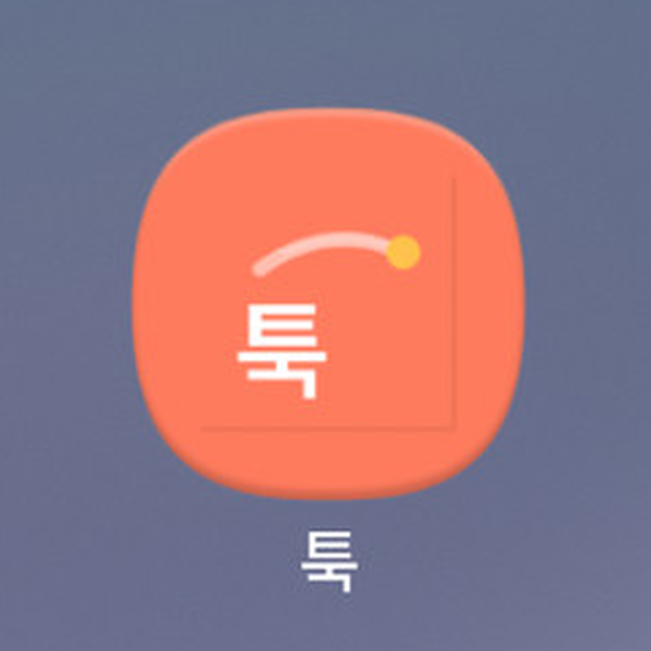 | 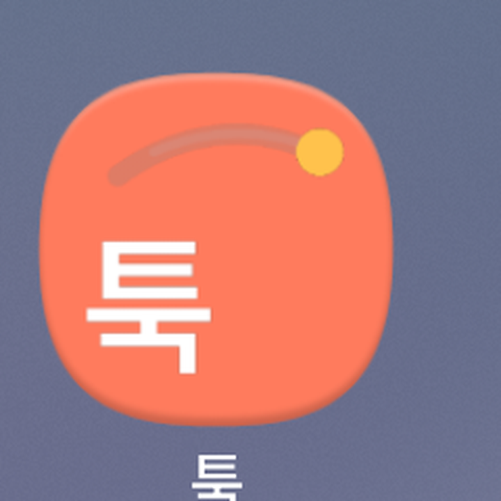 | 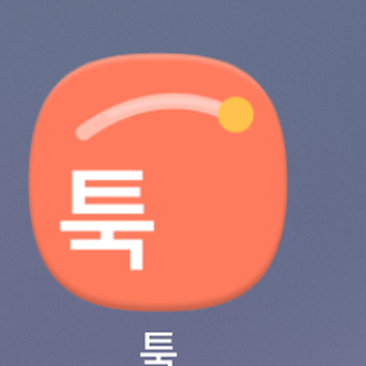 |

(세 장 모두 당시 실기기 홈 화면 캡처를 확대한 것)

### 테스트 🧪
실기기에서 버전마다 홈 화면 · 앱 서랍 · 알림 확인. 테두리 사라짐, 다른 앱 아이콘과 비슷한 밀도.

### 남은 과제
- DEV_LOG 의 해당 항목에는 v1 기준 "62%" 가 적혀 있다(최종은 72%). DEV_LOG 는 시간순 기록이라 손대지 않고 여기서 바로잡는다
- 교훈: **원본 에셋이 있으면 다시 그리지 않는다.** 재현하면 색 · 비율 어딘가가 어긋난다

---

## 10. `git add -A` 로 죽은 코드가 커밋됨 🐞

### 배경/문제
아이콘 커밋(`809fe53`)을 `git add -A` 로 만들었더니, **의도적으로 추적하지 않던 파일들**이 딸려 들어갔다 — 초기 스파이크 잔재(`lib/views/*_view.dart` · `gate.dart` · `home_shell.dart` · `ui.dart` · `home_view_model.dart`, 컴파일 에러가 있는 죽은 코드), `.vscode/`, 디자인 핸드오프 폴더.

### 구현/해결 내용 (`4f80c79`)
파일은 디스크에 두고 **추적만 해제**(`git rm --cached`) — 27개 파일, 18,280줄. 아이콘 · DEV_LOG 등 의도한 변경은 유지.

### Before / After
| | Before | After |
|---|---|---|
| 리포 | 컴파일 안 되는 옛 화면 코드 포함 | 의도한 변경만 |
| 규칙 | `git add -A` | **앱 리포에선 파일을 명시해서 stage** |

### 테스트 🧪
`git show --stat 4f80c79` 로 추적 해제 목록 확인.

### 남은 과제
미추적 파일이 리포 폴더에 섞여 있는 구조 자체는 그대로다(10-15 기준 `git status` 에 `.vscode/` · `design_handoff_tuk_*` 등이 남아 있음). `.gitignore` 에 넣을지 판단 필요.

---

## 11. 작업 순서 판단 — FCM 먼저, 웹은 미루고, 배포 전에 README 🧭

### 배경/문제
"배포 전 체크리스트"를 하던 중(09-02) 순서 질문이 이어졌다 — 배포처는 어디로? FCM 은 언제? 웹(Next.js)은 배포 전에 다 만들어야 하나?

### 선정 이유
| 질문 | 판단 | 이유 |
|---|---|---|
| FCM vs 배포 | **FCM 먼저**(09-02) | 배포처와 독립이고, 로컬 서버로도 검증되고, 무료다. 그리고 "꺼진 앱에 알림 없음"이 당시 가장 큰 구멍이었다 |
| 웹을 배포 전에? | **미룸**(09-03, 09-06) | 회고 웹은 **보여줄 데이터가 없다**(사용자 0명). 툭의 핵심 순간은 모바일에만 있다. 웹이 붙으면 인증 흐름 · CORS · 화면이 두 벌이 된다 |
| "배포 = 실서비스 출시"? | **아니다**(09-06) | 배포는 되돌릴 수 있다. 이 앱은 **실사용 없이는 검증 안 되는 것**(푸시 도달 · 콜을 켜 두는지 · 만료 시간 체감 · 초대 이탈)이 많다 |
| 지금 가장 급한 것 | **README** | 앱 README 는 29줄에 "1. 기초 세팅 ← 현재"로 멈춰 있었고, 서버는 README 자체가 없었다 → §13 |

> 진행 중 한 번 판단을 뒤집었다가 되돌렸다. 사용자가 말한 "회사에서 React · Node · Flutter 를 쓴다"를 **지원할 회사의 스택**으로 잘못 읽고 "React 산출물이 비어 있으니 웹 우선순위를 올리자"고 했다가, **현 직장의 스택**이라는 걸 확인하고 원래 판단(웹은 랜딩 정도로 최소화)으로 돌아왔다.

### 구현/해결 내용
코드 변경 없음. 실제 순서는 **FCM(09-03) → 알림 · 아이콘(09-06) → Docker(09-06) → Caddy · README(09-10) → 배포(09-15)** 가 됐다.

### Before / After
해당 없음(판단 기록).

### 테스트 🧪
해당 없음.

### 남은 과제
웹(`tuk-web`) 진행 상태는 이 문서 범위 밖 — **확인 필요**. 초대 안내 · 앱 없는 사람용 페이지는 이후 서버 정적 파일(`/invite` · `/app`)로 먼저 해결됐다(서버 `CLAUDE.md` "카카오톡 공유 카드용 정적 파일").

---

## 12. 모임방에 채팅을 넣지 않는다 — 대신 "출구" P1 ~ P4 🧭

### 배경/문제
사용자 질문(09-10): 번개 받고 모임방에 다 모이면 별다른 액션이 없다 — 채팅도 없고, 장소도 지도로 안 보여서 "모이면 시나리오가 종료되는 느낌"이다.

### 선정 이유
진단: **빠진 건 채팅이 아니라 "종결 처리"다.**

채팅을 만들지 않는 이유:
1. **카카오톡이 이미 있다.** 친한 친구끼리는 대화 채널이 있다. 툭이 채팅을 만들면 "덜 좋은 카톡"이 하나 더 생길 뿐이다
2. **툭의 가치는 "모이기 전"에 있다.** 단톡방에 묻기 민망한 마찰을 없애는 게 전부고, 모이고 나면 툭의 일은 끝난다 — 기능 부족이 아니라 포지셔닝
3. **유지 비용**: 메시지 저장 · 읽음 · 신고/차단 · 이미지 · 푸시 스팸이 따라온다. 1인 MVP 범위를 넘는다
4. **"거절이 안 보인다" 원칙과 충돌**: 채팅방이 생기면 누가 안 왔는지가 대화에서 드러난다

그래도 사용자가 느낀 "막다른 길"은 실제 결함이라, 출구를 제안했다:

| 우선순위 | 제안 | 결과 |
|---|---|---|
| P1 | 장소를 **지도 링크**로(지도 SDK 없이 딥링크) | ✅ 09-17 [FEATURE_NOTES_2026-09-15_09-18 §12](FEATURE_NOTES_2026-09-15_09-18.md) · 장소 검색 §15 |
| P2 | **"카톡으로 이야기하기"** 공유 — "여기까지가 툭, 나머지는 카톡" | ✅ 09-22 [FEATURE_NOTES_2026-09 §1](FEATURE_NOTES_2026-09-22_09-29.md) |
| P3 | 시간 정하기(장소 카드와 같은 패턴) | ✅ 09-24 [FEATURE_NOTES_2026-09 §5](FEATURE_NOTES_2026-09-22_09-29.md) |
| P4 | "만났어요" 종료 | 문서에서 구현 기록을 찾지 못함 — **확인 필요** |

당시 권고는 "P1 + P2 만 지금, P3 · P4 는 실사용에서 요구가 나오면" 이었다. P3 는 이후 구현됐다(계기는 이 문서 범위 밖).

### 구현/해결 내용
이 기간엔 결정만. 구현은 위 표의 각 문서.

### Before / After
| | Before | After(P1 · P2 이후) |
|---|---|---|
| 모임방의 끝 | 장소 텍스트 한 줄에서 끝 | 지도 앱 · 카톡으로 이어지는 출구 |

### 테스트 🧪
해당 없음(판단 기록).

### 남은 과제
P4.

---

## 13. README 개편 — 채용 담당자가 처음 3초에 보는 곳 ⚙️

### 배경/문제
5개 도메인(로그인 · 프레즌스 · 친구 · 번개 · 알림)이 다 돌아가는데 GitHub 에선 아무것도 안 보였다. 앱 README 는 29줄, "1. 기초 세팅 ← 현재"에서 멈춰 있었고, **서버 리포는 README 가 없었다.**

### 선정 이유
앱을 설치해 보는 사람은 소수고 README 는 거의 모두가 본다. 재료(의사결정 · 검증)는 DEV_LOG 에 이미 있었다.

### 구현/해결 내용
- 서버(`f149679`, 신규): **설계 원칙 4개를 코드 구조로 강제한 방식**(DECLINED 없음 · TTL/스위퍼 · 멱등 합류 · 서버 재검증) · 아키텍처 다이어그램 · 엔드포인트 · 실행 · 검증 상태
- 앱(`1ef6f1d`, 전면 개편): 스크린샷 3장 · "봐주셨으면 하는 것" 3개(실시간 두 경로 · single-flight refresh · 실패 노출 기준) · 실기기 실행법(`adb reverse`)

### Before / After
| | Before | After |
|---|---|---|
| 서버 | README 없음 | 원칙 · 아키텍처 · 실행 · 검증 |
| 앱 | 29줄, "기초 세팅 ← 현재" | 스크린샷 + 설계 의도 중심 |

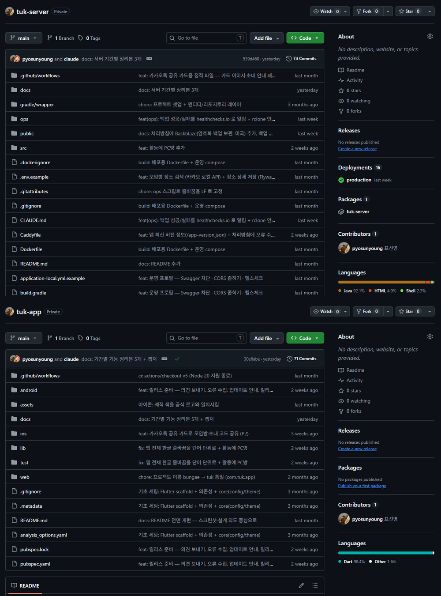

### 테스트 🧪
해당 없음.

### 남은 과제
README 의 숫자(서버 테스트 82개, "배포: 서버 반영 예정")는 09-10 기준이다. 10-07 기준 서버 테스트는 137개([FEATURE_NOTES_2026-09-30_10-07](FEATURE_NOTES_2026-09-30_10-07.md) 머리말) — README 갱신 필요.

---

## 14. 테스트 현황 🧪

| | 시작(08-30) | 끝(09-10) | 늘어난 것 |
|---|---|---|---|
| 서버 | 78 | **82** | `/users/me` +2(78 → 80) · 장소 정한 사람 +2, 기존 1개 확장(80 → 82) |
| 앱 | 1 | 1 | 없음 — 이 기간 검증은 전부 에뮬레이터 · 실기기 수동 E2E |

> DEV_LOG 의 장소 정한 사람 항목은 "3개 추가"라고 적혀 있지만, 커밋 diff(`git diff 9af85ad 4a10440 -- src/test`)를 보면 **케이스 3개 = 기존 `setPlace` 테스트 1개 확장 + 새 테스트 2개**다. 그래서 개수는 80 → 82.

### 실기기 검증 방식
- 로컬 백엔드 + `adb reverse tcp:8080 tcp:8080` + `--dart-define=API_HOST=localhost`
- 계정 전환: 랜딩 로고 길게 누르기 → 숨은 dev 로그인
- 푸시 테스트에서 `am force-stop` 은 쓰지 않는다(§8). 종료 상태는 `am kill` 또는 스와이프

---

## 경력기술서용 요약

형식: **문제 → 한 행동 → 결과(수치)**.

### 신규 기능 · 설계
- dev 로그인 stub 뿐이던 로그인 → 카카오 네이티브 SDK 연동, 카카오톡/계정 자동 분기 + 취소 신호 3종을 "취소"로 통합해 토스트 없이 복귀 → **에뮬레이터(계정) · 실기기(카카오톡) 두 경로 모두 실검증**, 기존 유저 재매칭으로 중복 가입 0건.
- 앱이 꺼지면 초대를 못 받는 구조 → 배포처 결정 전에 FCM 을 먼저 연동(서버 → FCM → 기기 경로라 로컬 서버로 검증 가능), 로그인 시 토큰 등록 · 로그아웃 시 해제 · 탭 라우팅 → **앱 종료 상태에서 알림 도착 → 탭 → 해당 화면 진입까지 실기기 검증**.
- 모임방에 "누가 장소를 정했는지" 부재 → 이미 조회한 멤버 목록에서 닉네임을 찾고 FK 는 참조 프록시로만 기록 → **추가 쿼리 0개**로 응답 확장.
- "모인 뒤 막다른 길" 피드백 → 채팅을 만들지 않는 근거 4가지(카톡 중복 · 포지셔닝 · 유지 비용 · 거절 비노출 원칙)를 정리하고 지도 링크 · 카톡 공유 · 시간 정하기로 출구를 설계 → **제안 4개 중 3개를 이후 2주 안에 구현**.

### 오류 해결
- 푸시 알림이 서랍에만 쌓이고 화면 위에 안 뜸 → FCM 메시지에 Android HIGH 우선순위 · 채널을 명시 → **보고 약 6분 만에 수정**, 실기기 heads-up 배너 확인.
- 푸시 미도착을 "서버가 죽은 세션을 온라인으로 오판"이라고 잘못 진단 → 세션 · 라우팅 로그를 먼저 붙여 확인 → **세션 해제 2초 내 정상 감지**로 진단을 철회하고 진짜 원인 3가지(force-stop · 재설치 토큰 무효 · 인코딩으로 grep 누락)를 기록.
- 친구 0명 화면에서만 아바타가 "나"로 고정 → 세션 문제가 아니라 그 화면만 수정 누락이었음을 실기기에서 특정 → 같은 기기 전/후 비교로 확인.
- 적응형 아이콘에 테두리 · 작은 글리프(캔버스의 45%) → 타일 대신 글리프만, 다시 그리지 않고 공식 PNG 픽셀을 잘라 72% 배치 → **공식 로고와 픽셀 단위 동일 색**.

---

## 이번 작업으로 수정·생성한 파일

| 리포 | 파일 | 무엇 |
|---|---|---|
| tuk-app | `docs/FEATURE_NOTES_2026-08-30_09-10.md` | 이 문서(신규) |
| tuk-app | `docs/images/` 16장(신규) | 아래 "캡처 목록" |
| tuk-app | `docs/DEV_LOG.md` | 08-30 ~ 09-06 항목 6개 끝에 이 문서로 가는 링크 한 줄씩 추가(기존 내용은 그대로) |
| tuk-server | `docs/OPS_NOTES_2026-09.md` | 같은 기간 서버 운영 정리본(비어 있던 파일에 작성) |

기능 코드 커밋은 각 항목의 커밋 해시 참고.

### 캡처 목록 (`docs/images/`, 당시 화면에서 추출)
| 파일 | 원래 화면 | 촬영 |
|---|---|---|
| `kakao-account-login.png` | 카카오계정 웹 로그인 | 08-30 에뮬레이터 |
| `kakao-consent-appname-before.png` | 동의 화면의 옛 앱 이름(이메일 위에서 잘라냄) | 08-30 에뮬레이터 |
| `me-avatar-before.png` · `me-avatar-after.png` · `me-room-after.png` | 아바타 `나` → `d`, 모임방 `· 나` | 08-30 · 08-31 에뮬레이터 |
| `place-setter-unset.png` · `place-setter-mine.png` · `place-setter-other.png` | 장소 미정 / 내가 / 친구가 정함 | 09-01 에뮬레이터 |
| `talk-login-avatar-before.png` · `talk-login-avatar-after.png` | 콜드스타트 아바타(프로필 사진 모자이크) | 09-01 실기기 |
| `fcm-shade-before.png` | 알림 서랍의 툭 알림(다른 앱 알림 · 미디어 잘라냄) | 09-03 실기기 |
| `fcm-tap-received.png` | 알림 탭 → 받은 번개 | 09-03 실기기 |
| `fcm-headsup-after.png` | 화면 위 배너(홈 화면 앱 목록 · 위치 잘라냄) | 09-06 실기기 |
| `icon-v1-before.png` · `icon-v2-pale.png` · `icon-v3-after.png` | 아이콘 세 버전(홈 화면 확대) | 09-06 실기기 |

### 아직 없는 캡처 (`![TODO:]` 자리)
| 파일명 | 찍는 법 |
|---|---|
| `kakao-consent-appname-after.png` | 이미 동의한 계정에선 동의 화면이 안 뜸 → **카카오 개발자 콘솔 > 앱 설정** 화면 캡처로 대체 |
| `push-misdiagnosis-log.png` | 로그 원문이 남아 있지 않아 재현 불가 → **서버 `9dff68e` diff 로 대체** |
| `readme-github.png` | 브라우저로 두 리포 첫 화면 캡처 |
