# 기능 정리본 — 2026-09-15 ~ 09-18

로컬에서만 돌던 툭을 **운영 서버에 올리고(배포·HTTPS), 배포를 자동화하고(CI/CD), 서버를 지키는 기본기(백업·SSH)를 갖춘 뒤**, 모임방의 막다른 길을 지도·장소 검색으로 푼 작업을 기능 단위로 정리한다.
시간순 개발 기록은 [`DEV_LOG.md`](DEV_LOG.md)에 있고, 이 문서는 **배경 → 선정 이유 → 구현 → Before/After → 테스트** 구조로 다시 묶은 것이다.
다음 기간(09-22 ~ 09-29, 카카오톡 공유 카드부터)은 [`FEATURE_NOTES_2026-09-22_09-29.md`](FEATURE_NOTES_2026-09-22_09-29.md).

- 범위: 앱 `tuk-app` 11커밋 + 서버 `tuk-server` 10커밋
- 테스트: 서버 82 → **97개**, 앱 1 → **18개** (각 커밋 기준으로 다시 셈)
- CI: 서버 워크플로 7회(실패 2 → 성공 5), 앱 CI 7회(전부 성공) — GitHub Actions 기록에서 확인
- 캡처: `docs/images/`. 이 기간 화면 캡처는 채팅에만 있고 파일로 남지 않았다. 터미널 증거는 **2026-10-15 에 운영 서버·로컬에서 다시 실행한 출력**을 코드 블록으로 붙였다(읽기 전용 명령만)
- `![TODO: …]` 는 아직 없는 캡처 자리, **확인 필요** 는 기록이 남아 있지 않아 지어내지 않은 부분

> 분류 표기: 🆕 신규 기능 · 🧭 설계/선정 · ⚙️ 개선 · 🐞 오류 해결 · 🧪 테스트

---

## 1. 운영 배포 — Vultr + Docker Compose + 자동 HTTPS 🆕 🧭 🧪

### 배경/문제
백엔드가 개발 PC 에서만 돌았다. 친구들이 실제로 쓰려면 인터넷에 떠 있어야 하고, 앱이 로그인 토큰을 주고받으므로 **HTTPS 가 필수**다(안드로이드는 9 부터 평문 HTTP 를 기본으로 막는다).

### 선정 이유
| 결정 | 고려한 것 | 고른 이유 |
|---|---|---|
| **sslip.io 임시 도메인** | 도메인 구매 / IP 로만 접속 | Caddy 의 자동 HTTPS(Let's Encrypt)는 **도메인 이름으로 인증서를 받는다.** sslip.io 는 `tuk.158-247-230-36.sslip.io` 처럼 IP 를 이름에 넣으면 그 IP 로 풀어 주는 공개 DNS 라, 구매·DNS 설정 없이 당일 HTTPS 까지 갈 수 있다. 진짜 도메인은 `.env` 두 줄 + 앱 재빌드로 교체 |
| **`git archive \| ssh tar -x` 로 코드 전송** | 서버에서 `git clone` | 리포가 비공개라 clone 하려면 서버에 GitHub 자격증명을 둬야 한다. 다음 날 CI/CD 로 대체(§5) |
| **앱에 `API_BASE_URL` 추가** | 기존 `API_HOST`(`http://host:8080` 형식) 재사용 | 운영은 Caddy 가 443 에서 TLS 를 끝내고 안으로 넘긴다. 고정 형식으로는 못 붙는다. 로컬 개발 경로는 그대로 둠 |
| **두 번째 사용자는 DB 테스트 유저** | 카카오 계정 하나 더 | 카카오 계정이 하나뿐. 받는 쪽(STOMP·FCM)은 똑같이 검증되고, 끝나고 전부 삭제 |

### 구현/해결 내용
- 서버: Vultr 서울 VM(2GB) → Docker 설치 → 방화벽(ufw) 22·80·443 만 → `.env`(DB 비밀번호·JWT 시크릿은 **서버에서 생성**, 로컬에 없음) → `docker compose up -d`
- 구성: **Caddy(80/443, TLS) → app(8080, 외부 비공개) → PostgreSQL · Redis**
- 앱: `flutter run --dart-define=API_BASE_URL=https://tuk.158-247-230-36.sslip.io` (서버 `94eb503`, 앱 `1d184e8`)

### Before / After
Before 는 "외부에서 접속 불가"라 화면이 없다. After — 10-15 에 다시 확인한 운영 상태:
```text
$ curl https://tuk.158-247-230-36.sslip.io/actuator/health
{"groups":["liveness","readiness"],"status":"UP"}  -> HTTP 200
$ curl http://tuk.158-247-230-36.sslip.io/actuator/health      # 평문 HTTP
HTTP 308 -> https://tuk.158-247-230-36.sslip.io/actuator/health
$ curl https://…/swagger-ui/index.html                          # 운영에선 문서 비공개
HTTP 401
$ curl http://158.247.230.36:8080/actuator/health               # 앱 포트 직접 접근
연결 안 됨(타임아웃)
$ openssl s_client … | openssl x509 -noout -issuer -subject -dates
issuer=C=US, O=Let's Encrypt, CN=YE2
subject=CN=tuk.158-247-230-36.sslip.io
notBefore=Sep 15 10:26:34 2026 GMT     ← 배포한 날 자동 발급
notAfter=Dec 14 10:26:33 2026 GMT      ← Caddy 가 만료 전 자동 갱신
```

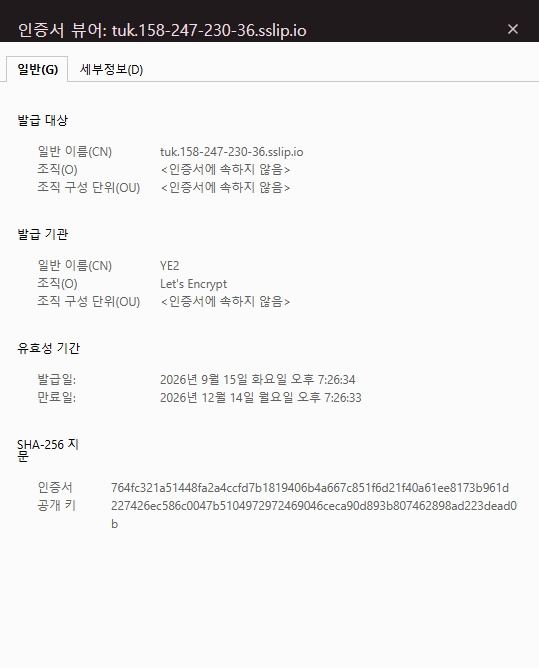

| 수치 (09-15 배포 당시) | 값 |
|---|---|
| 이미지 빌드(서버에서) | 약 4분 |
| 기동 | 약 40초 |
| 메모리 여유 (2GB 중) | 1.1GB |

### 테스트 🧪
- 외부 점검: health 200 · HTTP→HTTPS 308 · Swagger·actuator 상세·dev 로그인 401 · 다른 출처 CORS 403 · `/ws` 101 · 8080 외부 차단
- **실기기 E2E (갤럭시 S25 → 운영 서버)**: 카카오톡 로그인(운영 첫 사용자) → 기기 토큰 등록 → 앱을 켠 채로 툭 수신 시 **새로고침 없이 2초 안에** 배너 "받은 번개 1 → 2"(STOMP) → 홈 버튼으로 내리면 서버 `WS 해제 (온라인 0명)` → `FCM 발송 성공 count=1` → 알림 서랍 도착


### 남은 과제
진짜 도메인(10-15 기준 아직 sslip.io). 배포하며 잡은 버그 2개는 §2·§3.

---

## 2. 운영 compose 파일 YAML 파싱 실패 🐞

### 배경/문제
첫 배포에서 `docker compose` 가 설정 파일을 읽지도 못했다. 필수 값 안내 문구 `(예: tuk.example.com)` 안의 **`: ` 를 YAML 이 "키: 값" 으로 해석**했다. 개발 PC 에 Docker 가 없어 이 파일은 **한 번도 파싱된 적이 없었다.**

### 구현/해결 내용
값 전체를 따옴표로 감쌌다(서버 `94eb503`).
```diff
-      TUK_DOMAIN: ${TUK_DOMAIN:?도메인을 .env 에 넣어주세요 (예: tuk.example.com)}
+      TUK_DOMAIN: "${TUK_DOMAIN:?도메인을 .env 에 넣어주세요 (예: tuk.example.com)}"
```

### Before / After
10-15 에 두 버전 파일을 서버 임시 폴더에서 `docker compose config` 로 다시 읽혀 재현했다(운영 컨테이너와 무관):
```text
## 94eb503^ (고치기 전)
go-yaml load error in scanner at L50.C53: mapping values are not allowed in this context

## 94eb503 (고친 뒤) — YAML 은 통과, 일부러 비운 비밀 값만 막힘(의도한 안전장치)
error while interpolating services.app.environment.JWT_SECRET: required variable JWT_SECRET is missing a value: JWT 시크릿(32바이트 이상)을 .env 에 넣어주세요
```

### 테스트 🧪
위 재현 + 운영 기동 성공.

### 남은 과제
CI 에서 `docker compose -f docker-compose.prod.yml config` 를 돌리면 같은 실수를 배포 전에 잡는다(아직 안 함).

---

## 3. 좀비 세션 — refresh 401 을 네트워크 오류로 오인 🐞

### 배경/문제
운영 서버(로컬과 다른 JWT 시크릿)에 처음 붙는 순간 드러났다. 옛 토큰을 든 앱이 **로그아웃되지 않고 홈에 갇혀** STOMP 재연결만 무한 반복했다.

원인: 토큰 갱신 전용 HTTP 클라이언트(Dio)에 `validateStatus` 가 없었다. 기본값은 2xx 만 정상이라 **refresh 401 이 예외로 던져졌고**, catch 가 이를 "네트워크 오류 → 세션 유지"로 처리해 `onSessionExpired` 가 절대 불리지 않았다. 로컬에선 토큰이 늘 유효해 이 경로가 실행된 적이 없었다.

실사용자라면 **refresh 토큰 만료나 다른 기기 로그인(rotation) 순간 앱이 먹통**이 됐을 버그.

### 구현/해결 내용
앱 `ebcd4d7` — 갱신 클라이언트도 모든 상태 코드를 직접 판단하고, 5xx 는 "서버 사정"이므로 세션 유지:
```dart
validateStatus: (_) => true,                       // 401 을 예외가 아니라 응답으로 받는다
...
if ((res.statusCode ?? 0) >= 500) return false;    // 5xx: 토큰 무효가 아님 → 세션 유지
```

### Before / After
| | Before | After |
|---|---|---|
| refresh 401 | 예외 → "네트워크 오류"로 분류 → 세션 유지 | 응답으로 받아 **세션 만료 처리 → 랜딩** |
| refresh 5xx | (같은 예외 경로) | 세션 유지, 다음 요청에 재시도 |
| 화면 | 홈에 갇힘 + STOMP 무한 재시도 | 정상 로그아웃 |


### 테스트 🧪
실기기 — 옛 토큰으로 운영 서버 접속 → 랜딩으로 정상 로그아웃 → 재로그인.

### 남은 과제
이 분기를 지키는 **단위 테스트가 없다**(10-15 기준 `test/` 에 refresh 401/5xx 케이스 없음).

---

## 4. 콜드스타트 "지금 콜" 토글이 가짜 상태 🐞 🧭

### 배경/문제
친구 0명일 때 뜨는 홈(콜드스타트)의 "지금 콜" 카드가 서버와 무관한 **화면 로컬 상태**(`_callOn = true` + 2시간 타이머)였다. 신규 가입자는 서버상 꺼져 있는데 **"지금 콜 켜짐 · 1시간 59분 뒤"**를 봤다. 프레즌스 기능 때 홈만 서버에 연결하고 콜드스타트를 놓친 것. 운영 E2E 에서 발견.

### 선정 이유
| 결정 | 이유 |
|---|---|
| 상태 = `PresenceViewModel`(서버) | 앱을 다시 켜도 같은 값. 서버가 진실원 |
| 토글 동작을 홈과 같게 | 두 화면이 다르게 움직이면 헷갈린다 |
| 디자인의 "신규 가입자 기본 ON" **버림** | 동의 없이 내 상태를 친구에게 노출하는 셈. 친구 0명이라 켜도 보이는 사람이 없어 효과도 없다 |

### 구현/해결 내용
`home_coldstart_screen` 이 홈과 같은 vm 을 구독, 로컬 Timer 삭제, 만료 문구는 기존 `callExpiryText` 재사용(앱 `54dfd8c`).

### Before / After
| Before: 서버엔 꺼져 있는데 "켜짐" | After: 서버 상태 그대로 |
|---|---|
| 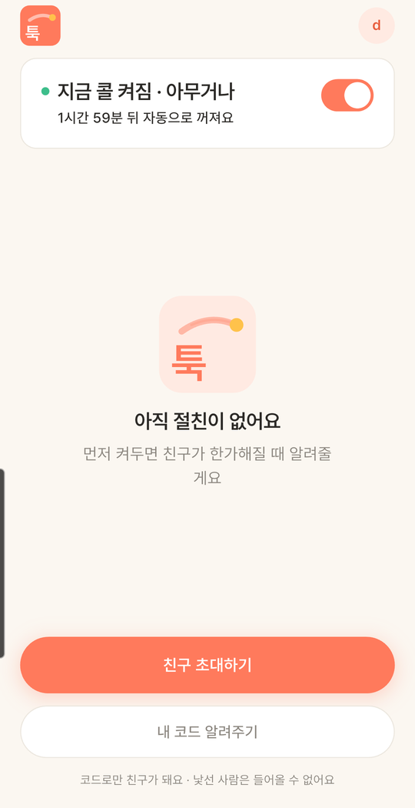 | 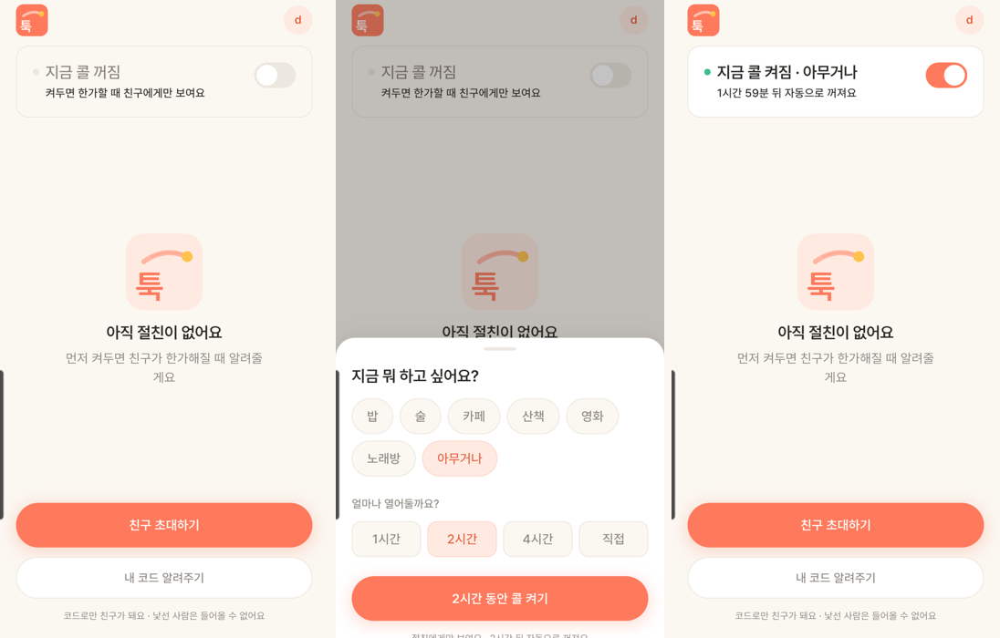 |

> 화면 문구는 09-22 용어 정리 때 "지금 한가해요"로 바뀌었다. 지금 찍으면 After 문구가 위 설명과 다르다.

### 테스트 🧪
운영 서버 + 실기기 — 첫 화면 "꺼짐"(서버와 일치) → 켜기(카페·1시간) → `POST /api/presence` 200, Redis `presence:1` TTL 3595 → **앱 강제 종료 후 재실행해도 켜짐 유지** → 끄기 → `DELETE` 200, Redis 키 삭제.

### 남은 과제
친구가 생겨도 콜드스타트 → 홈 자동 전환 없음 → 09-30 해결([FEATURE_NOTES_2026-09-30_10-07 §2](FEATURE_NOTES_2026-09-30_10-07.md)).

---

## 5. GitHub Actions CI/CD — 테스트 → 이미지 → 배포 → 자동 롤백 🆕 🧭

### 배경/문제
배포가 손으로 하는 4단계였다: 로컬 `git archive` → `ssh` 전송 → 서버에서 `docker compose up --build`(2GB 서버에서 이미지 빌드 약 4분) → 수동 확인. 테스트를 안 돌리고 올릴 수도 있고, 깨진 버전이 올라가면 되돌리는 것도 손으로 해야 했다.

### 선정 이유
| 결정 | 고려한 것 | 고른 이유 |
|---|---|---|
| **러너에서 빌드 → GHCR 이미지 → 서버는 pull 만** | 지금처럼 서버에서 빌드 | 작은 서버에서 빌드하면 느리고 운영 중인 앱과 메모리를 다툰다. 이미지는 어디서든 같은 결과 |
| **이미지 태그 = 커밋 SHA** | `latest` | 어느 커밋이 운영에 있는지 명확하고, **이전 SHA 로 바로 되돌릴 수 있다** |
| **영구 토큰 없음** — GHCR 은 실행마다 발급되는 `GITHUB_TOKEN` | 개인 액세스 토큰(PAT) | 유출돼도 그 실행이 끝나면 무효 |
| **배포 전용 SSH 키 + forced command** | root 키 | `authorized_keys` 에 `restrict,command="/usr/local/bin/tuk-deploy"` — 키가 털려도 **배포 스크립트 하나만** 실행된다(셸·포트포워딩 불가) |
| **서버 호스트 키 고정**(`DEPLOY_KNOWN_HOSTS`) | 처음 보는 호스트 자동 신뢰 | 중간자가 서버인 척 할 수 없게 |

### 구현/해결 내용
`.github/workflows/backend.yml` (서버 `4c31a0d`):
1. **test** — PostgreSQL·Redis 서비스 컨테이너로 전체 테스트
2. **image** — Docker 빌드 → `ghcr.io/pyosunyoung/tuk-server:<커밋SHA>` push
3. **deploy** — SSH 로 `deploy <sha> <actor>` 호출. stdin 1행 = GHCR 임시 토큰, 나머지 = compose·Caddyfile·정적 파일 tar
4. **smoke** — 공개 HTTPS health 확인

서버의 `ops/deploy/tuk-deploy`: 인자 검증 → `flock`(동시 배포 차단) → pull → `up -d` → **health 180초 대기 → 실패하면 직전 태그로 자동 롤백** → 성공 태그를 `.deploy-tag` 에 기록.
Secrets 4개: `DEPLOY_HOST` · `DEPLOY_USER` · `DEPLOY_SSH_KEY` · `DEPLOY_KNOWN_HOSTS`.

### Before / After
| | Before (수동) | After |
|---|---|---|
| 배포 방법 | 4단계 수작업 | **`main` 에 push** |
| 테스트 | 잊을 수 있음 | 실패하면 배포 job 이 아예 안 돈다 |
| 되돌리기 | 손으로 | health 실패 시 자동, 수동은 이전 run 재실행 |
| 배포 소요 (성공 run) | — | 3분 7초 ~ 5분 30초 |
| 배포 중 다운타임 | — | 약 46초 (09-16 측정, 원 로그는 남아 있지 않음) |

첫 자동 배포(run #3) deploy 로그 발췌 — 10-15 에 Actions 기록에서 읽음:
```text
[tuk-deploy] 로그인 완료, 이미지 ghcr.io/pyosunyoung/tuk-server:19d324fb19e4…
[tuk-deploy] 이전 버전: 없음 → 새 버전: 19d324fb19e4…
Container tuk-app Recreate → Recreated → Started
[tuk-deploy] 배포 성공: 19d324fb19e4…
```
10-15 의 운영 상태 — 지금 떠 있는 이미지가 마지막 배포 커밋과 같다:
```text
$ cat /opt/tuk-server/.deploy-tag
e55135784fe572ffa19e6734342ea813819633ac
$ docker ps
tuk-app   ghcr.io/pyosunyoung/tuk-server:e55135784fe5…   Up 7 days (healthy)
배포 계정 SSH 접속(= 자동 배포 실행) 09-16 이후: 23회
```

| 서버 워크플로 실행 (09-16 ~ 09-18) | 결과 | 소요 |
|---|---|---|
| #1 `4c31a0d` CI/CD 추가 | ❌ test exit 126 (§7) | 1m 11s |
| #2 `4b39596` gradlew 권한 수정 | ❌ deploy exit 255 (§8) | 7m 3s |
| #3 `19d324f` 배포 키 검사 | ✅ **첫 자동 배포** | 4m 3s |
| #4 `7c4bace` 문서 커밋 건너뛰기 | ✅ | 3m 50s |
| #5 `0b86dfa` SSH 강화 | ✅ | 3m 7s |
| #6 `9004a1c` 장소 검색 + Flyway V2 | ✅ | 5m 30s |
| #7 `79198e4` 공유 카드 정적 파일 | ✅ | 3m 55s |

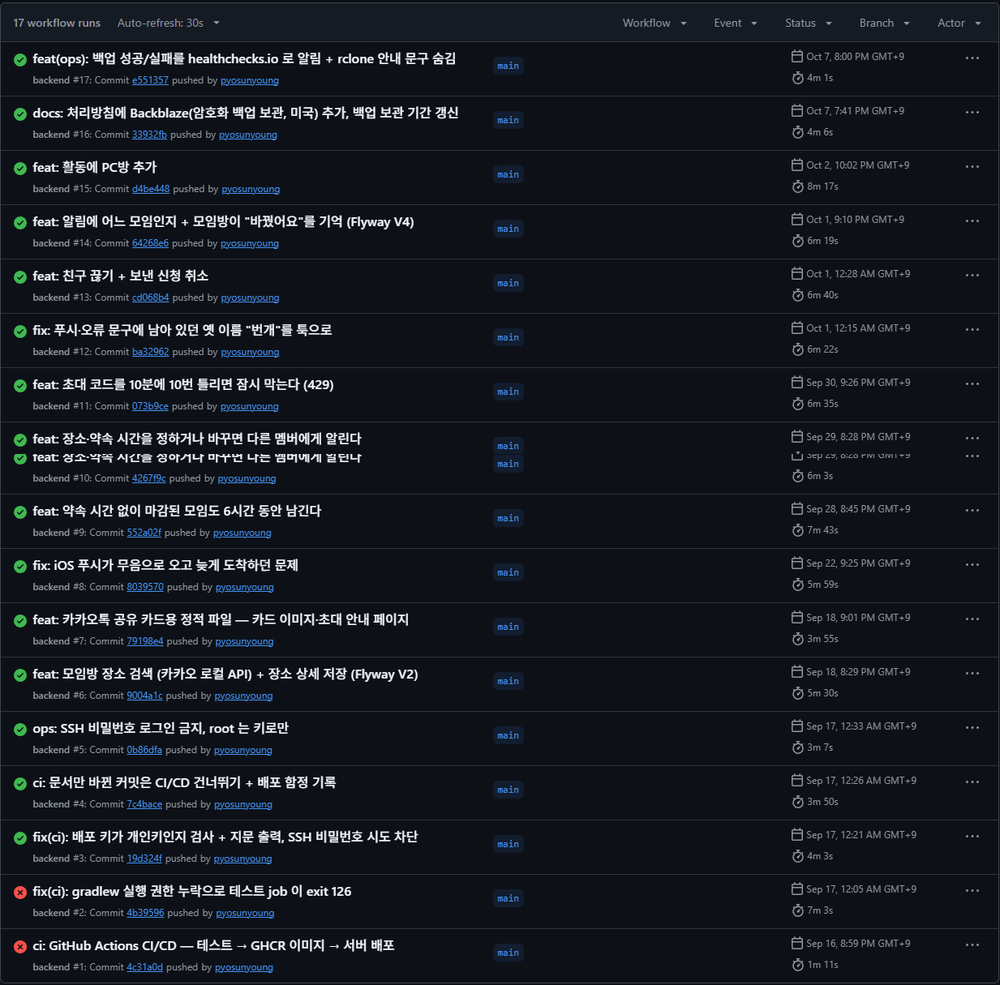
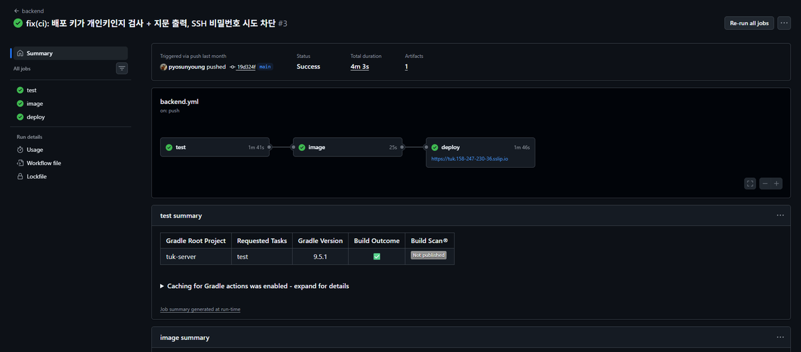

### 테스트 🧪
run #3 부터 매 push 가 테스트 → 배포 → 공개 health 까지 통과. 서버 SSH 강화(§10) 뒤에도 자동 배포 성공(run #5). **자동 롤백 경로를 일부러 실패시켜 확인했는지는 기록이 없다(확인 필요).**

### 남은 과제
- 서버 워크플로 일부 액션이 Node 20 기반이라 경고가 뜬다(`gradle/actions/setup-gradle@v4`, `docker/*` 액션). 앱은 `checkout@v5` 로 올림(§6)
- 브랜치 보호(main 직접 push 금지) 미적용

---

## 6. 앱 CI — analyze + test 🆕

### 배경/문제
앱도 커밋마다 정적 분석·테스트가 자동으로 돌아야 실수를 일찍 잡는다. 앱은 APK 를 직접 나눠 주므로 **배포는 하지 않고 검사만** 한다.

### 구현/해결 내용
`.github/workflows/app-ci.yml` — Flutter **3.44.8 고정**(로컬과 같은 버전), `flutter analyze --no-fatal-infos` + `flutter test`(앱 `eab78ec`). GitHub 러너의 Node 20 지원 종료 경고로 `actions/checkout@v5` 로 올림(`c5bd23c`).

### Before / After
| 앱 CI 실행 (09-16 ~ 09-18) | 결과 | 소요 |
|---|---|---|
| #1 ~ #7 (`eab78ec` → `11e6c95`) | ✅ 7/7 성공 | 1m 6s ~ 1m 56s |


### 테스트 🧪
이 기간 앱 커밋 7개 모두 CI 통과.

### 남은 과제
없음.

---

## 7. CI 테스트 job 이 exit 126 — gradlew 실행 권한 🐞

### 배경/문제
CI 첫 실행(run #1)이 테스트를 시작하지도 못하고 `Process completed with exit code 126`(실행 권한 없음)으로 끝났다.

원인: Windows 에서 커밋해 Git 이 `gradlew` 를 **일반 파일(100644)** 로 기록하고 있었다(`core.filemode=false`). 로컬 Docker 빌드는 `Dockerfile` 의 `RUN chmod +x gradlew` 가 가려 줘서 몰랐다. CI 는 Dockerfile 을 거치지 않고 `./gradlew` 를 바로 부른다.

### 구현/해결 내용
`git update-index --chmod=+x` 로 `gradlew` 와 운영 스크립트(`ops/…`)까지 실행 권한을 Git 에 기록(서버 `4b39596`, 4개 파일).

### Before / After
```text
$ git ls-tree 4c31a0d gradlew   →  100644   (run #1 ❌ exit 126, 1m 11s)
$ git ls-tree 4b39596 gradlew   →  100755   (run #2 test ✅ 3m 5s, image ✅)
```
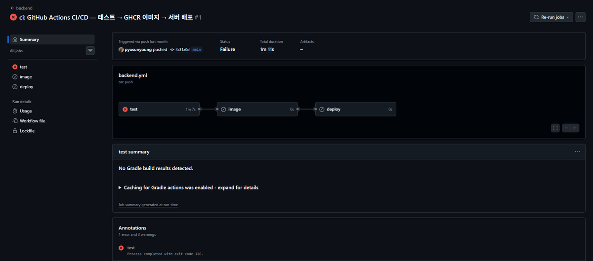

### 테스트 🧪
run #2 에서 test·image job 통과.

### 남은 과제
없음. 교훈: **Dockerfile 의 `chmod +x` 가 리포의 권한 누락을 숨긴다.**

---

## 8. 배포 키 `Permission denied (publickey)` 🐞 ⚙️

### 배경/문제
run #2 의 deploy job 이 6초 만에 `exit code 255`(SSH 실패)로 끝났다. 서버 로그에 GitHub 러너가 키 인증에 실패한 기록. Secret `DEPLOY_SSH_KEY` 에 **개인 키가 아닌 값(공개 키 `.pub` 로 추정)**이 들어가 있었다. Secret 은 다시 볼 수 없어서 넣은 값을 확인할 방법도 없었다.

### 구현/해결 내용
서버 `19d324f`:
- 배포 키를 새로 만들어 교체
- deploy job 의 Prepare SSH 단계가 **`ssh-keygen -y` 로 개인 키인지 먼저 검사**하고 지문(SHA256)을 로그에 찍는다 → 서버 `authorized_keys` 의 지문과 눈으로 대조 가능
- `BatchMode=yes` — 키가 틀리면 비밀번호를 묻지 않고 바로 실패(서버에 쓸데없는 비밀번호 시도 기록을 남기지 않음)

### Before / After
| | Before (run #2) | After (run #3) |
|---|---|---|
| deploy | ❌ exit 255, 6초 | ✅ 1m 46s, "배포 성공" |
| 잘못된 키를 넣으면 | 원인 모를 publickey 거부 | Prepare SSH 에서 "개인 키가 아님" 으로 즉시 실패 + 지문 |

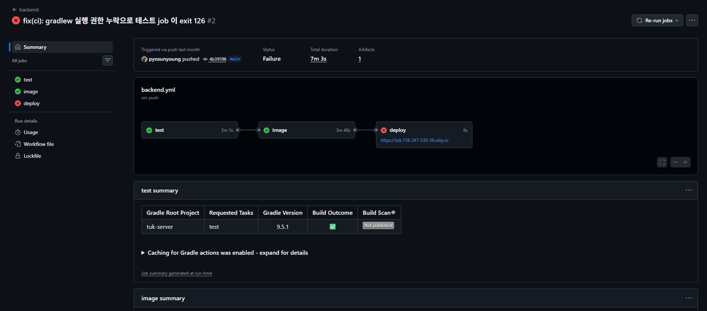

### 테스트 🧪
run #3 부터 deploy 성공. 진단 방법은 서버 `CLAUDE.md` 에 기록(`journalctl _COMM=sshd | grep "for deploy"`).

### 남은 과제
없음.

---

## 9. 문서만 바뀐 커밋은 CI/CD 건너뛰기 ⚙️

### 배경/문제
README·문서만 고쳐도 테스트 → 이미지 → **운영 재배포(약 46초 다운타임)**가 돌았다.

### 구현/해결 내용
`paths-ignore: ["**.md", "docs/**"]` — push·PR 둘 다(서버 `7c4bace`). 수동 실행(`workflow_dispatch`)은 열어 둠.

### Before / After
| | Before | After |
|---|---|---|
| `.md` 만 바뀐 push | 전체 파이프라인 + 재배포 | 실행 안 함 |

### 테스트 🧪
확인 필요 — 문서 전용 커밋 이후 실행이 생기지 않았는지 Actions 목록과 대조한 기록은 없다.

### 남은 과제
없음.

---

## 10. SSH 강화 — 비밀번호 로그인 금지 ⚙️

### 배경/문제
서버 인증 로그를 보니 **비밀번호 대입 공격이 상시** 들어오고 있었다. 적용 전 24시간 로그인 실패 **6,454회**(한 IP 에서만 3,248회).

### 선정 이유
| 결정 | 이유 |
|---|---|
| 비밀번호 로그인 **전면 금지**, 키로만 | 대입 공격을 "막는" 게 아니라 **시도할 방법 자체를 없앤다** |
| root 는 키로만(`prohibit-password`) | 운영 작업용 root 키는 유지 |
| 파일 이름을 `00-` 으로 시작 | sshd 는 같은 설정이 여러 번 나오면 **먼저 읽은 값**을 쓴다. 클라우드 이미지의 `50-cloud-init.conf` 에 `PasswordAuthentication yes` 가 있어 그보다 먼저 읽혀야 한다 |
| 키 분실 대비 | Vultr 웹 콘솔(서버 화면 직접 접속, sshd 와 무관)로 복구 |

### 구현/해결 내용
`/etc/ssh/sshd_config.d/00-tuk-hardening.conf`(리포 `ops/ssh/`, 서버 `0b86dfa`): `PasswordAuthentication no` · `KbdInteractiveAuthentication no` · `PermitEmptyPasswords no` · `PermitRootLogin prohibit-password` · `MaxAuthTries 3`.

### Before / After
10-15 에 서버에서 다시 확인:
```text
$ sshd -T | grep …
passwordauthentication no
kbdinteractiveauthentication no
permitrootlogin without-password      (= prohibit-password)
maxauthtries 3
```
서버 저널에서 하루 단위로 다시 셈:

| 날짜 | "Failed password" (비밀번호 틀림) | "Invalid user" (없는 계정 시도) |
|---|---|---|
| 09-15 (적용 전) | **5,855** | 2,562 |
| 09-16 (적용 전) | **3,512** | 1,063 |
| 10-14 (적용 후) | **0** | 646 |

공격 시도(없는 계정 이름 대입)는 계속 오지만, **비밀번호를 검사하는 단계까지 가지 못한다.**

### 테스트 🧪
적용 후 root 키 로그인 정상, GitHub 자동 배포(run #5) 성공, 비밀번호 로그인 시도 시 거부.

### 남은 과제
fail2ban 등 접속 차단은 미적용(비밀번호 경로가 없어 우선순위 낮음).

---

## 11. DB 일일 백업 🆕 🧭 🧪

### 배경/문제
운영 DB 에 백업이 없었다. 실수로 지운 데이터나 잘못된 마이그레이션을 되돌릴 방법이 없다.

### 선정 이유
| 대안 | 판단 |
|---|---|
| Vultr 자동 백업 | 서버 전체 스냅샷, **유료**(월 약 $2) — 사용자가 비용 때문에 보류 |
| **`pg_dump` + systemd 타이머** | 무료, DB 만 작게 백업, 테이블 단위 복구 가능 → 채택 |

한계를 알고 고름: 백업이 **같은 서버 디스크**에 있어서 서버가 통째로 사라지면 같이 사라진다 → 10-07 에 암호화 외부 사본(B2)으로 보완([FEATURE_NOTES_2026-09-30_10-07 §26](FEATURE_NOTES_2026-09-30_10-07.md)).

### 구현/해결 내용
`ops/backup/` (서버 `0d6469b`):
- `tuk-db-backup` — `pg_dump -Fc`(압축 + 테이블 단위 복구 가능) → **`.partial` 로 쓰고 `pg_restore --list` 로 검증한 뒤에야 이름 변경**(실패한 백업이 정상 파일처럼 남지 않게) → `chmod 600` → 14일 지난 파일 삭제
- `tuk-db-backup.timer` — 매일 04:00 KST, `Persistent=true`(그 시각에 서버가 꺼져 있었으면 켜진 뒤 바로 실행), `RandomizedDelaySec=5min`
- Redis 는 백업하지 않음(refresh 토큰·콜 상태뿐 — 잃으면 재로그인)

### Before / After
10-15 의 서버 상태 — 한 달째 매일 돌고 있다:
```text
$ systemctl list-timers tuk-db-backup.timer
NEXT                         LEFT      LAST                         PASSED
Wed 2026-10-14 19:04:04 UTC  2h 59min  Tue 2026-10-13 19:01:24 UTC  21h ago   (UTC 19시 = KST 04시)

$ ls -lh /var/backups/tuk | tail -5
20K Oct  9 19:04 tuk-20261010-0404.dump
20K Oct 10 19:03 tuk-20261011-0403.dump
20K Oct 11 19:01 tuk-20261012-0401.dump
20K Oct 12 19:05 tuk-20261013-0405.dump
20K Oct 13 19:01 tuk-20261014-0401.dump
총 18개
```

### 테스트 🧪
09-16 설치 당일 수동 실행 → 백업 파일로 복원 테스트 통과. 복원 때 비교한 구체적 수치는 남아 있지 않다(확인 필요). 이후 10-07 에 B2 사본으로 다시 복원해 **운영과 행 수·Flyway 버전 일치**를 확인했다(FEATURE_NOTES_2026-09-30_10-07 §26).

### 남은 과제
백업 스크립트는 배포가 자동 설치하지 않는다(고치면 `scp` + `install`).

---

## 12. P1 모임방 "지도에서 보기" 🆕 🧭

### 배경/문제
모임방에서 장소가 정해져도 **"그래서 어떻게 가지?"**에서 끝났다(막다른 길).

### 선정 이유
| 결정 | 이유 |
|---|---|
| **길찾기를 만들지 않고 지도 앱으로 넘긴다** | 채팅을 카톡으로 넘기는 것과 같은 원칙 — 사람들이 이미 쓰는 앱이 더 잘한다 |
| 카카오맵 · 네이버 지도만 | 구글 지도는 국내 길찾기가 제한적이라 제외 |
| **A안(장소 이름 검색)** 먼저 | 서버 변경 없이 바로 쓸 수 있다. 좌표 저장(B안)은 실사용 후 판단 → 다음 날 §15 로 진행 |
| 앱이 없으면 웹 지도 | 버튼이 아무 반응 없는 경우를 없앤다 |
| 마지막에 쓴 지도 앱을 맨 위 + "최근" | 매번 같은 앱을 쓰는 사람은 한 번에 누른다 |

### 구현/해결 내용
앱 `2150ed0`:

| 파일 | 내용 |
|---|---|
| `core/map_links.dart` | `buildMapLink` 순수 함수 — 앱 딥링크 + 웹 대체 주소 한 쌍 |
| `services/map_launcher.dart` | 앱 딥링크 → 실패 시 웹, 마지막 선택을 `shared_preferences` 에 기억 |
| `views/map_app_sheet.dart` | 지도 앱 선택 시트 |
| `AndroidManifest.xml` / `Info.plist` | `kakaomap`·`nmap` 조회 선언(Android 11+ 패키지 가시성, iOS 쿼리 스킴) |

### Before / After
| Before: 장소만 보이고 끝 | After: 지도 앱 선택 | 카카오맵으로 넘어감 |
|---|---|---|
| 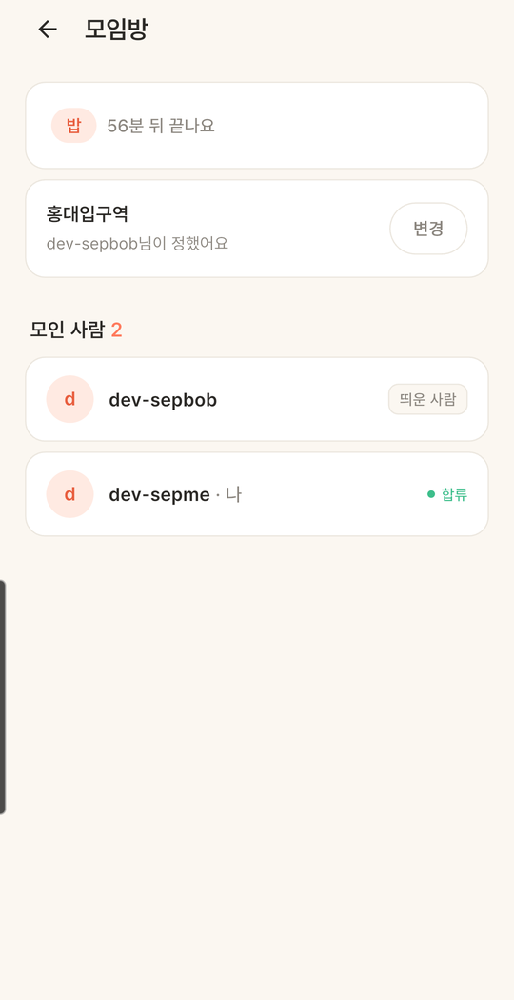 | 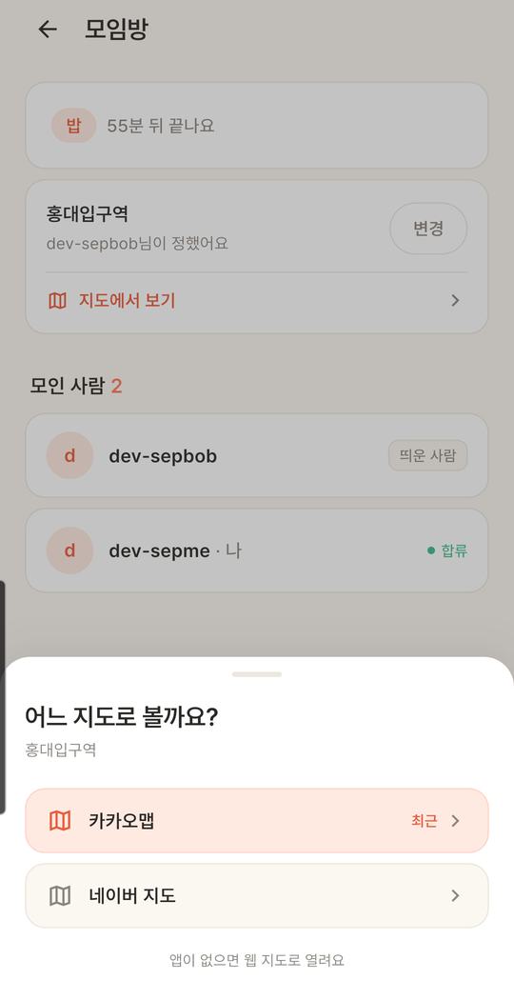 | 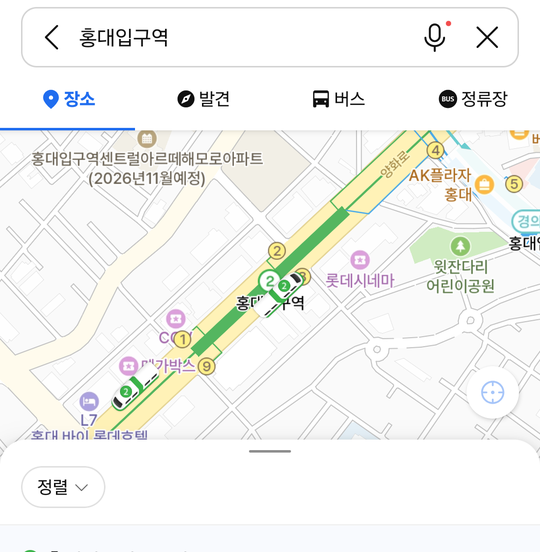 |

### 테스트 🧪
- 단위 테스트 `map_links_test` 8케이스 — 한글·공백·`&`·`/`·`#` 인코딩, 네이버 `appname`, 좌표 유무 분기
- 실기기(갤럭시 S25) — 두 지도 앱 모두 열림, 앱 없을 때 웹

### 남은 과제
09-28 카카오맵 앱 6.29 업데이트로 장소 ID 딥링크가 깨져 이름+좌표 검색 링크로 교체([FEATURE_NOTES_2026-09 §12](FEATURE_NOTES_2026-09-22_09-29.md)).

---

## 13. 앱을 한동안 안 쓰다 켜면 실시간(STOMP)이 영영 안 붙음 🐞

### 배경/문제
앱을 30분 넘게 안 쓰다 켜면 실시간(새 툭, 친구 콜 상태)이 **영원히** 안 왔다. STOMP 가 연결할 때 받은 **토큰 문자열을 계속** 들고 있어서, access token(30분)이 만료된 뒤 재연결할 때마다 같은 만료 토큰을 보내 서버에 거부당했다.
```dart
// cad8e59^ — 연결할 때 받은 토큰을 재연결에도 계속 씀
void connect(String accessToken) {
  final headers = {'Authorization': 'Bearer $accessToken'};
```

### 선정 이유
| 결정 | 이유 |
|---|---|
| 거부당한 뒤가 아니라 **연결 전에** 만료 임박 확인 | 거부 → 갱신 → 재연결은 매번 3초 손해 + 서버에 실패 기록 |
| HTTP 와 **같은 single-flight** 로 갱신 | 앱 시작 시 REST 여러 개와 STOMP 가 동시에 갱신하면 refresh rotation 이 두 번 돌아 먼저 받은 토큰이 무효가 된다 |
| 헤더 맵 객체를 재사용 | `stomp_dart_client` 는 재연결마다 `beforeConnect` 를 부른 뒤 CONNECT 보낼 때 그 맵을 읽는다(라이브러리 소스로 확인) |
| 서버 거부 후엔 **강제 갱신** | 만료 판단이 기기 시계 기준이라 시계가 틀리면 만료 토큰을 유효로 오판 — 검증 중 노트북 시계가 4분 빨라 실제로 겪음 |

### 구현/해결 내용
앱 `cad8e59` — `core/jwt.dart`(exp 읽기, "60초 안에 만료?") · `ApiClient.validAccessToken({forceRefresh})` · `StompService.connect(AccessTokenProvider)` 가 `beforeConnect` 에서 새 토큰을 채움.

### Before / After
`JWT_ACCESS_TOKEN_VALIDITY=2m` 로 서버를 띄워 30분 대기 없이 재현(로그인 → 앱 종료 → 2분 50초 대기 → 재실행):

| | Before | After |
|---|---|---|
| stomp error | 재연결마다 반복, 회복 안 됨 | **0회** |
| 서버 | 거부 반복 | `WS 연결 userId=364` |
| 실시간 | 안 옴 | 친구 콜 켜기 → 홈 "지금 한가한 친구 0 → 1" 2초 내 |


### 테스트 🧪
`jwt_test` 6케이스 — exp 파싱(패딩 없는 base64 포함), 만료 임박, 깨진 토큰은 안전하게 갱신 쪽으로. 10-15 재실행:
```text
$ flutter test test/map_links_test.dart test/jwt_test.dart
00:00 +17: All tests passed!
```

### 남은 과제
"기기 시계가 틀린 상태에서 강제 갱신" 경로는 기기 시계를 바꿔야 해서 실기기로 따로 재현하지 않음.

---

## 14. 바텀시트 마지막 줄이 내비게이션 바에 가림 🐞 ⚙️

### 배경/문제
갤럭시 S25(3버튼 내비게이션)에서 바텀시트 맨 아래 안내 문구가 반쯤 가려졌다. 안드로이드 edge-to-edge 로 앱이 내비게이션 바 뒤까지 그려지는데, 시트 하단 여백이 **고정 40** 이었다. P1 지도 시트를 실기기로 보다 발견 → 같은 패턴 시트 전부 점검.

### 선정 이유
| 결정 | 이유 |
|---|---|
| `viewPaddingOf` 가 아니라 **`paddingOf`** | 장소·코드 입력 시트는 키보드가 올라온다. `paddingOf` 는 키보드에 가려진 만큼을 빼 줘서 키보드 위에 빈칸이 안 생긴다 |
| `max(40, 24 + 하단 인셋)` | 인셋 없는 기기는 기존 디자인 여백 그대로 |
| 7곳 복붙 대신 함수 하나 | 다음 시트도 같은 실수를 안 하게 |

### 구현/해결 내용
`widgets/sheet.dart` 의 `sheetBottomPadding(context)` 하나로 통일, 시트 7곳 적용(콜 켜기 · 번개 발송 시간 · 장소 · 친구 추가 · 친구 미리보기 · 지도 앱 선택 등, 앱 `7f479fb`).

### Before / After
| Before: 마지막 문구가 바에 가림 | After |
|---|---|
| 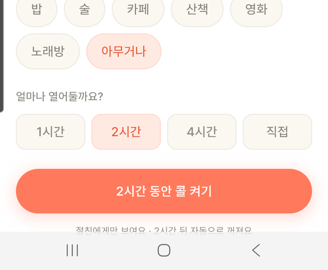 | 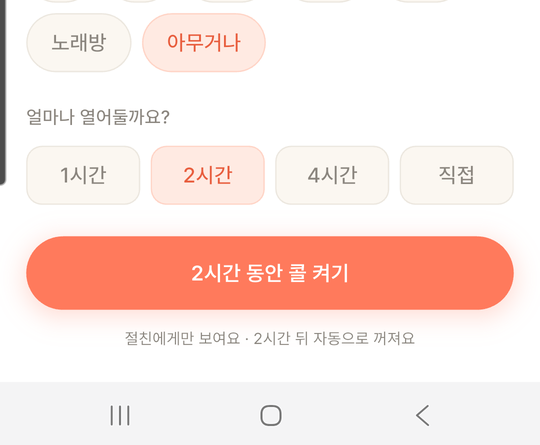 |

### 테스트 🧪
실기기 — 콜 켜기 시트 문구 온전히 보임 / 장소 시트 + 키보드: 키보드 위 빈칸 없음 / 지도 앱 시트 확인. analyze 무이슈, 테스트 15개 통과.

### 남은 과제
없음.

---

## 15. P1-B 모임방 장소 검색 (카카오 로컬 API) 🆕 🧭

### 배경/문제
장소를 손으로 썼다. **오타 하나로 약속이 틀어질 수 있고**, 지도 링크가 그 가게가 아니라 이름 검색 결과 목록으로 열렸다(사용자 제안: "검색해서 고르면 그 장소가 확실하다").

### 선정 이유
| 결정 | 고려한 것 | 고른 이유 |
|---|---|---|
| **서버가 카카오 API 를 대신 호출** | 앱에서 직접 호출 | REST API 키를 앱에 넣으면 APK 에서 누구나 꺼내 쓴다 |
| **"그대로 쓰기" 상시 노출** | 검색 결과만 허용 | "학교 정문"처럼 검색에 없는 약속 장소가 많고, 카카오 장애·쿼터 초과 때도 장소는 정해져야 한다 |
| 장소는 **통째로 교체** | 바뀐 칸만 갱신 | 검색 장소 → 직접 입력으로 바꿀 때 이전 가게 ID 가 남으면 지도가 엉뚱한 가게를 연다 |
| 네이버는 좌표 + 이름 | — | 카카오 장소 ID 를 모르므로. 지점 핀은 똑같이 정확 |
| 검색 350ms 디바운스 + 요청 번호 | 글자마다 호출 | 호출 수를 줄이고, **늦게 도착한 옛 응답이 최신 결과를 덮지 않게** |

### 구현/해결 내용
- 서버(`9004a1c`): `KakaoLocalClient`(키워드 검색, 401/403 → 경고 로그 + 502) · `PlaceSearchService`(검색어 1~50자, 도로명 주소 우선) · `GET /api/places/search` · **Flyway V2**(`place_kakao_id`, `place_address` 칸 추가 — **CI/CD 로 나간 첫 스키마 변경**, run #6) · 요청 검증(카카오 ID 는 숫자, 검색 장소면 좌표 필수)
- 앱(`51f6873`): `Place` 모델 · `PlaceRepository` · 장소 시트를 검색형으로 개편(입력 전·로딩·결과/없음·실패 4상태) · 모임방 카드에 주소 한 줄

### Before / After
| Before: 손으로 입력 | After: 검색 결과 | 결과 없음 → "그대로 쓰기" | 모임방 카드(이름+주소) |
|---|---|---|---|
| 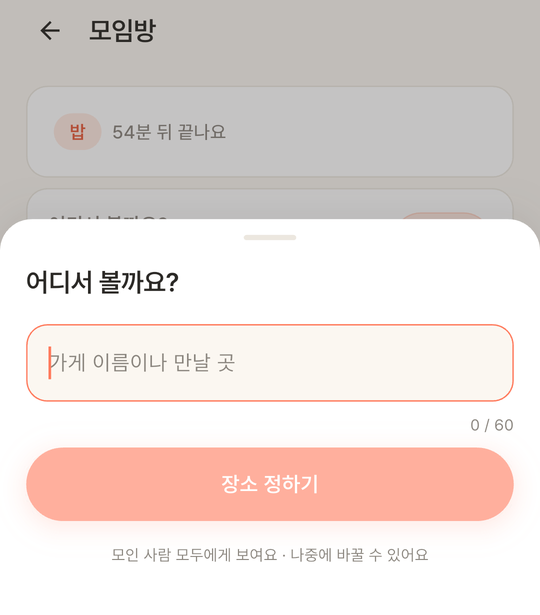 | 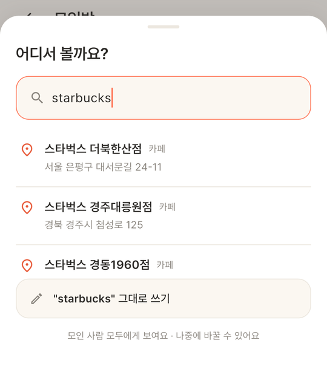 | 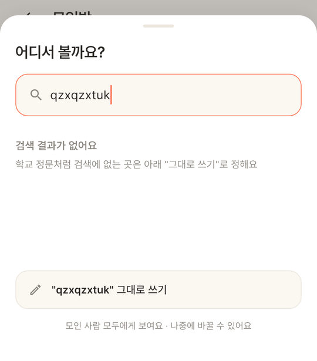 | 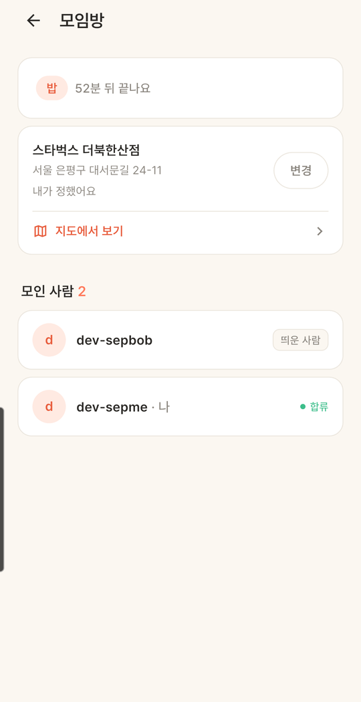 |

| 검색 확인 (실제 카카오 API) | 결과 |
|---|---|
| "강남역 스타벅스" | 15건 |
| "홍대입구역 9번 출구" | 6건 |
| 없는 장소 | 0건 |
| "starbucks gangnam" | 스타벅스 강남R점 |

### 테스트 🧪
- 서버 테스트 15개 추가(`KakaoLocalClientTest` · `PlaceSearchServiceTest` · `SetPlaceRequestTest` · `FlashServiceTest`) → 97개 통과
- API: 빈 검색어 400 · 비로그인 401 · 키 없음/카카오 오류 502
- 실기기: 선택 → DB 에 ID·주소·좌표 저장, Flyway V2 적용 / 카카오맵 → **가게 페이지(별점·영업시간)** / 네이버 → 정확한 지점 핀 / "그대로 쓰기"로 바꾸면 ID·주소·좌표가 NULL 로 지워짐

### 남은 과제
인코딩이 깨진 요청은 400 대신 401(오류 경로가 인증 필요) — 앱은 항상 UTF-8 이라 영향 없음. 카카오 키 문제는 §16.

---

## 16. 카카오 로컬 API 403 — 무료 쿼터는 계정당 첫 앱만 🐞

### 배경/문제
장소 검색이 실패했다. 앱을 거치지 않고 카카오를 직접 호출해 원인을 분리: `403 disabled OPEN_MAP_AND_LOCAL service` — 코드가 아니라 **콘솔 설정** 문제. 카카오맵 API 는 **계정당 첫 앱에만 무료**인데, 툭 앱은 첫 앱이 아니라 유료로 표시됐다.

### 선정 이유
| 대안 | 판단 |
|---|---|
| 툭 앱에서 유료 사용 | 비용 발생 → 보류 |
| 기존 공유캘린더 앱 삭제 후 재부여 | 다른 프로젝트에 영향, 무료 여부도 불확실 |
| **무료인 공유캘린더 앱에서 카카오맵을 켜고, 전용 REST 키(`tuk-server`)를 새로 발급** | 비용 0, 키가 툭 전용이라 따로 끊을 수 있다 → 채택 |

### 구현/해결 내용
콘솔 설정 + 서버 `.env`·로컬 설정의 `KAKAO_REST_API_KEY` 교체(키는 리포에 없음). 서버는 401/403 을 받으면 원인을 경고 로그로 남기고 502 로 응답.

### Before / After
| | Before | After |
|---|---|---|
| 카카오 직접 호출 | `403 disabled OPEN_MAP_AND_LOCAL service` | 200 |
| 앱 | "지금은 검색이 안 돼요" + 그대로 쓰기 | 검색 결과 |

### 테스트 🧪
카카오 직접 호출 200 → 서버 경유 검색 → 실기기 검색(§15).

### 남은 과제
**공유캘린더 앱을 지우면 장소 검색이 멈춘다**(앱은 "그대로 쓰기"로 대체되므로 장소 정하기는 계속 됨).

---

## 17. 번개 발송: 친구 선택에 "지금 한가함" 표시 🆕 🧭

### 배경/문제
툭을 보낼 친구를 고를 때 누가 지금 한가한지 알 수 없었다. "이 친구는 지금 불러도 되겠다"는 안심을 주자는 사용자 제안.

### 선정 이유
| 결정 | 이유 |
|---|---|
| **좋은 신호만** 표시 | 콜이 꺼진 친구에게 "바쁨"을 붙이지 않는다 — 툭의 "거절이 안 보인다" 원칙. 꺼져 있어도 부르면 올 수 있는 친구다 |
| 정렬은 **화면을 연 순간 한 번만** | 실시간으로 다시 정렬하면 누르려던 친구가 움직여 엉뚱한 사람을 누른다. 표시는 실시간, 순서는 고정 |
| "모두에게"엔 한가한 수만 | 꺼진 친구 수("2명은 바빠요")는 말하지 않는다 |

### 구현/해결 내용
앱만, 서버 변경 없음(`11e6c95`). 홈과 같은 실시간 데이터(`PresenceViewModel.friends`)를 발송 화면도 구독.
- 골라서: 이름 아래 **"● 지금 한가함 · 밥 · 38분 남음"**(홈과 같은 초록 점)
- 모두에게: "친구 3명에게 갈 거예요 **· 1명은 지금 한가해요**"

### Before / After
| Before | After: 골라서 | After: 모두에게 |
|---|---|---|
| 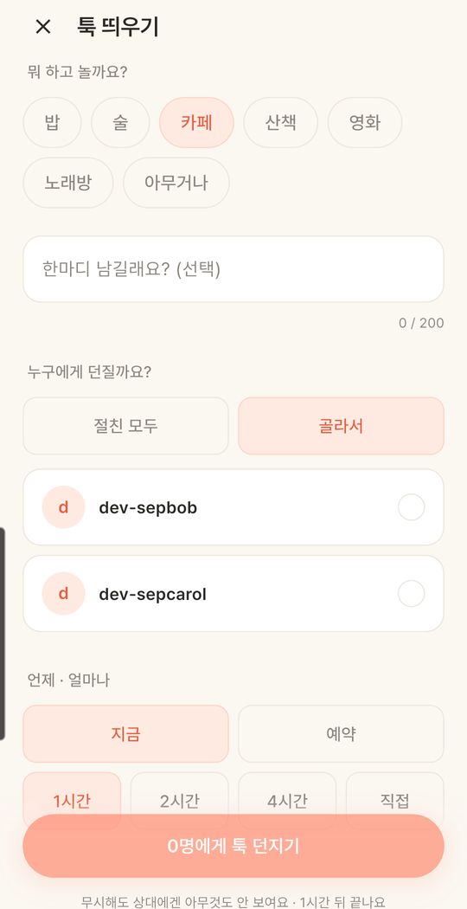 |  | 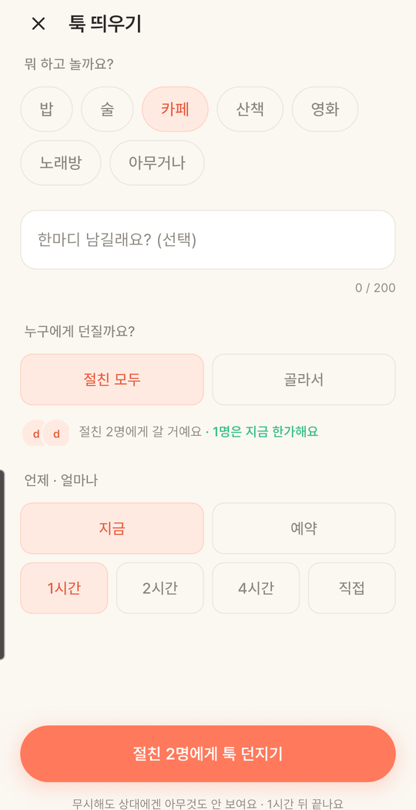 |

### 테스트 🧪
실기기 + 로컬 서버(dev 계정 bob·carol):
- bob 켜짐 · carol 꺼짐 → bob 에만 표시, "1명은 지금 한가해요"
- bob 끄고 carol 켠 뒤 재진입 → 이름순으로 뒤인 **carol 이 위로**
- 화면을 연 채로 bob 켜기 → 표시가 **실시간으로 붙고 순서는 그대로**
- analyze 무이슈, 테스트 18개 통과

### 남은 과제
없음.

---

## 18. 테스트 현황 🧪

| | 시작(09-15) | 끝(09-18) | 늘어난 것 |
|---|---|---|---|
| 서버 | 82 | **97** | 장소 검색 15개(카카오 클라이언트 · 검색 서비스 · 요청 검증 · 장소 저장) |
| 앱 | 1 | **18** | `map_links_test` 8 · `jwt_test` 6 · 그 뒤 3개(`11e6c95` 까지) |

각 커밋에서 `@Test` / `test(` · `testWidgets(` 개수를 다시 센 값. CI 는 서버 7회 중 앞의 2회 실패(설정 문제, 코드 문제 아님) 뒤 전부 성공, 앱 7/7 성공.

### 실기기 검증 방식
- 운영 검증은 실계정 하나 + DB 테스트 유저(검증 후 삭제)
- 기능 검증은 로컬 백엔드 + `adb reverse tcp:8080 tcp:8080` + dev 계정(alice·bob·carol) 전환
- 시간이 걸리는 버그는 **설정으로 시간을 줄여** 재현 — access token 30분 → 2분
- 원인 분리는 중간 단계를 빼고 직접 호출 — 카카오 API 를 서버·앱 없이 호출해 콘솔 문제임을 확인

---

## 경력기술서용 요약

형식: **문제 → 한 행동 → 결과(수치)**.

### 운영 · 인프라
- 로컬에서만 돌던 백엔드 → Vultr VM 에 Docker Compose(Caddy · Spring Boot · PostgreSQL · Redis)로 배포, sslip.io 로 도메인 구매 없이 Let's Encrypt 자동 HTTPS → **당일 HTTPS 운영 + 실기기 E2E(로그인 · STOMP 2초 내 · FCM) 통과**, 앱 포트는 외부 차단.
- 수동 4단계 배포 → GitHub Actions 로 테스트 → GHCR(커밋 SHA 태그) → 제한 SSH 키(forced command) 배포 → health 대기 · **실패 시 자동 롤백** → `main` push 한 번으로 배포, 회당 **3~5분**, 영구 토큰 0개.
- 상시 SSH 비밀번호 대입 공격(**하루 실패 3,512~5,855회**) → 비밀번호 인증 자체를 끄고 키 전용, cloud-init 설정보다 먼저 읽히게 `00-` 파일로 적용 → **비밀번호 실패 0회**, 자동 배포 영향 없음.
- 운영 DB 백업 부재 → 유료 스냅샷 대신 `pg_dump` + systemd 타이머, **검증을 통과한 파일만 백업으로 인정** → 추가 비용 0원, 한 달째 매일 자동 실행.

### 오류 해결
- 갱신 요청의 401 이 예외로 던져져 "네트워크 오류"로 오분류 → 로그아웃이 영원히 안 되는 좀비 세션 → 상태 코드를 직접 판단(401 = 만료, 5xx = 유지) → 운영 첫 접속에서 발견해 **실사용 전 차단**.
- STOMP 가 첫 토큰을 재연결에도 재사용해 30분 뒤 실시간이 영구 단절 → 연결 전 만료 확인 + HTTP 와 같은 single-flight 갱신 + 서버 거부 시 강제 갱신 → 토큰 수명을 2분으로 줄여 재현, **재연결 오류 반복 → 0회**.
- CI 첫 실행이 exit 126 → Windows 커밋으로 `gradlew` 실행 권한 누락(Dockerfile 의 chmod 가 가리고 있었음) → Git 에 권한 기록 → 다음 실행 통과.
- 운영 compose 파일이 한 번도 파싱된 적 없어 첫 배포에서 YAML 오류 → 원인(`: `) 특정 후 따옴표 처리, 고치기 전 파일로 **오류 위치(L50.C53)까지 재현**.

### 신규 기능 · 설계
- 손으로 쓴 장소의 오타 위험 → 카카오 로컬 API 를 **서버가 대신 호출**(키 비노출) + 350ms 디바운스 · 옛 응답 무시 + 검색 실패 시 "그대로 쓰기" 탈출구 → 지도에서 **그 가게 페이지가 바로 열림**, Flyway V2 를 CI/CD 로 반영, 서버 테스트 15개 추가.
- 장소가 정해져도 "어떻게 가지?"에서 끝나는 모임방 → 길찾기를 만들지 않고 카카오맵 · 네이버 지도 딥링크로 위임(앱 없으면 웹, 최근 앱 기억) → 링크 테스트 8케이스.
- 누구를 불러야 할지 모르는 발송 화면 → "한가함"만 표시하고 꺼진 친구는 표시하지 않음(거절이 안 보이는 원칙), 정렬은 화면을 연 순간 한 번만 → 실시간 표시 중에도 누르려던 친구가 움직이지 않음.

---

## 이번 작업으로 수정·생성한 파일

| 리포 | 파일 | 무엇 |
|---|---|---|
| tuk-app | `docs/FEATURE_NOTES_2026-09-15_09-18.md` | 이 문서 |
| tuk-app | `docs/DEV_LOG.md` | 이 기간에 빠져 있던 시간순 기록 3건(DB 백업 · CI/CD · SSH 강화) 추가 + 기존 09-15 ~ 09-18 항목 끝에 이 문서로 가는 링크 추가(기존 내용은 그대로) |

기능 코드 커밋은 각 항목에 적힌 커밋 해시 참고. 캡처 파일은 아직 추가하지 않았다(아래).

### 아직 없는 캡처 (`![TODO:]` 자리)
| 파일명 | 찍는 법 |
|---|---|
| `cicd-runs.png` · `cicd-first-deploy.png` · `cicd-exit126.png` · `cicd-publickey-before.png` · `app-ci-runs.png` | GitHub 로그인 상태에서 각 TODO 에 적힌 주소 → 화면 캡처 |
| `deploy-tls-cert.png` | 브라우저로 운영 주소 → 주소창 자물쇠 → 인증서 |
| `deploy-e2e-home.png` | 릴리스 앱 홈(실계정 프로필 가리기) |
| `coldstart-call-after.png` · `p1-map-sheet.png` · `p1-kakaomap.png` · `sheet-navbar-after.png` · `place-search.png` · `place-manual.png` · `place-room.png` · `badge-pick.png` · `badge-all.png` | 로컬 서버 + `adb reverse` + dev 계정, 실기기 |
| `coldstart-call-before.png` · `p1-before.png` · `sheet-navbar-before.png` · `place-before.png` · `badge-before.png` · `stomp-before.png` | 해당 커밋 직전(`<커밋>^`)을 worktree 로 빌드 — 손이 많이 가므로 **코드 diff 대체 권장** |
| `zombie-session-before.png` | 재현 어려움 — **diff 대체(본문에 있음)** |
