# 기능 정리본 — 2026-09-22 ~ 09-29

카카오톡 공유 카드 이후 약속 시간 · 모임 목록 · 알림을 붙이며 한 작업을 기능 단위로 정리한다.
시간순 개발 기록은 [`DEV_LOG.md`](DEV_LOG.md)에 있고, 이 문서는 **배경 → 선정 이유 → 구현 → Before/After → 테스트** 구조로 다시 묶은 것이다.

- 범위: 앱 `tuk-app` 15커밋 + 서버 `tuk-server` 9커밋
- 테스트: 서버 98 → **125개**, 앱 23 → **47개**
- 캡처: `docs/images/`. 화면은 로컬 개발 서버 + dev 계정, 실기기(갤럭시 S25)

> 분류 표기: 🆕 신규 기능 · 🧭 설계/선정 · ⚙️ 개선 · 🐞 오류 해결 · 🧪 테스트

---

## 1. 카카오톡 공유 카드 마무리 🆕 🐞

### 배경/문제
모임방을 카톡으로 공유하는 기능(P2)의 마지막 세 가지가 남아 있었다.
그중 **공유 링크로 연 모임방의 만료 시간이 빈칸**으로 나오는 버그가 있었다.

### 구현/해결 내용
| 항목 | 내용 |
|---|---|
| 앱 스킴 | 카카오 콘솔 "기본 네이티브 앱 스킴"이 패키지명 없이 등록돼 있어 "툭에서 보기"가 앱 대신 웹으로 열렸다 → 콘솔에서 교정 후 실기기 확인 |
| 초대 카드 | 친구 초대 코드용 공유 카드 추가 |
| 만료 빈칸 | **UI 버그가 아니라 API 계약 문제** — 모임방 응답에 `expiresAt` 자체가 없었다. 목록으로 들어오면 앱이 들고 있던 값을 쓰고, 링크로 바로 들어오면 들고 있는 값이 없다. 응답에 `expiresAt` 추가 (`3a48964`) |

만료 시간이 없다는 것은 **"끝났는지"도 판단할 수 없다**는 뜻이어서, 빈칸 외에 종료 상태 표시도 같이 깨져 있었다.

### Before / After
| Before — 링크로 연 모임방 | After — 공유 카드 · 모임방 |
|---|---|
| 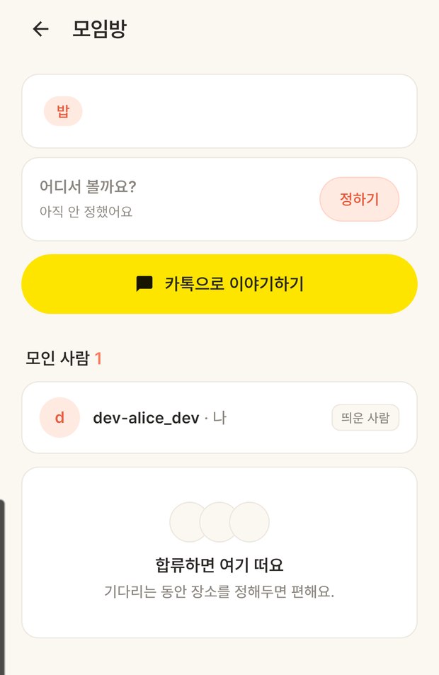 | 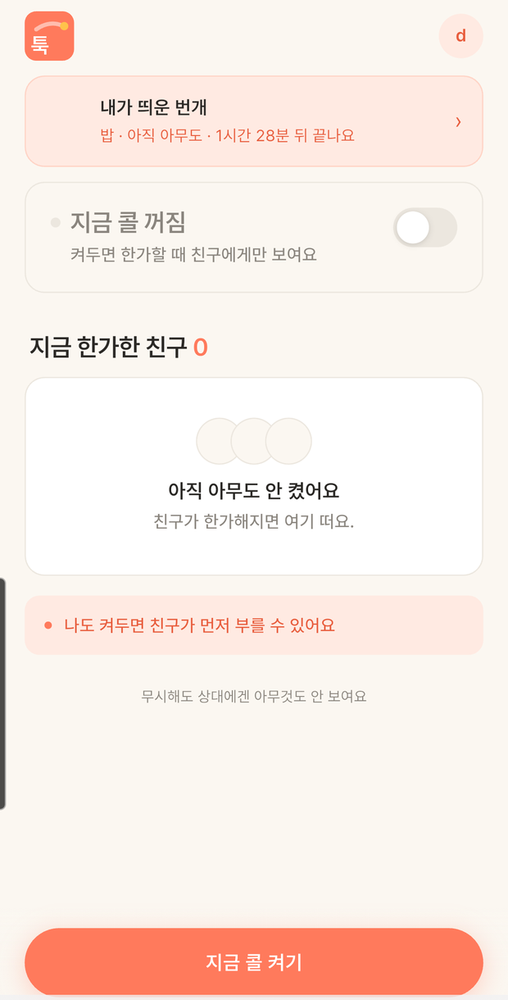 |

| 모임방 | 초대 카드 |
|---|---|
|  | 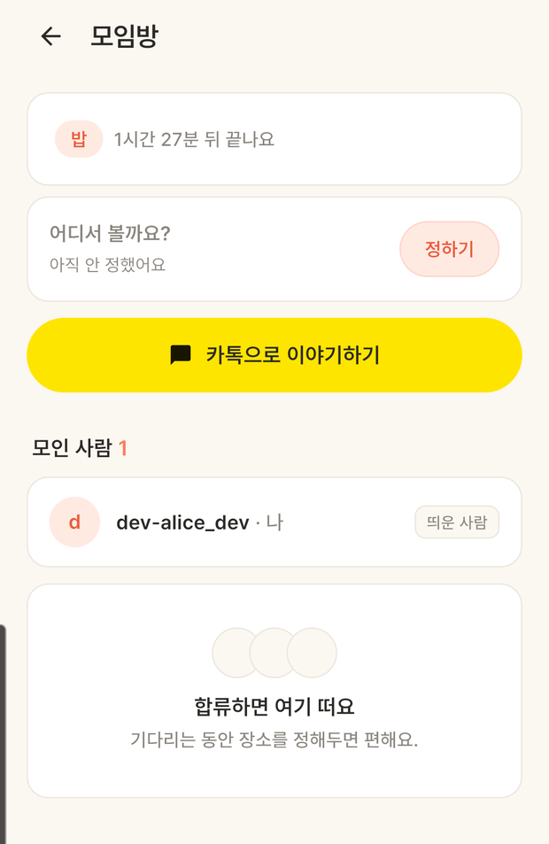 |

### 테스트
- 실기기에서 카톡 카드 → "툭에서 보기" → 앱 모임방 진입(콜드 스타트 포함)
- 딥링크는 카톡을 거치지 않고 재현: `adb shell am start -a android.intent.action.VIEW -d "kakao{네이티브키}://kakaolink?room={id}"`, `am force-stop` 후 같은 명령이면 콜드 스타트까지 확인
- 앱 없는 사용자용 웹 대체 주소 3종 200

---

## 2. iOS 빈틈 메우기 🆕

### 배경/문제
안드로이드로만 개발해 왔는데, 테스트를 단톡방에 뿌리면 **아이폰 사용자는 아예 못 쓴다.**
Mac이 없어 빌드·검증은 불가능하지만, **Mac 없이도 메울 수 있는 코드 빈틈**이 어디까지인지 확인했다.

### 선정 이유
전부 다 하려면 Mac이 필요하다(Apple 로그인, APNs 키, 서명, 심사). 그래서 **"Mac 없이 지금 짤 수 있는 것"과 "Mac이 생겨야 되는 것"을 나눠** 앞쪽 3개만 처리했다. 나중에 Mac을 구했을 때 처음부터 보지 않아도 되게.

### 구현/해결 내용
| 빈틈 | 처리 |
|---|---|
| 딥링크 진입점 | iOS는 `SceneDelegate.willConnectTo`로 콜드 스타트 URL이 들어온다 — 안드로이드 쪽과 같은 `MethodChannel("com.tuk.app/deeplink")`로 통일 |
| 푸시가 무음·지연 | `ApnsConfig`에 `apns-priority: 10` + `Aps.sound("default")`. 없으면 iOS가 저우선순위로 묶어 늦게, 소리 없이 띄운다 (`8039570`) |
| 알림 권한 | `DarwinInitializationSettings(request*: false)`로 초기화 시 권한 요청을 끄고, 포그라운드 중복 배너도 차단 |

### Before / After


**비포/애프터 캡처 불가** — Mac이 없어 컴파일조차 되지 않는다. 대체 자료는 `ios/Runner/SceneDelegate.swift`, `FcmPushSender.java`의 `ApnsConfig` 블록.

### 남은 과제
- **미컴파일 코드** — Mac 확보 전까지 동작 미검증
- Apple 로그인(`SocialClient` 구현체가 Kakao만), APNs 인증 키, 빌드·심사 환경

---

## 3. 용어 정리 — 제품이 쓰지 않는 말 걷어내기 🧭 ⚙️

### 배경/문제
상태를 켜는 토글이 **`콜`** 이었다. 한국어에서 "콜"은 술자리에선 "좋아", 게임에선 "동의", 보통은 "전화"로 읽힌다. 정작 뜻하려던 **"나 지금 한가해"** 는 어디에도 없었다.
결정적으로 **앱이 이미 다른 곳에서는 "한가하다"로 부르고 있었다** — "지금 한가한 친구", "N명은 지금 한가해요". 토글 하나만 다른 언어를 쓰고 있었다.

같이 발견한 것:
- 옛 코드네임 **"번개"** 가 UI에 남아 있었다. 특히 **알림 채널 이름이 "번개 알림"** 이라 안드로이드 설정 화면에 써본 적 없는 단어가 떠 있었다
- 동사가 `띄우다` / `던지다`로 갈려 있었는데, 하필 **가장 많이 눌리는 홈 버튼이 소수파**였다
- 한 시트 안에서 `얼마나 열어둘까요?` + `콜 켜기` — 여는 건지 켜는 건지 섞여 있었다

### 선정 이유
| 후보 | 판단 |
|---|---|
| `툭 켜기` | ❌ **"툭을 켠다"가 "나 한가해"를 뜻하지 않는다** — 콜의 실수를 그대로 반복한다 |
| `불 켜기` | ❌ 은유가 한 겹 더 늘어 무슨 뜻인지 더 모른다 |
| **`지금 한가해요`** | ✅ 직접적이고, **앱이 이미 쓰고 있는 말**이다 |

원칙: **브랜드 단어는 행동에, 뜻이 통하는 말은 상태에.** 툭은 던지는 *행동*이고, 한가함은 *상태*다.

### 구현/해결 내용
- 토글 라벨을 `지금 한가해요`로 **고정**하고 상태는 스위치가 보여준다 (예전엔 `지금 콜 켜짐` ↔ `지금 콜 꺼짐`으로 라벨 자체가 흔들렸다)
- 홈 카드와 CTA가 둘 다 `지금 한가해요`라 중복 → CTA는 `한가하다고 알리기`
- UI·알림 채널의 "번개" → "툭", 동사는 `던지다`로 통일
- 친구 화면 입구: 우상단 맨 아바타는 관습적으로 "내 프로필"로 읽혀 **만든 사람만 아는 길**이었다 → `친구` 라벨을 붙인 알약(`FriendsEntryChip`)
- 커밋 `f5174ea`(용어), `46390ed`(친구 칩)

### Before / After
| After — 토글 | After — 시트 |
|---|---|
| 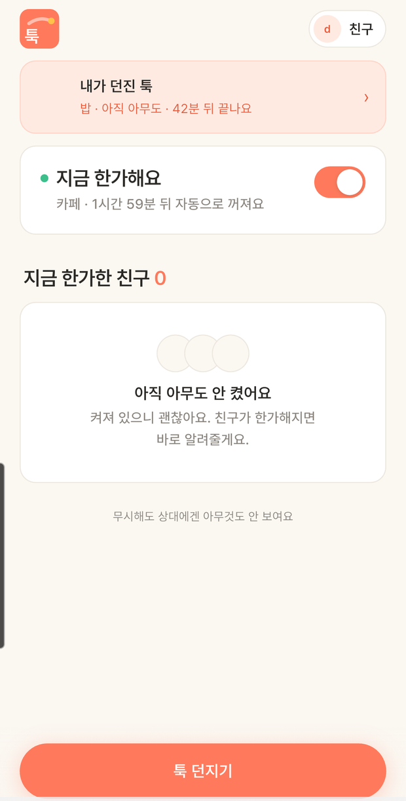 | 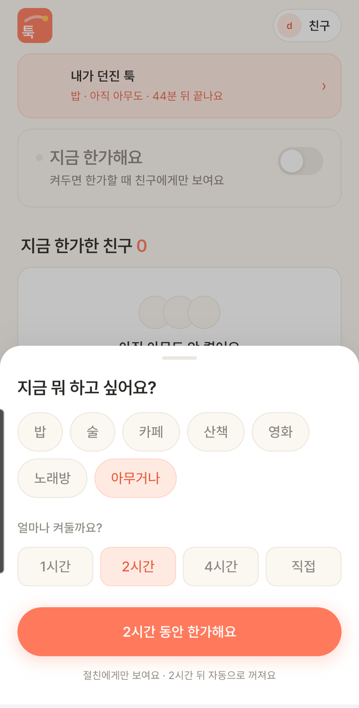 |


**비포 재현 불가(현재 코드에 없음).** 대체: `git diff ad1e70e f5174ea -- lib/` 또는 `git checkout ad1e70e -- lib/` 후 빌드.

### 테스트
- `flutter analyze` 무이슈, 실기기에서 토글·시트·친구 칩 육안 확인

### 남은 과제
- **코드 내부 식별자는 아직 "콜"** — `CallToggle`, `callExpiryText`, `showCallOnSheet`, `call_on_sheet.dart` (UI 문구만 바꿨다)
- `친구` / `내 절친` / `친구 추가` 가 한 화면에 혼재 — 용어 통일 미정

---

## 4. 오류 문구에서 개발자 말투 걷어내기 ⚙️ 🐞

### 배경/문제
로그인이 실패하면 **"서버가 켜져 있는지 확인해주세요"** 라고 띄웠다.
사용자는 서버가 뭔지도, 어떻게 확인하는지도 모른다. 비행기 모드나 지하철에서도 같은 문구가 떴다.

### 선정 이유
그 줄만 고치면 다른 화면에서 또 난다. **원인은 로그인이 아니라 구조**였다 — `ApiClient`가 4xx/5xx만 감싸서, **서버에 닿지 못한 경우엔 `DioException`이 그대로 새어나가** 화면마다 제각각 문구를 지어내고 있었다.

### 구현/해결 내용
- `ApiClient._request()`가 **모든** `DioException`을 `ApiException`으로 번역 — 한 곳에서만 문구를 만든다
- 최상위 `connectionMessageFor(DioExceptionType)` — 타입별 해요체 문구, 상태 코드·"서버"·"Dio" 미노출
- 커밋 `fca7876`

### Before / After


**비포 재현 가능**: 로컬 서버를 끄고 dev 로그인. 애프터는 서버를 켜고 기기 비행기 모드.

### 테스트 🧪
- `test/api_error_message_test.dart` — **모든 `DioExceptionType`** 에 대해 "서버"·"Dio"·상태 코드가 새지 않고 해요체로 끝나는지 검사
- 개발자 말투가 다시 들어오면 CI에서 걸린다

---

## 5. 모임방 약속 시간 🆕 🧭

### 배경/문제
모임방은 **장소는 기억하는데 시간은 못 기억했다.** 약속을 잡고 나면 "몇 시였지"를 다시 볼 곳이 없어 반쪽짜리 메모였다.
게다가 모임방 헤더의 `21:43까지`가 **합류 마감인데 약속 시간으로 읽혔다.**

### 선정 이유
**가장 중요한 결정: 약속 시간을 정해도 만료를 늘리지 않는다.**

| 대안 | 판단 |
|---|---|
| `meetAt`에 맞춰 `expiresAt` 연장 | ❌ **"시간 지나면 알아서 꺼져요"라는 제품 약속이 무의미해진다.** 계속 미루면 끝없이 늘어난다 |
| **두 시각을 분리** | ✅ 각자 다른 일을 한다 |

| 시각 | 무엇을 정하나 | 약속을 정하면 |
|---|---|---|
| `expiresAt` | 모집 마감 — 언제까지 합류할 수 있나 | 그대로 |
| `meetAt` | 약속 시간 — 실제로 만나는 시각 | 새로 생김 |

부가 결정:
- **조율이 아니라 기록** — 시간대 투표·후보 복수 선택을 두지 않았다. 맞추는 건 카톡이 잘하고(그래서 모임방에 "카톡으로 이야기하기"가 있다), 여기는 결론을 적어두는 자리다
- **아무나 정하고 아무나 바꾼다** — 장소와 같은 규칙

### 구현/해결 내용
| 레이어 | 내용 |
|---|---|
| DB | Flyway `V3__meetup_room_meet_at.sql` — `meet_at`, `meet_at_set_by`(FK). **칸 추가만**이라 이전 버전 앱도 그대로 동작 |
| 도메인 | `MeetupRoom.setMeetAt(LocalDateTime, User)` |
| API | `PATCH /api/flashes/{id}/room/time`, 응답에 `meetAt`·`meetAtSetById`·`meetAtSetByNickname`·`expiresAt` |
| 검증 | 과거 1시간 ~ 미래 24시간. `@Future`를 **안 쓴 이유**: "8시"를 8시 정각에 누르면 거부되어 쓸 수 없다 |
| 앱 | `meet_time_sheet.dart` — 30분 단위 24칸. `itemExtent` 고정 + `initialScrollOffset`으로 **고른 시간이 열자마자 보이게** |
| 커밋 | 서버 `8fbbdb5`, 앱 `1f4c03f` |

### Before / After
| After — 모임방 | After — 시간 시트 |
|---|---|
| 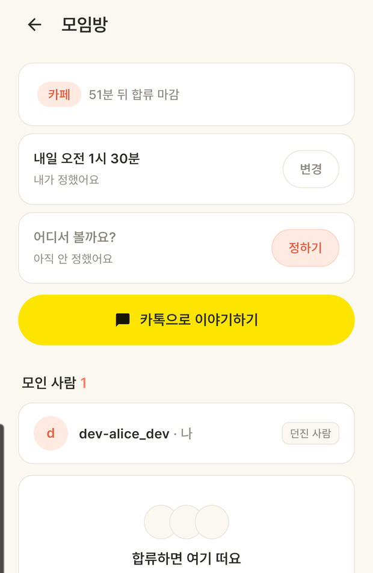 | 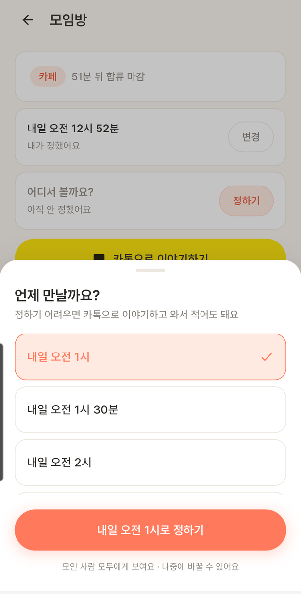 |

헤더가 `카페 · 51분 뒤 합류 마감`, 시간 카드가 `내일 오전 1시 30분 · 내가 정했어요`로 **두 시각이 라벨로 구분된다.**

### 테스트 🧪
- 서버 `setMeetAtDoesNotExtendExpiry` — **만료 미연장을 테스트로 고정**. 나중에 "약속 시간 지나면 방 닫히는데요?"라며 늘리려 할 때 걸린다
- 범위 경계(과거 1시간 직전/직후, 미래 24시간 직전/직후)
- 앱 `test/meet_time_test.dart` — 30분 경계 생성, `오늘/내일` 라벨 분기
- 같은 결정을 **테스트 · API 계약서 · 마이그레이션 주석** 세 곳에 남겼다

---

## 6. 홈 "진행 중인 모임" 여러 개 + 중복 발송 안내 🆕 🧭

### 배경/문제
"친구 한 명에게 툭을 던졌는데, 다른 세 명에게 또 던지니 앞의 게 사라진다"는 제보.
확인해보니 **서버는 처음부터 여러 개를 들고 있었다** — 홈이 `sent.first`로 **가장 최근 하나만 그리고** 있었다. 데이터는 멀쩡한데 화면만 하나였다.

### 선정 이유
| 아이디어 | 판단 |
|---|---|
| 하루 툭 발송 개수 제한 | ❌ 툭은 **절친(코드로만 추가, 검색 불가)에게만 가고 자동 만료**된다 — 구조적으로 스팸이 어렵다. 막으려는 건 개수가 아니라 **받는 사람이 시끄러운 것**이고, 사용자 0명인 지금 제한을 걸면 정상 사용자만 막힌다 |
| 모임방 리스트 **화면** 신설 | ❌ `홈 → 리스트 → 모임방` 3단계가 되어 "한 탭으로 던지는" 가벼움이 깨진다. **홈의 툭 목록이 곧 모임방 리스트다** |
| **같은 친구에게 또 던질 때 안내** | ✅ 실제 문제(모임방이 둘로 갈라져 친구가 어디로 합류할지 헷갈림)를 더 정확히 겨눈다. **막지 않고 알려만 준다** — 점심·저녁 약속을 따로 잡는 건 정상 |

**"내가 던진 툭"을 어떻게 구분할지**도 갈렸다. 처음엔 받은 툭과 한 목록으로 합치려 했다(합류한 받은 툭도 이미 내 모임이므로). 그런데 내가 띄운 건 "아무도 안 오면 어쩌지" 하는 **내 책임**이라 무게가 다르다.
→ 섹션을 둘로 쪼개지는 않고(1개씩만 있어도 헤더 두 개는 무겁다) **한 목록 안에서 줄마다 `내가 띄움` 배지**. 정작 중요한 구분은 "누가 띄웠냐"보다 **"결정이 필요하냐"** 라서, 아직 합류 안 한 받은 툭만 위에 따로 뒀다.

### 구현/해결 내용
- 홈에 `진행 중인 모임 N` 섹션 — 최대 3개 펼치고 넘치면 `+N개 더`
- 줄마다 약속 시간과 합류 마감을 함께 (`오늘 오후 11시 · 15분 뒤 합류 마감`)
- 발송 화면에 `OO님 외 2명에겐 이미 띄운 툭이 있어요 · 새로 띄우면 모임방이 따로 생겨요`
- 서버 응답에 `recipientIds` 추가 (`72f5998`) — 앱이 "누구에게 이미 띄웠는지" 알아야 안내할 수 있다
- 커밋 앱 `ab32aab`, `9890d0a`

### Before / After
| After — 모임 4개 | After — 두 시간 함께 |
|---|---|
| 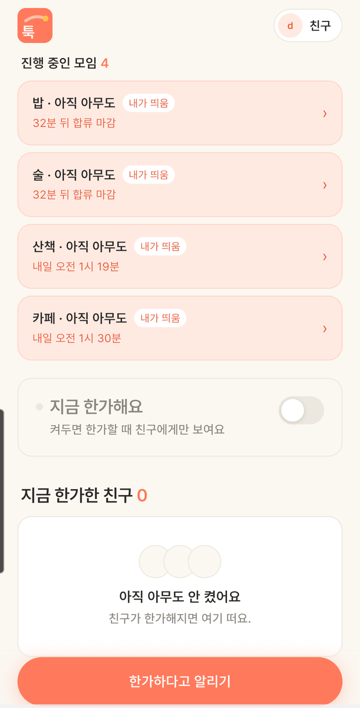 | 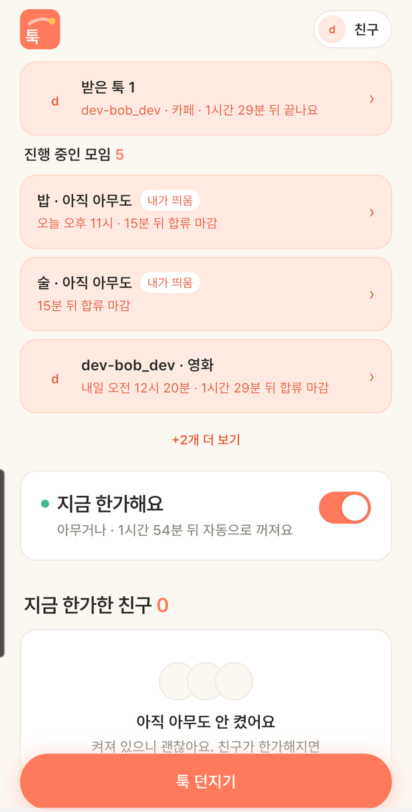 |


---

## 7. "내가 띄운 툭" 목록 N+1 제거 ⚙️

### 배경/문제
6번에서 `recipientIds`를 추가하려고 보니, 기존 코드가 **툭마다 수신자를 따로 조회**하고 있었다.
홈은 앱을 열 때마다 호출되는 화면이라 툭이 늘수록 쿼리가 비례해 늘어난다.

### 구현/해결 내용
```java
// 이전 — 툭마다 1번씩
for (Flash flash : flashes) {
    flashRecipientRepository.findByFlashIdAndStatus(flash.getId(), JOINED);  // N회
}

// 현재 — 배치 1번 (user 는 join fetch 라 닉네임도 같은 쿼리로)
Map<Long, List<FlashRecipient>> byFlashId = ...;
for (FlashRecipient r : flashRecipientRepository.findByFlashIdIn(flashIds)) { ... }
```
합류자(`joined`)와 초대받은 사람(`recipientIds`)을 **같은 결과에서 함께** 만든다. 커밋 `72f5998`.

### Before / After — 측정값

`@DataJpaTest` + Hibernate `Statistics.getPrepareStatementCount()`, 로컬 PostgreSQL, 수신자 5명 고정.

| 툭 개수 | Before | After | 감소 |
|---|---|---|---|
| 1 | 2 | **1** | −50% |
| 5 | 6 | **1** | −83% |
| 10 | 11 | **1** | −91% |
| 20 | 21 | **1** | −95% |

**Before = N+1, After = 1 (상수)** — 툭 개수와 무관해졌다.
`default_batch_fetch_size: 100`이 켜져 있어 닉네임 지연 로딩은 이전에도 1회로 묶였고, **증가분은 전부 수신자 조회였다**(그래서 N+1 중 "+1"이 닉네임, "N"이 수신자).

> 재현: `@DataJpaTest`에 `hibernate.generate_statistics=true`를 주고 두 레포지토리 메서드를 같은 데이터로 호출해 `getPrepareStatementCount()` 차이를 비교. 측정용 테스트는 일회성이라 커밋하지 않았다.

### 남은 과제
- 응답 시간은 측정하지 않았다 — 로컬·소규모 데이터라 쿼리 수가 더 정직한 지표

---

## 8. 친구 신청·수락 알림 + 보낸 신청 목록 🆕 🧭

### 배경/문제
친구 신청을 보내도 **상대는 앱을 열어보기 전까지 모른다.** 보낸 쪽도 "신청을 보냈어요" 토스트 하나가 전부라 앱을 닫으면 흔적이 없었다 — 같은 코드를 또 넣거나 "내가 신청했었나?"를 알 길이 없었다.

### 선정 이유
**"거절이 안 보이는 앱인데 친구 알림도 조용해야 하나?"** 를 검토했고 **반대라는 결론**이 났다.
알림이 없으면 상대가 앱을 안 열었을 뿐인데 며칠이 지나도 친구가 안 되니 **무응답이 거절처럼 느껴진다** — 그게 오히려 원칙을 깬다. 다만 `N일째 기다려요` 같은 재촉은 만들지 않았다.

| 아이디어 | 판단 |
|---|---|
| **알림 센터**(알림이 쌓이는 화면) | ❌ 놓친 걸 나중에 보는 장치인데 **툭은 놓치면 사라지는 게 컨셉**이다. 지난 툭이 목록에 쌓이면 랜딩의 "시간 지나면 알아서 꺼져요"와 정면으로 부딪힌다. **홈이 이미 그 역할을 한다** — 받은 툭·진행 중인 모임·친구 배지 전부 "지금 상태"지 "지나간 사건"이 아니다 |
| 친구 신청 **배지** | ✅ 숫자 하나로 충분 |
| **보낸 신청 목록** | ✅ 친구 목록 **아래** 섹션. 상대 닉네임 노출은 괜찮다 — 애초에 그 사람이 나에게 초대 코드를 건넨 사이다 |
| 친구 알림을 WebSocket/FCM으로 분기 | ❌ 번개와 달리 실시간 화면 갱신이 필요 없고, 앱이 켜져 있어도 배지는 올라가야 한다 → **FCM 한 경로**가 단순 |

문구도 골랐다: `수락 대기`가 아니라 **`기다리는 중`** — "상대가 안 해주고 있다"는 뉘앙스를 피했다. 아래엔 `수락하면 알려줄게요`.

### 구현/해결 내용
| 레이어 | 내용 |
|---|---|
| 서버 | `FriendshipEvent`(`FRIEND_REQUEST` / `FRIEND_ACCEPTED`) + `FriendshipPushListener` — 번개와 같이 `@TransactionalEventListener(AFTER_COMMIT)`라 롤백 시 유령 알림이 없다 (`e5910e2`) |
| 서버 | `GET /api/friendships/requests/sent` → `SentRequestResponse` (`df178a4`) |
| 앱 | 푸시 라우팅이 `type.startsWith('FRIEND_')`면 친구 화면으로, `friendsChanged` 알림으로 **배지 자동 갱신**(앱을 껐다 켜지 않아도 숫자가 오른다) (`38b1c36`) |
| 앱 | 친구 화면 하단 `보낸 신청` 섹션 (`cdd7efe`) |

### Before / After
| After — 배지 | After — 보낸 신청 |
|---|---|
| 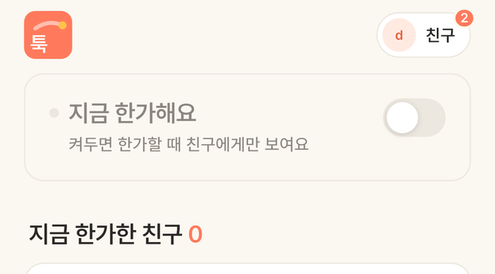 | 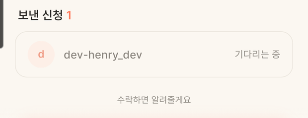 |

### 테스트 🧪
알림 방향이 헷갈리기 쉬워 **테스트로 고정**했다:

| 상황 | 알림 |
|---|---|
| 새 신청 | 받는 사람에게 `FRIEND_REQUEST` |
| 수락 | 신청한 사람에게 `FRIEND_ACCEPTED` |
| **맞신청으로 즉시 친구** | **먼저 신청한 쪽**에 `FRIEND_ACCEPTED` |
| 실패한 신청 | 알림 없음 |

---

## 9. 합류 마감 ≠ 모임 종료 ⚙️ 🐞

### 배경/문제
모임방이 둘을 한 덩어리로 봐서, **7시 약속인데 6시에 합류가 마감되면 6시부터 읽기 전용으로 박제**됐다. 비가 와서 장소를 바꾸려 해도 앱에서는 못 바꿨다.
그런데 **서버는 원래 허용하고 있었다 — 앱만 잠그고 있었던 서버/앱 불일치.**

추가로 확인된 것:
- 만료된 모임방에서 **시간·장소가 아예 안 보였다** (의도인지 실수인지 판단 필요했다 → 실수)
- 종료 화면의 `곧 사라져요`는 **거짓말**이었다 — 스위퍼는 상태만 바꾸고 아무것도 지우지 않는다

### 구현/해결 내용
```dart
bool get _joinClosed => (_room?.status == 'CLOSED')
    || (_expiresAt != null && flashEnded(_expiresAt!));

bool get _over {
  final meetAt = _room?.meetAt;
  if (meetAt != null) return flashEnded(meetAt);   // 약속 시간이 진짜 끝
  return _joinClosed;
}
```

| 상태 | 헤더 문구 | 장소·시간 수정 |
|---|---|---|
| 모으는 중 | `32분 뒤 합류 마감` | 가능 |
| 합류 마감 | `합류는 끝났어요 · 약속은 그대로예요` | **가능** |
| 모임 종료 | `모임이 끝났어요 · 기록은 남아요` | 읽기 전용 |

- 종료 화면에 `모였던 사람` 닉네임 목록 + `같은 내용으로 다시 던지기`
- `곧 사라져요` 제거 (`c075ccb`)

### Before / After
| After — 합류 마감 | After — 모임 종료 |
|---|---|
| 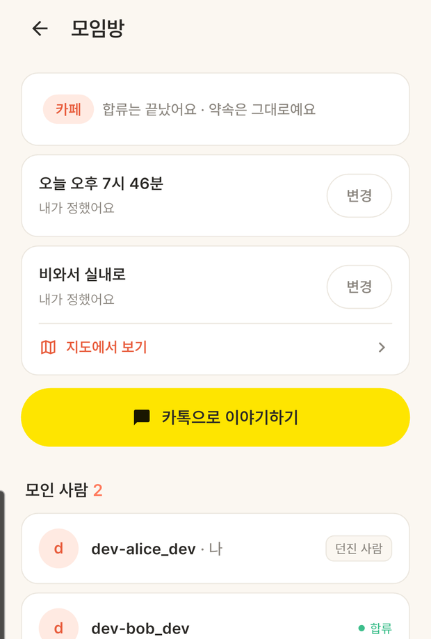 | 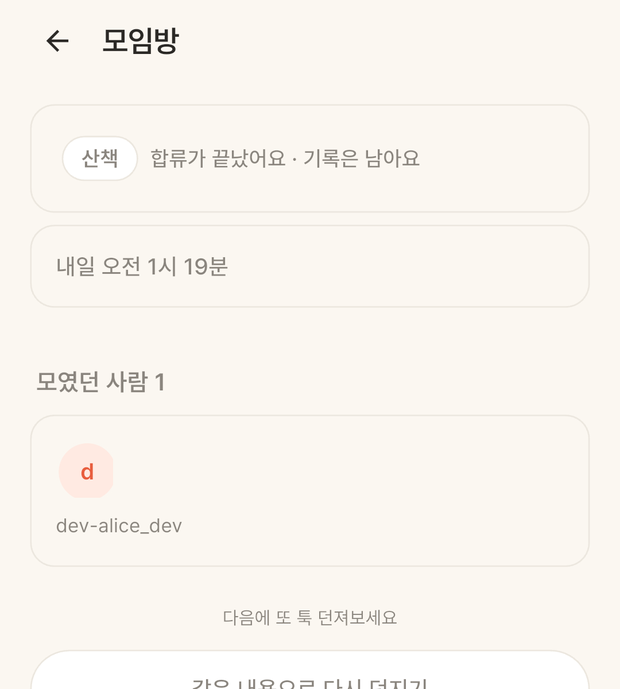 |

### 테스트 🧪
- `test/room_lifecycle_test.dart` — `_joinClosed`와 `_over`가 갈리는 경계(약속 시간 유/무 × 마감 전/후)
- 실기기: 1분짜리 툭으로 마감을 실제로 넘겨 확인

---

## 10. 마감 임박 강조 + 받은 툭 카드 탭 버그 ⚙️ 🐞

### 배경/문제
① 합류 마감이 코앞인 툭이 평범한 툭과 똑같이 생겼다.
② **카드 아무 데나 눌러도 합류됐다.** 보낸 사람 이름이나 메시지를 읽으려고 눌러도 합류.

### 선정 이유
- **빨강을 쓰지 않았다** — 재촉하지 않는 앱이라 경고색은 성격이 어긋난다. 코랄 계열 테두리를 진하게
- 강조 기준 10분 = `곧 끝나요` 기준. 둘이 어긋나면 "곧 끝나요인데 테두리는 평범한" 상태가 생긴다 → **같은 함수를 쓰는지 테스트로 묶음**
- 약속이 잡힌 모임은 강조에서 제외(이미 결론이 났다)
- 합류는 상대에게 보이고 **되돌릴 수 없다**(거절·취소가 없는 앱) → 버튼에서만 받는다. 이미 합류한 카드는 눌러도 모임방이 열릴 뿐이라 전체 탭 유지

### 구현/해결 내용
- 카드 전체가 `GestureDetector`였고 **"합류하기"는 모양만 있는 `Container`** 였다 → `_FlashCard({required onJoin})`로 콜백을 받아 `_cta`만 `GestureDetector`로 감쌌다
- 카드 레벨 탭은 `joined`일 때만 (`06b79fd`, `f737c52`)

### Before / After
| After — 마감 임박 | After — 받은 툭 |
|---|---|
| 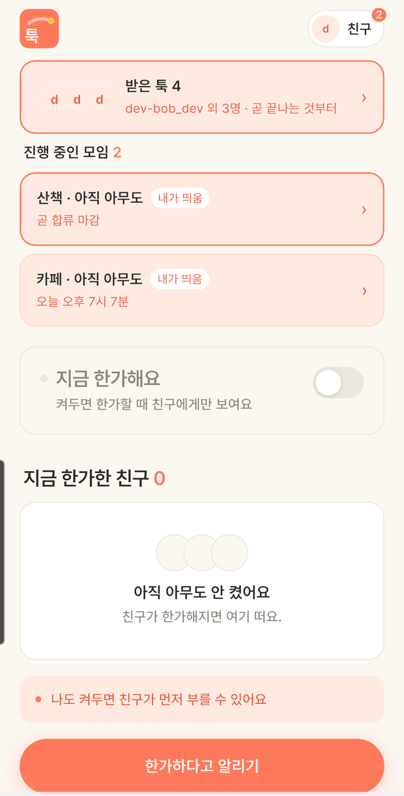 | 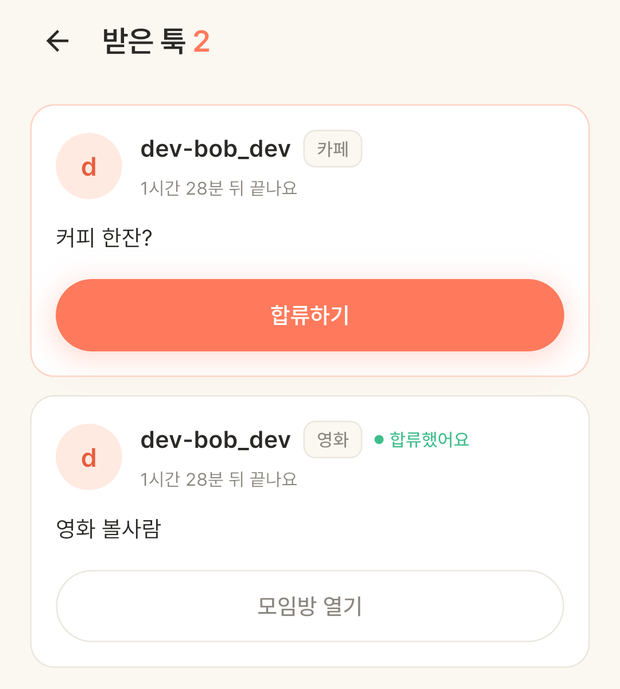 |

 — **정지 화면으로 표현 불가.** 대체: `git show f737c52 -- lib/views/received_flashes_screen.dart`의 `GestureDetector` 범위 diff.

### 테스트 🧪
- `test/flash_urgency_test.dart` — 강조 기준과 `곧 끝나요` 기준이 같은 함수인지
- 실기기: 본문·보낸이 이름·여백을 **세 번 눌러도** 서버 상태가 `PENDING` 그대로임을 API로 확인 → 버튼을 눌러 정상 합류까지 확인

---

## 11. 모임 수명 규칙 — 두 번 헛디디고 한 곳으로 🐞 🐞 ⚙️

### 배경/문제
"약속 시간이 남았으면 합류 마감 뒤에도 홈에 보인다"를 넣고 나서 **그 조건을 잘못 잡은 버그가 이틀 연속** 나왔다. 원인이 같았다 — **연장해도 되는 경우를 너무 넓게 잡은 것.**

**① 죽은 초대가 남았다 (`a13408a`)**
쿼리에 *"PENDING은 약속 시간이 있을 리 없으니 자연히 빠진다"* 는 주석까지 달아뒀는데 틀린 가정이었다 — **보낸 사람도 멤버라 약속 시간을 잡을 수 있다.**
1. alice가 bob에게 툭을 던진다 → 2. alice가 약속 시간을 3시간 뒤로 잡는다 → 3. bob은 합류하지 않고 마감 → 4. **bob의 "받은 툭"에 남고, 합류하기를 누르면 400**

**② 혼자인 방이 홈에 남았다 (`3e7f55f`)**
같은 연장 조건이 **합류자 수를 안 봤다.** 홈에 `카페 · 아직 아무도 / 오늘 오후 7시 7분` 카드가 떴다 — 누구와 만난다는 건지 알 수 없다. **약속 시간은 모인 사람들 사이의 약속**이라 혼자면 약속이 아니다.

**③ 세 번째: 시간 미정 모임이 사라졌다 (`552a02f`, `4542710`)**
합류자는 있는데 약속 시간을 아직 안 정한 모임이 마감과 동시에 사라졌다. 마감 1분 전 합류나 "시간 고민 중"은 흔한데 **정할 기회 자체가 없어졌다.**

### 선정 이유
③을 고치며 깨달은 것: **앱도 1분마다 같은 판단을 따로 하고 있었다.** 서버 규칙만 바꾸면 *서버엔 있는데 화면에서만 사라지는* 상태가 된다 — **세 버그가 전부 이 모양이었다.**

→ **규칙은 서버 한 곳(`MeetupLifecycle`)에만 두고, 응답에 `visibleUntil`을 실어 보낸다. 앱은 규칙을 갖지 않고 그 시각만 본다.**

| 상황 | 언제까지 홈에 보이나 |
|---|---|
| 성사 안 됨(합류자 0 / 나는 합류 전) | 합류 마감까지 |
| 성사 + 약속 시간 있음 | 마감과 약속 중 **늦은 쪽** |
| 성사 + 시간 미정 | 마감 후 **6시간** (`UNSCHEDULED_GRACE`) |

6시간인 이유: 툭은 즉흥 모임이라 **당일이면 충분**하다.
`아직 시간 안 정하셨어요` 같은 리마인드는 만들지 않았다 — **홈에 남아 있는 것 자체가 신호다.**

### 구현/해결 내용
- 연장 조건을 `JOINED 수신자` + `합류자 ≥ 1`로 좁힘 → 이후 `MeetupLifecycle`로 통합
- 목록 쿼리 두 곳(`FlashRepository`·`FlashRecipientRepository`)이 같은 클래스를 따른다
- 앱은 `visibleUntil`만 따르고, 없는(옛 서버) 응답이면 기존 기준으로 대신 — **업데이트 안 한 앱도 깨지지 않는다**
- 정렬: 지난 마감 시각을 기준으로 잡으면 **시간 미정 모임이 맨 위로 올라와서**(가장 확정 안 된 게 가장 위) 시간이 정해진 모임 뒤로 보냈다
- 카드 문구 `시간 미정 · 합류는 끝났어요`
- 커밋 메시지에 앞선 커밋 해시를 적어, **다음에 이 쿼리를 건드릴 때 같은 자리임을 알 수 있게** 했다

### Before / After
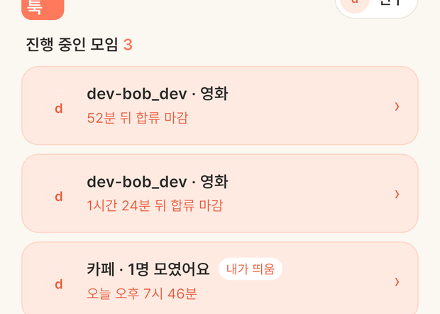

`아직 아무도`짜리는 마감과 함께 정리되고 `1명 모였어요`만 남는다.


**비포 재현 어려움**(서버 롤백 + 1분 툭 + 마감 대기 필요). 대체: `git show 3e7f55f` 쿼리 diff와 커밋 메시지.

### 테스트 🧪
- 서버: 6시간 경계(1시간 전 → 남음 / 7시간 전 → 사라짐 / 미합류 → 연장 없음)를 **받은 쪽·보낸 쪽 각각**, `MeetupLifecycleTest` 단위 테스트
- `findActiveReceived` 슬라이스 테스트가 **이미 만료 처리된 툭이 새어드는 것**을 잡아냈다(조건에서 status를 통째로 빼서 생긴 문제) → "(ACTIVE이고 마감 전) 또는 (약속이 남음)" 두 갈래로 분리
- 앱 `test/meetup_lifetime_test.dart`
- 실기기: **1분짜리 툭을 만들어 마감이 지나기를 실제로 기다려** 목록에 남는지 확인 (만료 스위퍼가 60초 주기라 스윕까지 기다려야 진짜 동작을 본다)

---

## 12. 카카오맵에서 장소가 안 열림 🐞

### 배경/문제
검색으로 고른 장소를 "지도에서 보기 → 카카오맵"으로 열면 **"네트워크 연결" 오류 뒤 빈 지도.**
직접 입력한 장소("홍대입구역")와 네이버 지도는 정상이라 처음엔 **그 순간의 폰 네트워크를 의심했다.**

### 구현/해결 내용
실기기에 링크를 하나씩 직접 던져 비교했다. 저장된 장소 ID는 정상이었다(홍대입구역 2호선 = `21160589`).

| 링크 | 결과 |
|---|---|
| `kakaomap://place?id=21160589` | ❌ 오류 후 기본 지도 |
| `https://place.map.kakao.com/21160589` (앱 링크) | ❌ 오류 후 기본 지도 |
| `kakaomap://look?p=좌표` | ⚠️ 주소 핀만("동교동 155-55") — 장소가 아님 |
| **`kakaomap://search?q=이름&p=좌표`** | ✅ **그 장소가 맨 위에 핀과 함께** (역·카페 모두) |

**공식 문서 형식 그대로인데도 깨졌다.** 열흘 전(09-18)엔 `place?id=`가 가게 페이지를 열었으니 **그 사이 카카오맵 6.29 업데이트로 깨진 것.**

- 카카오맵 앱은 항상 이름 검색, 좌표가 있으면 `p=`로 그 근처 기준
- `look?p=`도 같은 방식으로 통일
- **장소 ID는 앱이 없을 때 여는 웹 링크에만** 남김
- 네이버 지도는 변경 없음 (`8d860b8`)

### Before / After
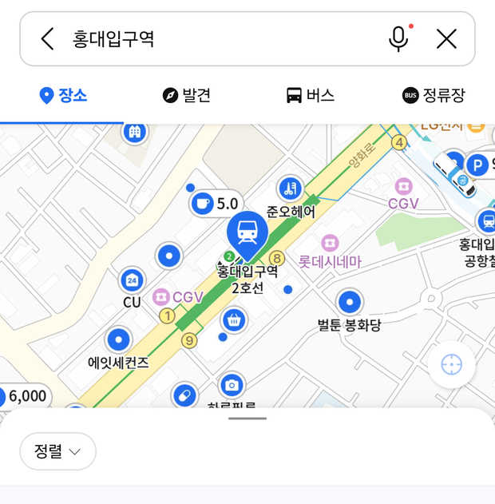


**비포 재현 가능**: `adb shell am start -a android.intent.action.VIEW -d 'kakaomap://place?id=21160589'`

### 테스트 🧪
- `test/map_links_test.dart` — 링크 생성 규칙(좌표 유/무, 앱/웹)
- 실기기에서 위 4종 링크를 직접 던져 비교

### 남은 과제
- **카톡 공유 카드의 지도 버튼은 아직 `place.map.kakao.com/{id}`** — 카톡 인앱 브라우저로 열려 영향이 다를 수 있는데 미확인

### 교훈
남의 앱 URL 스킴은 **문서가 아니라 기기에서** 확인하고, **업데이트로 조용히 깨질 수 있다**는 걸 전제로 한다. 가장 단순한 경로(이름 검색)가 가장 오래 버틴다.

---

## 13. 장소·시간 변경 알림 + 백그라운드 알림 유실 🆕 🐞

### 배경/문제
장소나 약속 시간이 바뀌어도 **방에 다시 들어가야만 보였다.** 바뀐 걸 모르면 7시에 옛 장소로 가는 사고가 난다.

### 선정 이유
| 결정 | 이유 |
|---|---|
| **처음 정함 / 바꿈을 구분** | `정해졌어요`는 정보, `바뀌었어요`는 경고다. 바뀐 경우엔 **이전 값을 같이** 보여줘야 "어디서 어디로"가 한눈에 보인다 (`합정역 → 망원역`) |
| 정한 본인은 제외 | 내가 방금 한 일을 알림으로 받으면 소음이다 |
| 같은 값 재저장은 알림 없음 | 저장 버튼을 두 번 누른 걸로 친구 폰이 울리면 안 된다 |
| `아직 안 정했어요` 리마인드 | ❌ 재촉이다 |

### 구현/해결 내용
| 레이어 | 내용 |
|---|---|
| 서버 | `PLACE_UPDATED` / `MEET_AT_UPDATED` 이벤트. 합류 알림과 대상 계산이 같아 `publishToOtherMembers`로 묶음. 푸시 시간 표기(`MeetTimeLabel`)는 앱 `meetTimeLabel`과 같은 모양 — 같은 날이면 날짜를 한 번만 (`4267f9c`) |
| 앱 | 방 안: 바로 다시 불러오고 `OO님이 장소를 바꿨어요 · 망원역` 토스트 / 방 밖(앱 켜짐): 홈 갱신 + 같은 토스트 / 알림 탭 → 그 모임방 (`ae17d46`) |
| 앱 | **그 방을 보고 있으면 방이 이미 알리므로 루트는 건너뛴다**(`RoomScreen.isOpen`) — 토스트 두 번 방지 |

### 🐞 만들다 발견한 더 큰 버그
**앱을 홈 버튼으로 내려놓으면 알림이 아무 데도 뜨지 않았다 — 푸시가 가장 필요한 바로 그 상황에서.**

원인은 알림이 아니라 **연결**이었다. 앱이 백그라운드로 가도 STOMP 연결을 끊지 않아 **서버는 계속 "접속 중"으로 보고 FCM 대신 WebSocket으로 보냈는데, 화면에 없는 앱은 그걸 보여줄 수 없다.** 서버 로그에 홈 버튼을 눌러도 `오프라인 0명`이 찍히는 걸 보고 확인했다.

**이번 알림만의 문제가 아니었다 — 새 툭 알림도 같은 이유로 놓칠 수 있었다. 이 기능을 만들지 않았으면 못 찾았을 버그다.**

수정: `paused`에서 끊고 `resumed`에서 다시 붙이며 그사이 변화를 다시 불러온다(홈 목록·친구·열려 있던 모임방). `inactive`(알림창 내림 등)는 잠깐이라 무시 — 여기서 끊으면 연결이 쉴 새 없이 끊겼다 붙는다.

### Before / After


**재현 가능(계정 2개 필요)**: A가 장소 변경 → B 화면 확인. 백그라운드는 B에서 홈 버튼을 누른 뒤 A가 변경.

| 측정 | Before | After |
|---|---|---|
| 백그라운드 상태에서 알림 도달 | **0 / 4 경로** | **4 / 4 경로** |

### 테스트 🧪
실기기 4경로: 홈 토스트 · 방 안 즉시 반영 · **백그라운드 FCM 배너** · 배너 탭 → 최신 상태의 모임방.
*실제 FCM 배너를 실기기에서 처음 확인한 날이기도 하다.*

---

## 14. 테스트 현황 🧪

| 리포 | Before(09-22) | After(09-29) |
|---|---|---|
| `tuk-server` (`@Test`) | 98 | **125** |
| `tuk-app` (`test()`) | 23 | **47** |

이 기간에 추가된 앱 테스트 파일:
`meetup_room_test.dart` · `meet_time_test.dart` · `meetup_lifetime_test.dart` · `api_error_message_test.dart` · `flash_urgency_test.dart` · `room_lifecycle_test.dart` · `map_links_test.dart`

**테스트를 "결정을 고정하는 장치"로 썼다**는 점이 특징이다 — `setMeetAtDoesNotExtendExpiry`(만료 미연장), 오류 문구 전 타입 검사(개발자 말투 재유입 차단), 강조 기준 일치 검사가 그 예다.

### 실기기 검증 방식
- 로컬 백엔드 + `adb reverse`, dev 로그인으로 여러 계정 전환
- **시간이 걸리는 것은 실제로 기다려서** 확인 — 1분짜리 툭을 만들고 만료 스위퍼(60초 주기)가 돌 때까지
- 딥링크·외부 앱 스킴은 `adb shell am start`로 앱을 거치지 않고 직접

---

## 경력기술서용 요약

> 문제 → 행동 → 결과

1. **홈 목록 N+1 쿼리** — 툭마다 수신자를 개별 조회해 쿼리가 선형 증가하던 것을, `IN` 절 + `join fetch` 배치 조회로 전환. **쿼리 수를 N+1 → 1(상수)로 고정**(툭 20개 기준 21 → 1, 95% 감소), Hibernate `Statistics`로 측정 검증.

2. **백그라운드 푸시 알림 유실** — 앱이 백그라운드에서도 STOMP 연결을 유지해 서버가 "접속 중"으로 판단, FCM 대신 WebSocket으로 보내 **알림이 전혀 표시되지 않던 문제**를 서버 세션 로그로 진단. 생명주기(`paused`/`resumed`) 연동으로 **백그라운드 알림 도달률 0/4 → 4/4**, 기존 번개 알림의 잠재적 유실까지 함께 해결.

3. **모임 수명 규칙 중복** — 서버와 앱이 같은 판단을 각자 수행해 "서버엔 있는데 화면에서만 사라지는" 버그가 3회 반복. 규칙을 서버 단일 클래스(`MeetupLifecycle`)로 통합하고 `visibleUntil`을 응답에 포함해 **클라이언트에서 규칙 제거**, 구버전 앱 호환(fallback) 유지.

4. **스키마 변경 무중단 배포** — 약속 시간 기능을 위해 Flyway `V3` 마이그레이션을 **칸 추가 전용**으로 설계, 구버전 앱 호환을 유지한 채 CI/CD(GitHub Actions → GHCR → SSH 배포)로 운영 반영.

5. **설계 결정의 회귀 방지** — "약속 시간이 만료를 연장하지 않는다"는 제품 원칙을 **테스트·API 계약서·마이그레이션 주석 3곳에 고정**해 이후 수정 시 자동 검출되도록 구성.

6. **사용자 문구 일원화** — 연결 실패 예외가 화면까지 그대로 노출돼 "서버가 켜져 있는지 확인해주세요" 같은 개발자 문구가 사용자에게 보이던 구조를, HTTP 클라이언트 단일 지점 번역으로 전환. **전 예외 타입에 대한 문구 검사 테스트**로 재발 차단.

7. **외부 앱 연동 장애 대응** — 카카오맵 6.29 업데이트로 장소 ID 딥링크가 동작 중단된 것을 **실기기 링크 4종 비교 실험**으로 특정하고, 좌표 기반 검색 스킴으로 전환해 복구.

8. **제품 원칙 기반 기능 선별** — 일일 발송 제한 · 모임방 목록 화면 · 알림 센터를 각각 "구조적으로 불필요 / 탐색 깊이 증가 / 자동 만료 컨셉과 충돌"로 판단해 **구현하지 않는 결정**을 내리고, 대신 중복 발송 안내 · 홈 통합 목록으로 실제 문제를 해결.

---

## 이번 작업으로 수정·생성한 파일

### 생성
| 파일 | 내용 |
|---|---|
| `tuk-app/docs/FEATURE_NOTES_2026-09-22_09-29.md` | 이 문서 |
| `tuk-app/docs/images/` | 캡처 19장 (아래) |

### 수정
| 파일 | 내용 |
|---|---|
| `tuk-server/docs/API_FOR_APP.md` | `GET /api/friendships/requests/sent` 행 추가 · 친구 알림(`FRIEND_REQUEST`/`FRIEND_ACCEPTED`) 푸시 타입 표 추가 |

> `DEV_LOG.md`는 13개 항목이 **이미 모두 작성돼 있어 손대지 않았다**(L826~L1158).

### 캡처 목록 (`docs/images/`)
`share-expiry-before.png` · `share-card-after.png` · `share-room-after.png` · `share-invite-after.png` · `term-toggle-after.png` · `term-sheet-after.png` · `meettime-room-after.png` · `meettime-sheet.png` · `home-many-after.png` · `home-both-times.png` · `dup-notice.png` · `friend-badge.png` · `sent-request.png` · `lifecycle-joinclosed.png` · `lifecycle-ended.png` · `urgent-border.png` · `received-list.png` · `ghost-card-after.png` · `kakaomap-after.png`

### 아직 없는 캡처 (`![TODO:]` 자리)
| 파일명 | 재현 |
|---|---|
| `login-error-before.png` / `-after.png` | 로컬 서버 끄고 dev 로그인 / 서버 켜고 비행기 모드 |
| `kakaomap-before.png` | `adb shell am start -a android.intent.action.VIEW -d 'kakaomap://place?id=21160589'` |
| `notify-toast.png` / `notify-fcm-banner.png` | 계정 2개, A가 장소·시간 변경 → B 확인 (백그라운드는 B에서 홈 버튼 후) |
| `term-toggle-before.png` | `git checkout ad1e70e -- lib/` 후 빌드 — **코드 diff 대체 권장** |
| `ghost-card-before.png` | 서버 롤백 필요 — **커밋 diff 대체 권장** |
| `card-tap-before.png` | 정지 화면으로 표현 불가 — **코드 diff 대체** |
| `ios-push-banner.png` | **Mac 없이 불가** |
