# 기능 정리본 — 2026-09-30 ~ 10-07

친구들에게 릴리스 APK 를 건네기까지(탈퇴·친구 끊기·알림 다듬기·릴리스 준비)와, 실사용이 시작된 뒤 운영 안전망(외부 백업·모니터링)을 붙인 작업을 기능 단위로 정리한다.
시간순 개발 기록은 [`DEV_LOG.md`](DEV_LOG.md)에 있고, 이 문서는 **배경 → 선정 이유 → 구현 → Before/After → 테스트** 구조로 다시 묶은 것이다.
바로 앞 기간(09-22 ~ 09-29, 6시간 유지 규칙·카카오맵·장소·시간 알림 포함)은 [`FEATURE_NOTES_2026-09-22_09-29.md`](FEATURE_NOTES_2026-09-22_09-29.md).

- 범위: 앱 `tuk-app` 10커밋 + 서버 `tuk-server` 12커밋
- 테스트: 서버 125 → **137개**, 앱 47 → **56개**
- 캡처: `docs/images/`. 화면은 로컬 개발 서버 + dev 계정, 실기기(갤럭시 S25). "전" 화면 일부는 10-12 에 당시 커밋을 따로 빌드해 재현. 터미널·사이트 캡처는 버킷 이름·IP·메일을 가림
- `![TODO: …]` 는 아직 없는 캡처 자리, **확인 필요** 는 기록이 남아 있지 않아 지어내지 않은 부분

> 분류 표기: 🆕 신규 기능 · 🧭 설계/선정 · ⚙️ 개선 · 🐞 오류 해결 · 🧪 테스트

---

## 1. D3 옛 실험 코드 정리 ⚙️

### 배경/문제
리포에 추적 안 하는 옛 실험(스파이크) 파일이 남아 `flutter analyze` 에 에러가 섞여 나왔다. 진짜 문제가 묻힌다.

### 구현/해결 내용
지우지 않고 리포 밖 `C:\Users\A\tuk-spike-backup\` 으로 옮겼다(나중에 참고할 수 있게).

### Before / After
analyze 에러 **확인 필요 → 0**. 정리 전 에러 개수는 기록이 남아 있지 않다(확인 필요).

### 테스트 🧪
`flutter analyze` 에러 0.

### 남은 과제
없음.

---

## 2. B1 첫 친구가 생겨도 "친구 0명" 화면에 머묾 🐞

### 배경/문제
친구 수(홈 ↔ 콜드스타트 화면을 가르는 값)를 `PresenceViewModel` 이 로그인 때 한 번만 셌다. 수락하거나 상대가 받아 줘도 0 그대로라 **앱을 다시 켜야** 홈이 나왔다. 새 사용자가 가장 먼저 겪는 경로.

### 구현/해결 내용
`FriendViewModel` 이 바뀌면 `syncFriendCount` 로 맞춘다. 처음 불러오기 전·중엔 건드리지 않는다(빈 목록으로 보여 콜드스타트가 깜빡일 수 있음). 친구가 늘면 "지금 한가한 친구"도 다시 불러온다(앱 `3085308`).

### Before / After
| Before: 수락 후에도 친구 0명 화면 | After: 재시작 없이 홈 |
|---|---|
|  | 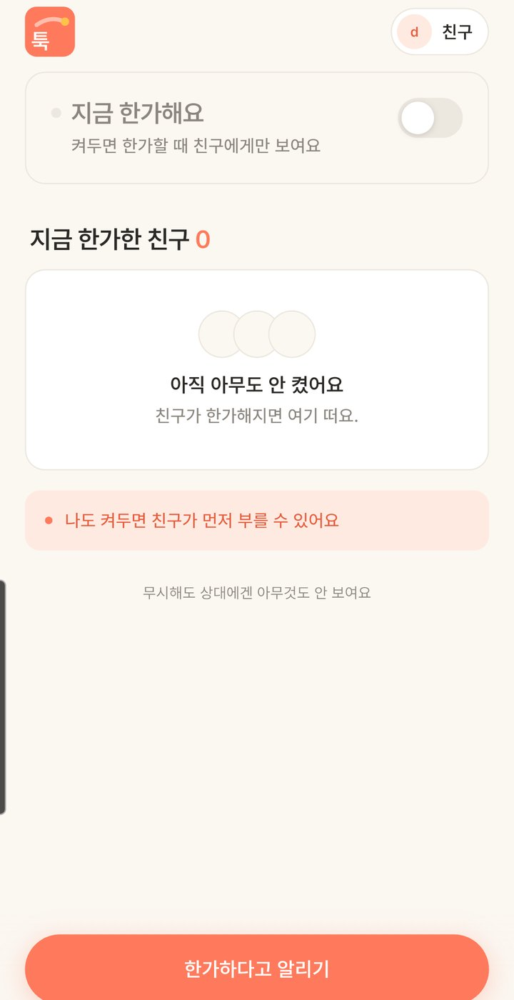 |

### 테스트 🧪
실기기 — 친구 0명 dora 가 콜드스타트에 있는 상태에서 alice 가 수락 → 친구 수락 푸시 → 재시작 없이 홈.

### 남은 과제
없음.

---

## 3. A2 이용약관·개인정보 처리방침 페이지 🆕

### 배경/문제
랜딩에 "계속하면 이용약관·개인정보 처리방침에 동의합니다"라고 써 두고 볼 수 있는 페이지가 없었다. 밑줄 링크는 눌러도 반응이 없었다.

### 선정 이유
처리방침은 **실제로 받는 것만** 적었다(카카오 회원번호·닉네임·프로필 사진 주소, 이용 중 생기는 정보, 기기 토큰, 접속 기록). 권한은 알림 하나라 위치·연락처는 안 받는다고 명시. 운영자 표기 "툭 운영자"와 연락처는 사용자 결정.

### 구현/해결 내용
서버 `public/terms.html`·`privacy.html` + Caddy 경로(`df9250b`). 앱은 인앱 브라우저로 연다, 로컬 개발 중에도 운영 주소(`ShareConfig.webBase`) 사용(`ec0899a`).

### Before / After
| Before | After |
|---|---|
|  | 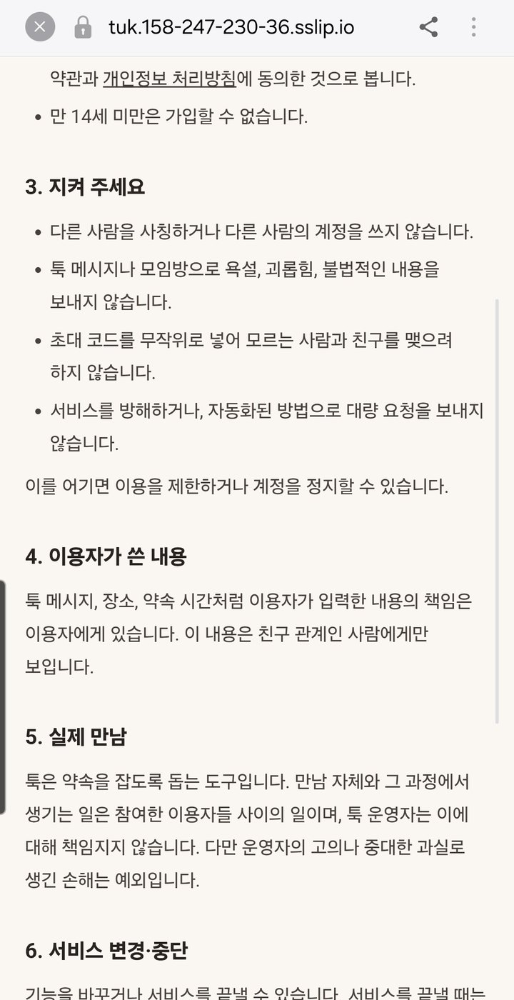 |

### 테스트 🧪
운영 배포 후 실기기에서 랜딩 링크 → 페이지 열림.

### 남은 과제
위탁처가 늘 때마다 갱신(10-02 Crashlytics, 10-07 Backblaze 추가됨).

---

## 4. A4 초대 코드 입력 횟수 제한 🆕

### 배경/문제
코드만 맞히면 모르는 사람에게 친구 신청이 가는데 입력 횟수 제한이 없었다. 코드 공간(31⁸)은 사람이 손으로 못 맞히지만 스크립트로 두드리는 건 막아야 한다.

### 선정 이유
**틀린 코드만** 센다(제대로 받은 코드를 넣는 사람은 거의 안 틀린다). 첫 실패에만 `EXPIRE` 를 걸어 창이 밀리지 않게.

### 구현/해결 내용
`InviteCodeAttemptLimiter` — Redis `INCR` + 첫 실패 시 `EXPIRE 600`. 한도에 닿으면 코드를 조회하지도 않고 429(`TooManyRequestsException`)(서버 `073b9ce`).

### Before / After
수치로 대신한다.
| | Before | After |
|---|---|---|
| 틀린 코드 11번 | 11번 모두 404 | 1~10번 404, **11번째 429** |
| 제한 창 | 없음 | 10분(키 TTL 600초) |


### 테스트 🧪
`InviteCodeAttemptLimiterTest`, 로컬 Redis 로 404×10 → 429, TTL 600초 확인.

### 남은 과제
없음.

---

## 5. A1 계정 탈퇴 🆕 🧭

### 배경/문제
스토어에 안 올려도 필요하다. 처리방침이 탈퇴 방법을 약속하고, 개인정보를 받는 이상 지울 길이 있어야 한다(사용자 질문 "Play 에 안 올려도 필요한 기능이야?"에 대한 답).

### 선정 이유
| 대상 | 선택 | 이유 |
|---|---|---|
| 남의 툭에 받은 초대·합류 | 삭제 | "탈퇴한 사용자"로 남기면 이름 없는 유령 멤버가 된다 |
| 남의 방에서 내가 "정한 사람" | 비움, 장소·시간은 유지 | 장소는 그 방의 것 |
| 친구 관계 | 삭제, 알림 없음 | "거절 안 보임"과 같은 결 |

### 구현/해결 내용
`DELETE /api/users/me` + `AccountDeletionService`. 외래키에 CASCADE 가 없어 **자식 → 부모 순 벌크 삭제**를 한 트랜잭션(TransactionTemplate)으로, Redis 는 밖에서. "한가해요"는 친구 관계를 지우기 전에 꺼야 누구에게 알릴지 안다. 앱: 친구 ⋯ → 확인 시트 → 서버 삭제 → 카카오 연결 끊기(SDK) → 랜딩(서버 `d927091`, 앱 `a9ee0b1`).

### Before / After
| 메뉴 | 확인 시트 | 탈퇴 후 | 상대 방은 남음 |
|---|---|---|---|
| 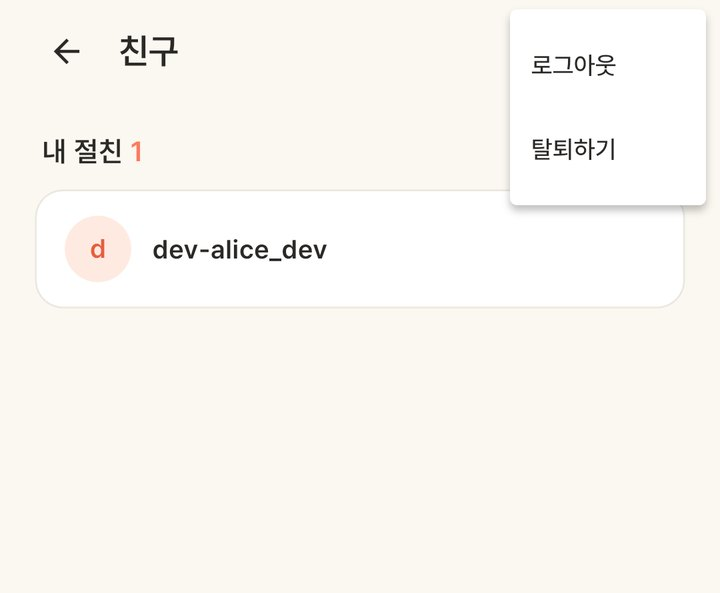 | 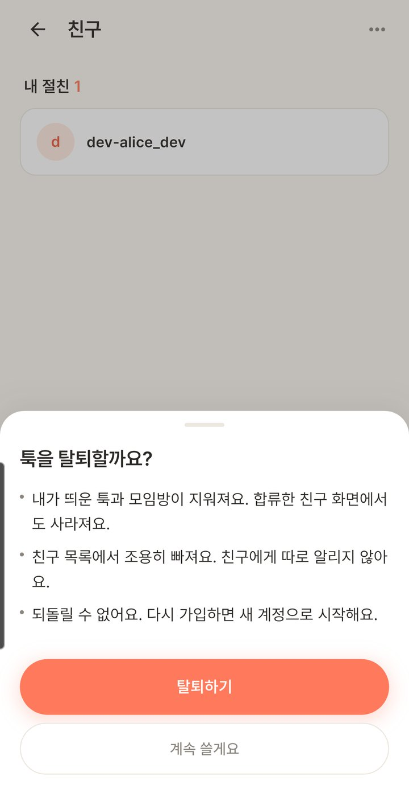 | 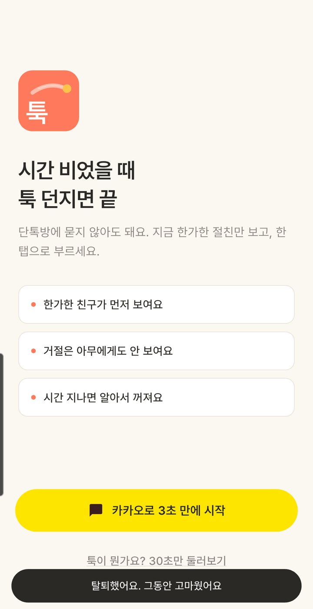 | 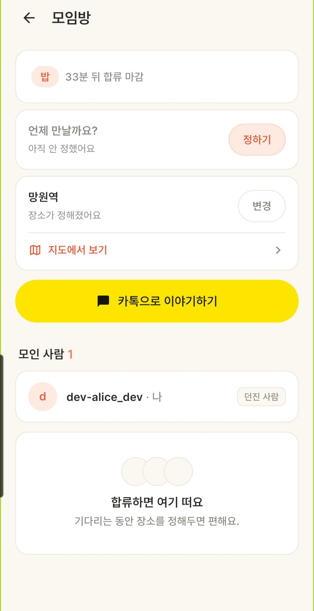 |

### 테스트 🧪
`AccountDeletionServiceTest`(@SpringBootTest, 실제 DB). **삭제 한 줄을 일부러 빼면 외래키 위반으로 실패하는 것 확인**(모킹이면 못 잡는 순서 실수). 실기기: dora 탈퇴 → alice 쪽 친구·받은 툭에서 사라짐, dora 의 방 404, alice 의 방은 남고 dora 만 빠짐.

### 남은 과제
카카오 연결 끊기 **미검증** — 개발 계정은 카카오 계정이 아니고, 실계정으로 하면 운영 계정이 지워진다.

---

## 6. A3 친구 끊기 · 보낸 신청 취소 🆕 🧭

### 배경/문제
친구끼리 쓰는 앱인데 관계를 정리할 수단이 없었다.

### 선정 이유
| 대안 | 판단 |
|---|---|
| 한쪽만 숨기기 | "보낸 툭이 계속 무응답"인 이상한 상태가 생긴다 → 기각 |
| **관계 삭제** | 양쪽 목록에서 조용히 사라짐, 알림 없음 → 채택(사용자 결정) |
| 받은 신청 "거절" API | 상대의 "보낸 신청"에서 사라져 **거절이 드러난다**(원칙 1) → 만들지 않음 |
| 보낸 신청 "취소" | 내 행동이라 드러날 게 없다 → 채택, 확인 없이 바로(코드 다시 넣으면 복구 가능) |

### 구현/해결 내용
`DELETE /api/friendships/friends/{id}`, `DELETE /api/friendships/requests/{id}`(내가 보낸 PENDING 만, 남의 것 403). 앱은 낙관적 삭제 없이 서버가 끝낸 뒤 목록 갱신, 마지막 친구를 끊으면 콜드스타트로. 확인 시트는 `widgets/confirm_sheet.dart` 로 공용화(서버 `cd068b4`, 앱 `471516e`).

### Before / After
| 친구 목록 | 끊기 시트 | 끊은 뒤 | 신청 취소 |
|---|---|---|---|
| 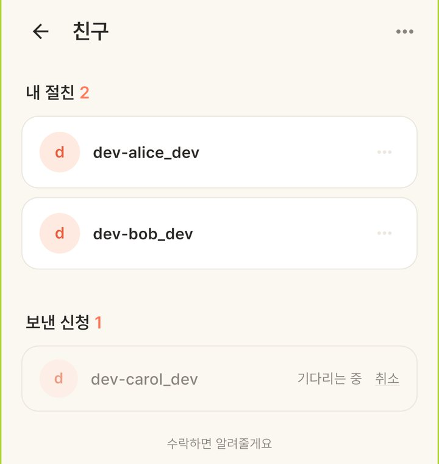 | 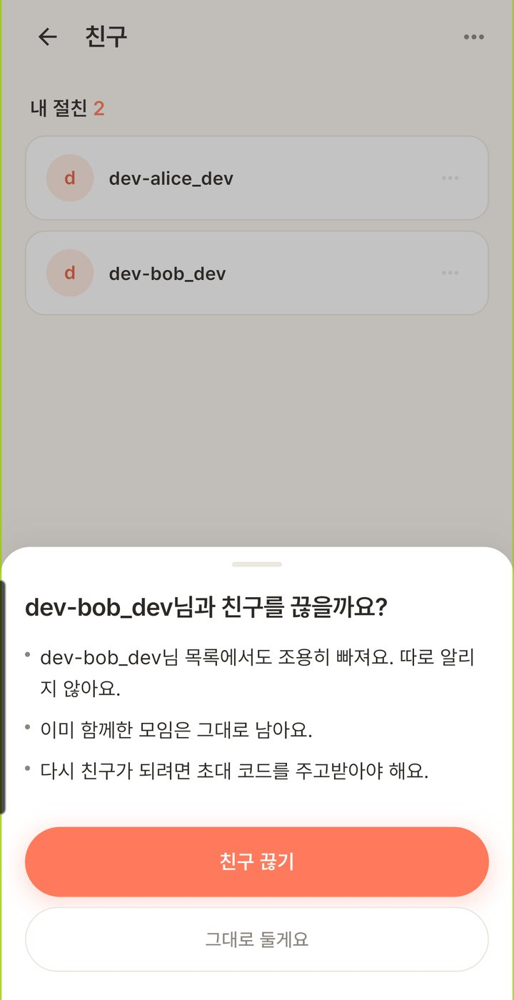 | 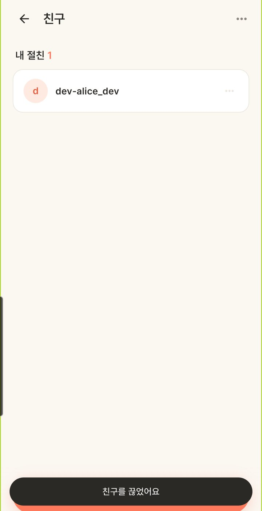 | 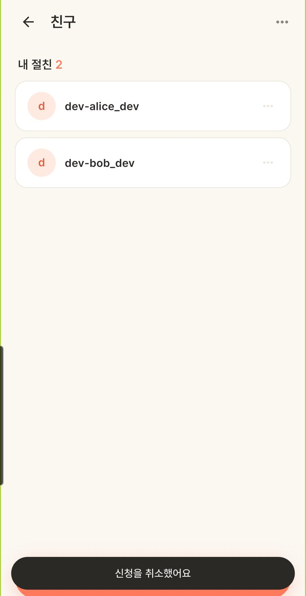 |

### 테스트 🧪
서비스 테스트(남의 신청 403, 이미 친구 400, 친구 아님 404). 실기기: erin 이 carol 신청 취소 → 목록에서 빠짐, bob 끊기 → 목록 1명, 서버에서 양쪽 목록 확인.

### 남은 과제
끊은 사이에 오간 **합류 전 초대**가 남는다(사용자 결정으로 다음 작업으로 미룸).

---

## 7. 동사 "띄우다 vs 던지다" 판단 🧭

### 배경/문제
장소·시간 알림 작업 중 사용자 질문 — "툭 띄운다보다 던진다라는 표현이 더 맞아? 어색하지 않고? 우리 컨셉에 맞고?"

### 선정 이유
"던지다"를 유지했다. 9/22 에 이미 "던지다"로 통일했고, 이번엔 그 뒤에 만든 화면에서 다시 섞인 "띄우다"를 찾아 정리했다. 질문에 답하며 비교한 세부 근거는 이 대화 기록에 원문이 남아 있지 않아 **확인 필요**.

### 구현/해결 내용
앱 "띄우다" 잔재 7곳 → "던지다"(홈 배지 "내가 던짐", 중복 발송 안내 등)(`3a8b49f`).

### Before / After
아래 "번개 → 툭" 캡처와 함께 본다.

### 테스트 🧪
화면 문구 grep.

### 남은 과제
없음.

---

## 8. 푸시·오류 문구에 남은 옛 이름 "번개" 🐞

### 배경/문제
알림창에 "dev-alice_dev님의 번개", "번개 합류"가 떴다(사용자 캡처 제보). 9/22 에 앱 문구는 정리했는데 **서버가 만드는 문구**가 빠져 있었다.

### 구현/해결 내용
새 툭 "OO님이 툭 던졌어요"(본문 메시지 또는 "지금 볼래?"), 오류 "초대받지 않은 툭이에요." 등 해요체(서버 `ba32962`).

### Before / After
| Before | After | 홈 배지 |
|---|---|---|
| 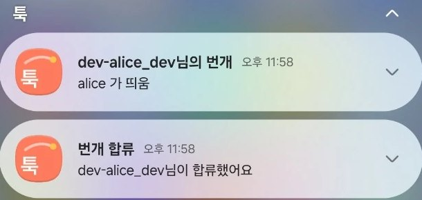 | 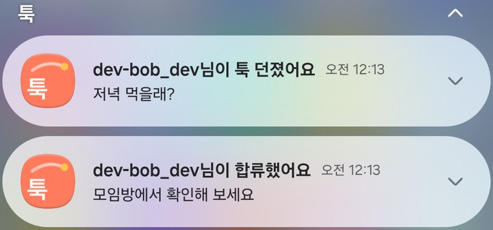 | 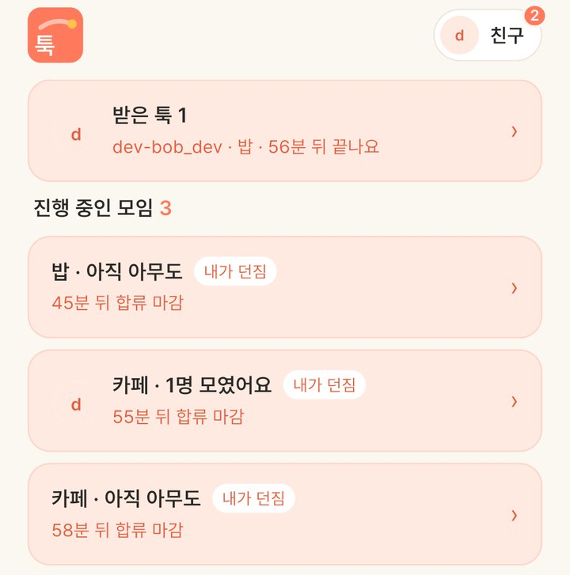 |

### 테스트 🧪
**모든 푸시 종류의 제목·본문에 "번개"가 없는지** 테스트로 고정. 실기기 알림 배너 확인.

### 남은 과제
없음. 교훈 — 서버 문자열도 UI 다, 용어를 바꿀 땐 두 리포를 grep.

---

## 9. "절친" → "친구 / 친한 친구" 🧭 ⚙️

### 배경/문제
화면마다 "절친"이면 처음 친구를 추가할 때 "이 사람이 절친인가?" 망설이게 된다(고민 리스트에서 사용자와 결정).

### 선정 이유
전부 같은 말로 바꾸지 않고 두 갈래 — 기능 문구는 "친구", 소개 문구(랜딩·인트로·공유 카드)는 "친한 친구"로 닫힌 그룹의 어감을 남김. 홈 배지 "내가 던짐"은 유지(카드 맥락·모임방 "던진 사람"과 짝).

### 구현/해결 내용
앱 기능 문구 12곳 + 소개 4곳, 서버 오류 "툭을 받을 친구가 없어요."(`68df05b`, `59a3f9f`). 조사가 섞여 있어 문장마다 정확히 한 번 나오는지 확인하며 치환.

### Before / After
| Before | After (홈) | After (친구 화면) |
|---|---|---|
|  | 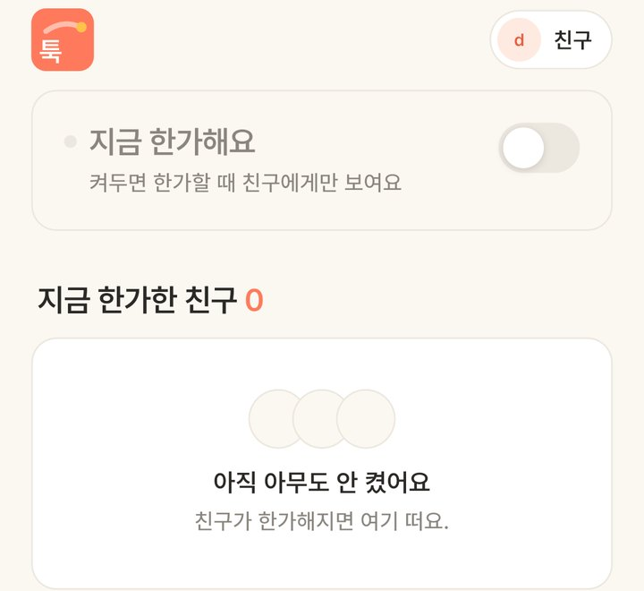 | 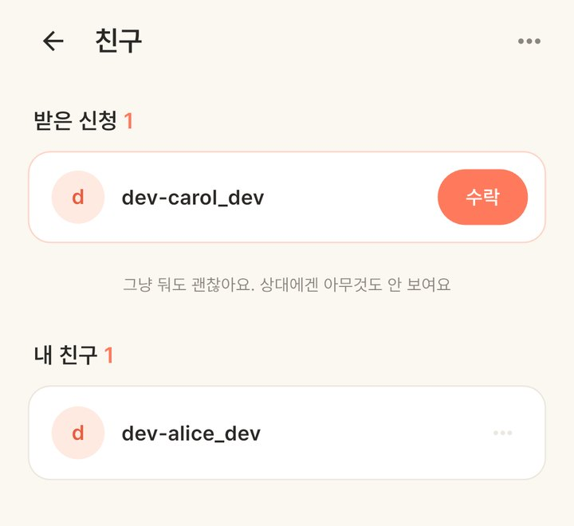 |

### 테스트 🧪
실기기 화면 확인.

### 남은 과제
Before 캡처(보류).

---

## 10. B2 앱을 보는 중에 뜬 알림을 눌러도 반응 없음 🐞

### 배경/문제
앱이 켜져 있으면 알림을 앱이 직접 띄우는데, 그 알림의 탭 처리기가 없었고 payload 도 flashId 뿐이었다. 친구 알림은 항상 FCM 이라 실제로 겪는 경로.

### 구현/해결 내용
payload 에 data 전체(type 포함)를 JSON 으로, `onDidReceiveNotificationResponse` 로 시스템 알림 탭과 같은 경로에 보낸다(`68df05b`).

### Before / After
| Before | After: 알림 | After: 탭 → 친구 화면 |
|---|---|---|
|  |  |  |

### 테스트 🧪
실기기 — 홈을 보는 중 친구 신청 알림 → 탭 → 친구 화면.

### 남은 과제
없음.

---

## 11. B4 알림 탭 시 같은 화면이 한 겹 더 쌓임 🐞

### 배경/문제
친구 화면을 보는 중 친구 알림을 누르면 친구 화면이 하나 더 열려 뒤로를 두 번 눌러야 홈이 나왔다. 모임방도 같았다.

### 선정 이유
여는 쪽(홈 카드·받은 툭·딥링크·알림 등 여러 곳)에서 챙기면 하나만 빠뜨려도 다시 쌓인다 → **화면이 스스로 "열려 있음"을 등록**하는 방식.

### 구현/해결 내용
`core/open_routes.dart` 의 `OpenRoutes` + `OpenRouteTracking` mixin. 이미 열려 있으면 `popUntil` 로 그 화면까지 돌아간다. `dispose` 에서 `ModalRoute` 조회가 안전하지 않아 등록할 때 라우트를 들고 있다가 해제(`68df05b`).

### Before / After
| Before | After: 알림 | After: 쌓이지 않고 갱신 | After: 뒤로 한 번에 홈 |
|---|---|---|---|
|  |  | 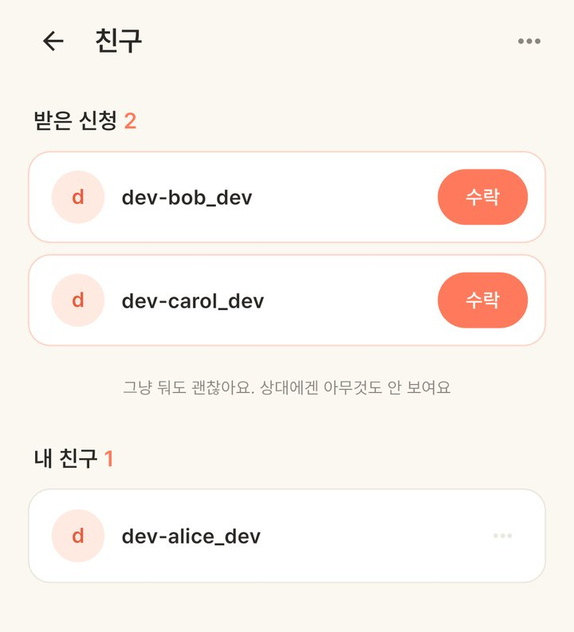 | 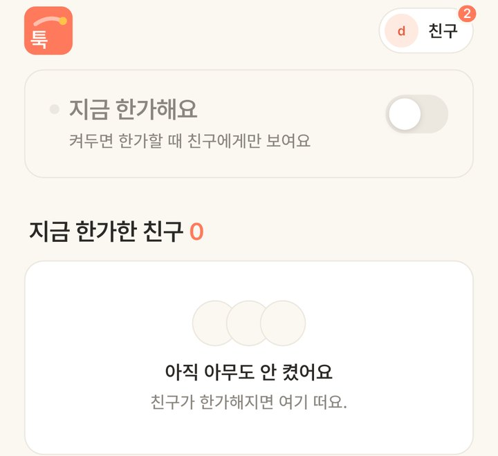 |

### 테스트 🧪
실기기(친구 알림 경로). 모임방 알림 경로는 같은 코드라 별도 실기기 확인 안 함.

### 남은 과제
Before 캡처(보류), 모임방 알림 경로 실기기 확인.

---

## 12. 릴리스 전 점검 — 릴리스 빌드에서만 드러날 함정 🧪

### 배경/문제
지금까지 모든 테스트는 **디버그 빌드**로 했다. 사용자 요청 — "A5 이후는 진짜 사용자가 쓰니, 더 수정하거나 추가할 게 없는지 꼼꼼하고 세세하게 점검하고 들어가야 할 듯."

### 선정 이유
기능 목록을 다시 훑는 대신 **릴리스 빌드 설정**과 **친구가 앱을 받는 경로**를 중심으로 코드를 직접 열었다. 디버그에서는 절대 안 보이는 문제가 거기 몰려 있다.

### 구현/해결 내용
| 발견 | 근거 | 그대로 두면 | 처리 |
|---|---|---|---|
| 릴리스 기본 서버 주소가 에뮬레이터용 | `config.dart`: 빌드 옵션이 없으면 `http://10.0.2.2:8080` | 옵션 하나 빠뜨리면 로그인부터 안 됨 | `kReleaseMode` 면 운영 주소(`4eab517`) |
| 릴리스가 디버그 키로 서명 | `build.gradle.kts` `signingConfig = debug` | 키를 바꾸면 카카오 키 해시 재등록 필요 | `key.properties` 로 릴리스 키 + 카카오 키 해시 추가(22번) |
| 초대 페이지에 설치 방법이 없음 | `public/invite.html`: "툭 앱을 설치해요"만, "절친" 문구 | 초대받은 친구가 앱을 받을 길이 없음 | "설치 파일은 초대한 친구에게" + "친한 친구"(서버 `6bdafd5`) |
| 릴리스에서만 코드 축소(R8) | Flutter 기본 `isMinifyEnabled = true` | 카카오 SDK·Firebase 가 릴리스에서만 깨질 수 있음 | 릴리스 APK 로 운영 실기기 검증(23번) |
| 숨은 dev 로그인이 릴리스에도 | `landing_screen.dart` 로고 길게 누르기 | 운영 서버가 401 로 막아 위험은 낮음 | 개발 빌드에서만(`4eab517`) |
| 버전 번호 규칙 없음 | `pubspec.yaml` `1.0.0+1` | 업데이트 안내가 꼬일 수 있음 | 첫 릴리스는 `1.0.0+1` ↔ `app-version.json` `latestBuild: 1`. 앞으로의 규칙 문서화는 **확인 필요** |

같은 점검에서 "실사용 전에 넣으면 좋은 것"(C1·C2·B3, 의견 보내기, 오류 수집, 업데이트 안내)과 "실사용 후로 미룰 것"(C3 알림 묶기, 도메인, 백업 외부 사본, iOS, B5)을 나눴다. 사용자 결정: 10-01 C1·C2·B3, 10-02 A5.

### Before / After
화면이 아니라 코드 근거라 캡처 대상 아님. 위 표의 "근거" 열이 Before.

### 테스트 🧪
6개 모두 10-02 릴리스 빌드에서 확인 — 운영 주소 연결, 릴리스 키 서명(`signingReport`), 카카오 로그인, R8 빌드 실행, dev 로그인 안 열림. 초대 페이지는 운영 배포 후 반영.

### 남은 과제
R8 빌드의 **푸시 경로**는 운영에 상대 계정이 있어야 확인 가능(첫 친구에게 APK 전달 후).

---

## 13. C1 알림에 어느 모임인지 ⚙️

### 배경/문제
모임이 둘 이상이면 "장소가 바뀌었어요"만 보고 어느 모임인지 몰랐다.

### 선정 이유
제목만 봐도 구분되게 앞에 "밥 · ". 새 툭은 제목에 보낸 사람이 있어 본문 앞에. 방 안 토스트엔 붙이지 않음(뻔함). 서버 활동 이름 표(`ActivityLabel`)는 앱 `Activity.label` 과 1:1(다르게 부르면 다른 모임처럼 보인다).

### 구현/해결 내용
합류·장소·시간 이벤트에 `activity` 추가(서버 `64268e6`), 앱 방 밖 토스트(앱 `ba6d435`).

### Before / After
| After: 방 밖 토스트 | After: FCM |
|---|---|
| 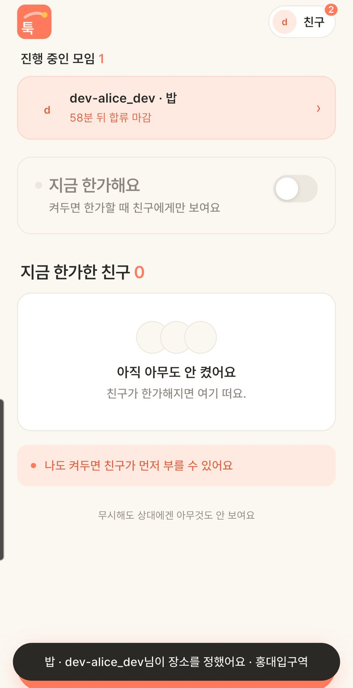 |  |

Before 는 같은 화면에 "밥 · "만 없던 상태라 따로 남기지 않았다([FEATURE_NOTES_2026-09-22_09-29](FEATURE_NOTES_2026-09-22_09-29.md) 13번의 장소 알림과 비교 가능).

### 테스트 🧪
실기기(erin) — 홈 토스트 "밥 · …", 백그라운드 FCM "밥 · 약속 시간이 정해졌어요".

### 남은 과제
없음.

---

## 14. C2 방이 "바꿨어요"를 기억 (Flyway V4) ⚙️ 🐞

### 배경/문제
알림은 "바뀌었어요"인데 방에 들어가면 "OO님이 정했어요"였다. 서버가 처음/변경을 저장하지 않았다. 같은 값을 다시 고르면 "정한 사람"이 재저장한 사람으로 덮이기도 했다.

### 구현/해결 내용
V4 `meetup_rooms.place_changed` / `meet_at_changed`(기본 false, 칸 추가만이라 옛 앱도 동작), 응답 `placeChanged`/`meetAtChanged`. **같은 값이면 방을 아예 건드리지 않음**(서버 `64268e6`, 앱 `ba6d435`).

### Before / After
| 처음 정함 | 바꾼 뒤 |
|---|---|
| 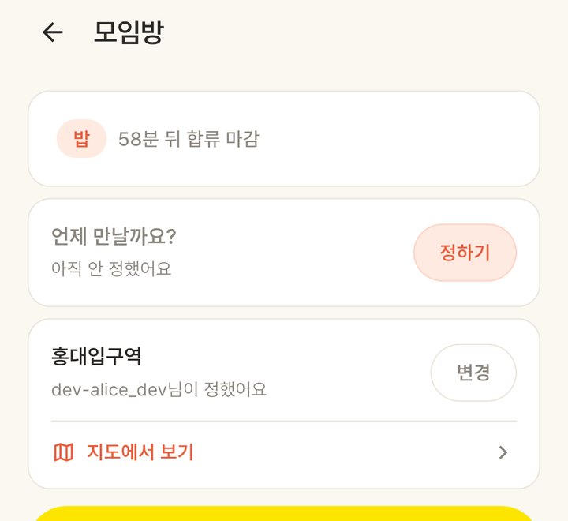 | 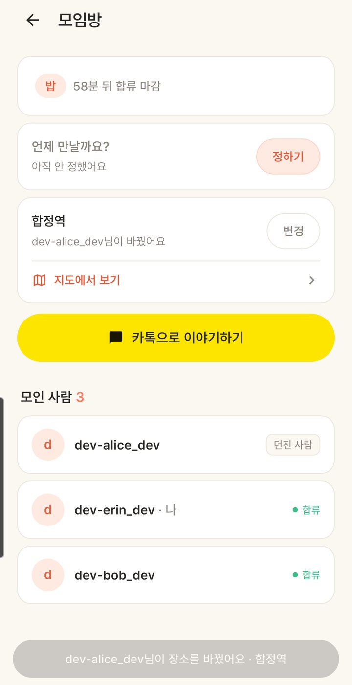 |

### 테스트 🧪
서비스 테스트(처음 정함 false / 바꿈 true / 같은 값 → 정한 사람·플래그 그대로·알림 없음). 기존 테스트 하나가 Mockito "쓰이지 않는 준비 코드"로 실패 → 바로 이 변화 때문이라 그 줄 제거. 운영 배포 후 health 200(마이그레이션 실패였다면 기동 실패로 롤백). 서버 테스트 137.

### 남은 과제
없음.

---

## 15. B3 방 밖에선 누가 합류해도 조용했다 ⚙️

### 배경/문제
앱을 보는 중 방 밖에 있으면 합류가 실시간 연결로만 와서 아무 표시가 없었다. 앱이 꺼져 있었다면 푸시가 떴을 일.

### 구현/해결 내용
장소·시간 토스트와 같은 자리에서 "밥 · OO님이 합류했어요". 그 모임방을 보고 있으면 방이 직접 반영하므로 건너뜀(앱 `ba6d435`).

### Before / After
| After |
|---|
| 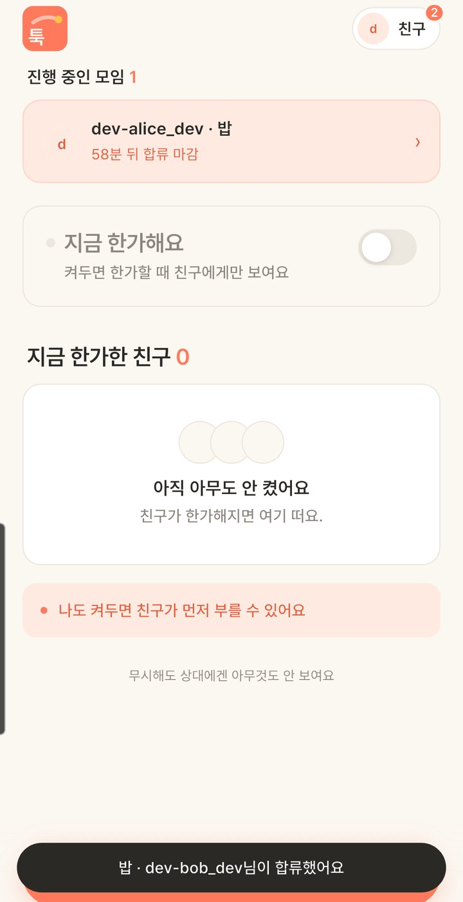 |

Before 는 "아무 표시 없음"이라 화면이 없다.

### 테스트 🧪
실기기(erin) 홈에서 bob 합류 토스트.

### 남은 과제
없음.

---

## 16. 인트로 6컷 다시 쓰기 ⚙️

### 배경/문제
인트로가 8월 초 그대로였다(사용자 지적: "인트로 페이지가 좀 옛날 거 아니야?"). 9월에 생긴 모임방이 없고, **사실이 아닌 문장 두 개**가 있었다 — 실제로 없는 "나도/다음에" 버튼, "던진 툭도 시간이 지나면 사라져요"(9월 말부터 모인 약속은 남음).

### 선정 이유
첫 사용자가 인트로를 믿고 기대한 것과 실제 앱이 다르면 첫인상이 깨진다 → 사실과 다른 문장 수정을 최우선, 그다음 빠진 기능(모임방) 한 컷 추가. 그림 속 알림·버튼은 실제 앱 문구와 똑같이. 2컷의 민수가 3컷에서 던지고 4컷에서 그 방이 나오게 이야기를 잇는다.

### 구현/해결 내용
`intro_screen.dart` 5컷 → 6컷(새 `_CutRoom`), `core/keep_words.dart`(한글 단어 단위 줄바꿈) 추가(`25e00a3`).

### Before / After
| 3컷 Before | 3컷 After | 새 4컷 |
|---|---|---|
| 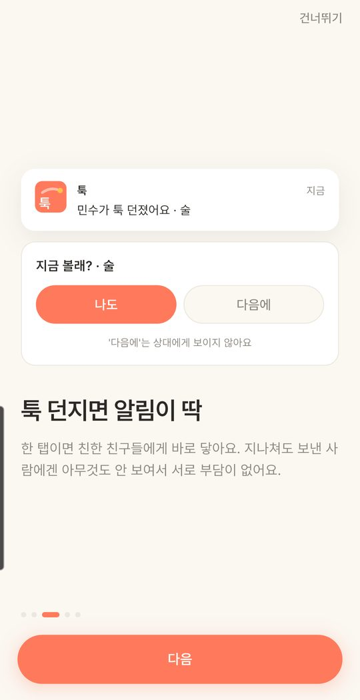 | 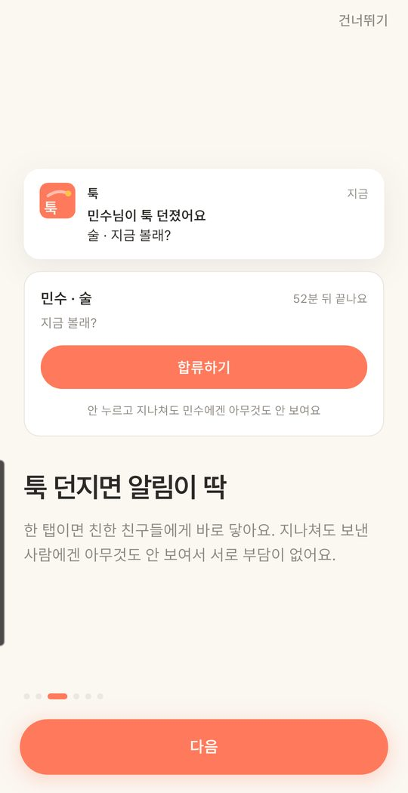 | 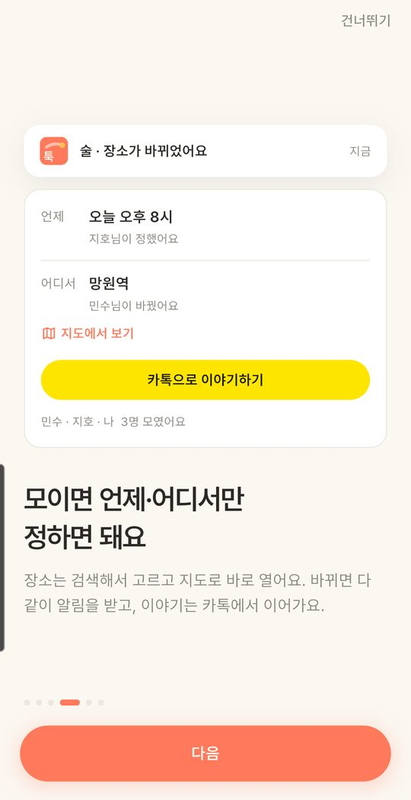 |

| 자동 만료 컷 Before | After | 마지막 컷 After |
|---|---|---|
| 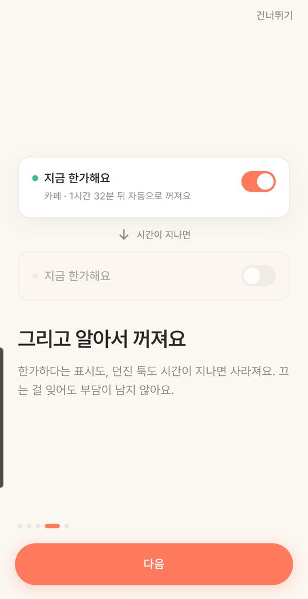 | 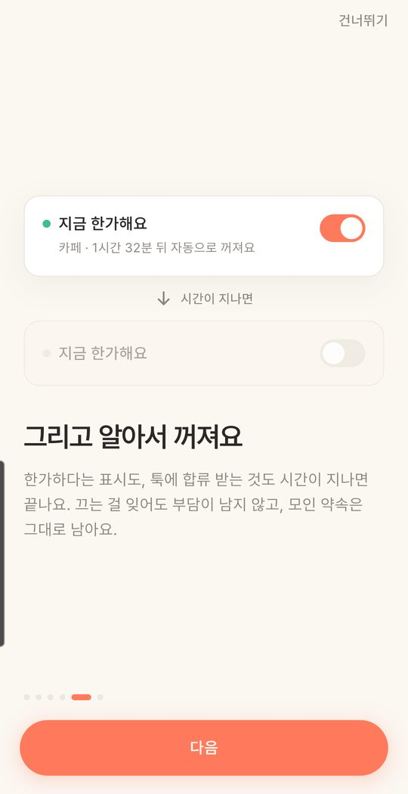 | 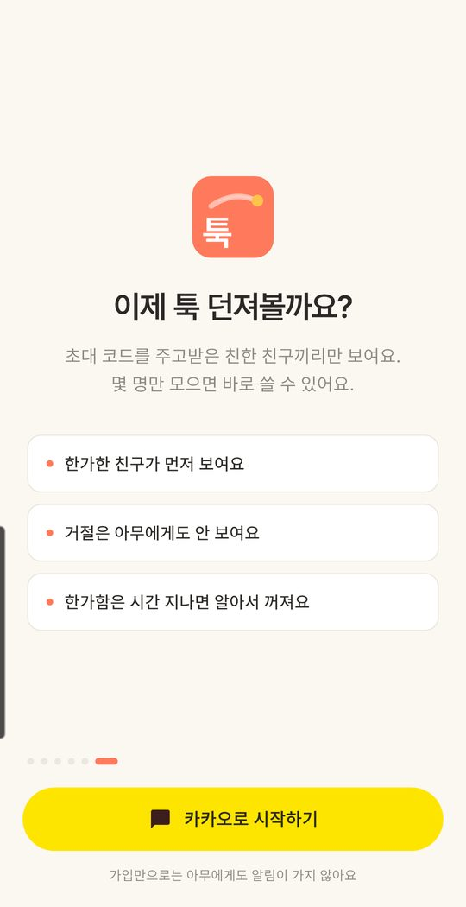 |

Before 는 10-12 에 `ba6d435` 를 따로 빌드해 재현.

### 테스트 🧪
`keep_words_test.dart`, 실기기 6컷 확인.

### 남은 과제
없음.

---

## 17. 의견 보내기 🆕

### 배경/문제
APK 를 직접 나눠주면 스토어 리뷰·문의 창구가 없다. 불편을 말할 곳이 카톡뿐.

### 선정 이유
서버 게시판 대신 메일 앱(받는 주소는 처리방침의 문의 메일과 같게). 본문에 앱 버전·기기를 미리 채워 "안 돼요"만 와도 상황을 알 수 있게. 메일 앱이 없으면 주소 복사.

### 구현/해결 내용
`views/feedback_sheet.dart`, `package_info_plus`, Android 11+ 를 위해 `AndroidManifest` `queries` 에 mailto. 친구 ⋯ 메뉴 순서 의견 보내기 / 로그아웃 / 탈퇴하기(`4eab517`).

### Before / After
| 메뉴 | 시트 |
|---|---|
| 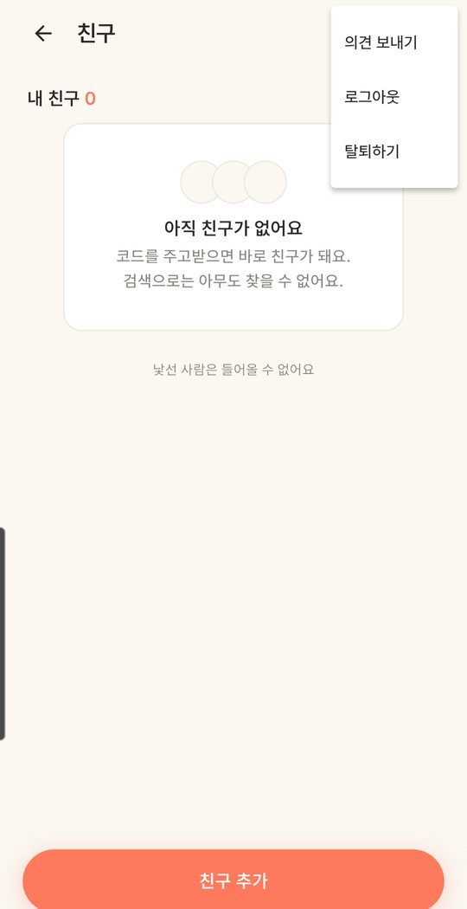 | 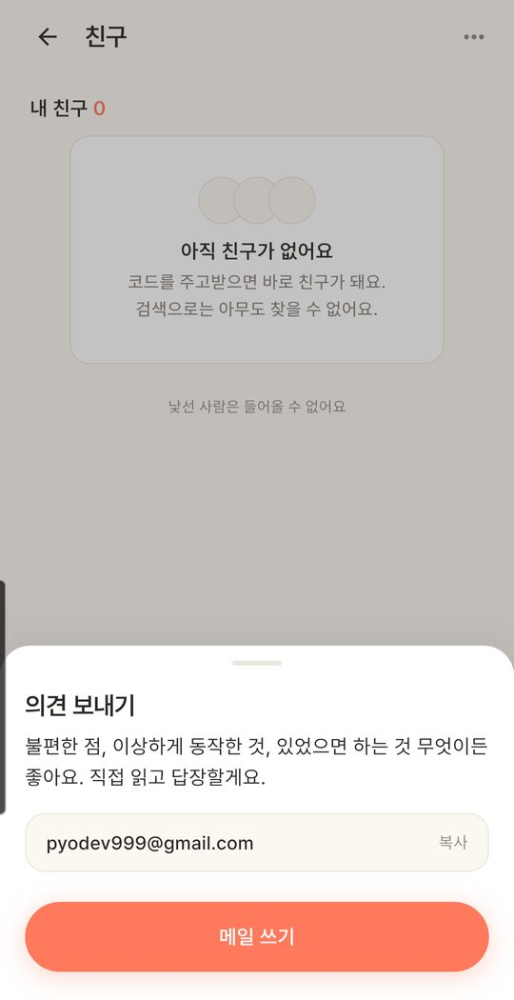 |

### 테스트 🧪
실기기에서 메뉴·시트 확인. 실제 메일 발송은 확인 안 함(확인 필요).

### 남은 과제
없음.

---

## 18. 오류 수집 (Firebase Crashlytics) 🆕 🧭

### 배경/문제
친구 폰에서 앱이 죽어도 알 길이 없다(스토어의 비정상 종료 보고가 없음).

### 선정 이유
사용자 질문 "Crashlytics 하면 돈 나감?" → 무료(Spark 요금제 포함). 대신 기기 정보를 받으므로 처리방침에 항목 추가. 개발 빌드는 수집 안 함(일부러 낸 오류가 섞이지 않게).

### 구현/해결 내용
`FlutterError.onError`(화면 오류) + `PlatformDispatcher.onError`(비동기 오류), `setCrashlyticsCollectionEnabled(!kDebugMode)`, Gradle 플러그인 3.0.6(`4eab517`). 처리방침 갱신(서버 `6bdafd5`).

### Before / After


### 테스트 🧪
릴리스 빌드 실행 확인. 콘솔 수신은 **미확인**.

### 남은 과제
첫 보고 확인.

---

## 19. 새 버전 안내 🆕 🧭

### 배경/문제
APK 직접 배포라 새 버전이 나와도 아무도 모른다.

### 선정 이유
서버 `public/app-version.json` 한 파일만 고쳐 푸시하면 되게(스토어 없이 가장 단순). 재촉하지 않는 규칙:
| 상황 | 안내 |
|---|---|
| 최신 | 없음 |
| 새 버전, 처음 봄 | 한 번 |
| 새 버전, 이미 봄 | 없음(본 버전 번호를 기기에 저장) |
| `minBuild` 보다 오래됨 | 매번 |

### 구현/해결 내용
`services/update_checker.dart`(`UpdateChecker.decide` 순수 함수), `views/update_sheet.dart`, 앱 시작 3초 뒤 확인, 실패하면 조용히 건너뜀. Caddy 에서 캐시하지 않음(앱 `4eab517`, 서버 `6bdafd5`). `downloadUrl` 이 없으면 "나눠준 친구·단톡방에서 받아 주세요".

### Before / After
| After |
|---|
| 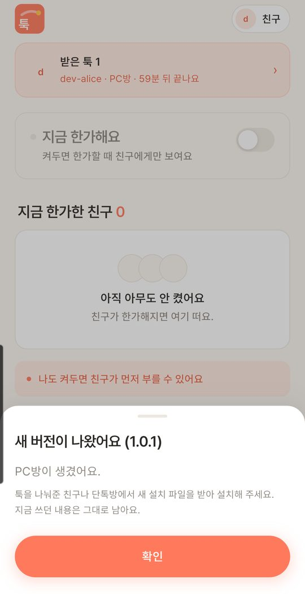 |

10-12 에 로컬에 `latestBuild: 2` json 을 띄워 재현.

### 테스트 🧪
`update_checker_test.dart` 3개(최신 / 한 번만 / minBuild 아래 매번). 운영 json 이 없을 때(401) 아무것도 안 띄우는 것 실기기 확인, 푸시 후 운영 200.

### 남은 과제
받을 링크가 생기면 json 의 `downloadUrl` 한 줄.

---

## 20. 랜딩 다듬기 · 숨은 개발용 로그인 감춤 ⚙️

### 배경/문제
인트로를 고치며 랜딩도 점검(사용자: "이 랜딩 페이지는 바뀔 부분 없는 거야?"). 셋째 요약 "시간 지나면 알아서 꺼져요"는 주어가 없어 모임까지 꺼지는 것처럼 읽혔고, 설명 문장은 "사/람만"처럼 단어 중간에서 끊겼다. 로고 길게 누르기 dev 로그인이 릴리스에도 있었다.

### 선정 이유
사용자 결정 "문구 그대로 하고 A5 진행" → 문구 틀은 유지, 주어 하나와 줄바꿈만. dev 로그인은 운영 서버가 막고 있어 위험은 낮지만 친구가 우연히 낯선 창을 보지 않게 숨김.

### 구현/해결 내용
"**한가함은** 시간 지나면 알아서 꺼져요", 설명 세 줄, `onLongPress: kReleaseMode ? null : …`(`4eab517`).

### Before / After
| Before | After |
|---|---|
| 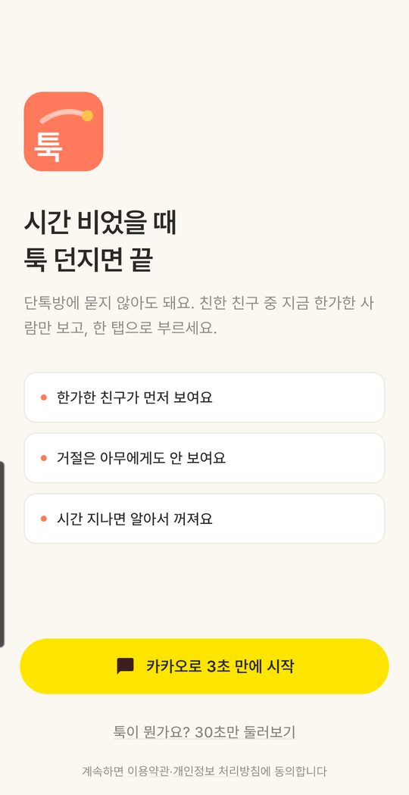 | 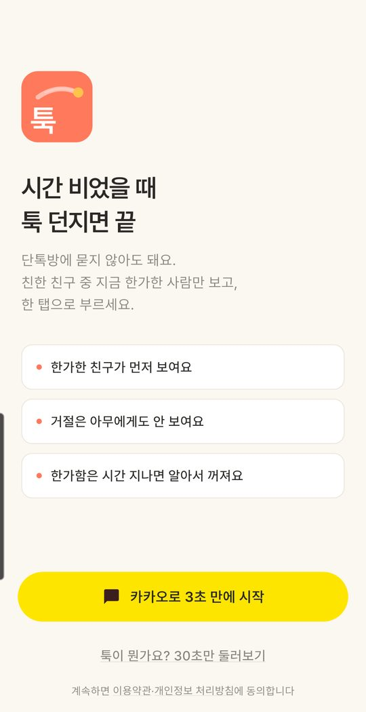 |

### 테스트 🧪
릴리스 빌드에서 로고 길게 눌러도 안 열림.

### 남은 과제
없음.

---

## 21. 배포 방식 선정 (APK 직접 vs Play) 🧭

### 배경/문제
친구들에게 어떻게 앱을 건넬지.

### 선정 이유
| 대안 | 장점 | 단점 |
|---|---|---|
| **APK 직접(카톡)** | 무료, 바로 가능 | 설치 시 "출처를 알 수 없는 앱" 허용, 업데이트마다 다시 보냄 |
| Play 내부 테스트 | 링크 하나, 자동 업데이트 | 개발자 등록 $25, 심사 |
| APK 를 우리 서버에 | 링크로 배포 | 비용은 없지만 배포 `rsync --delete` 가 지우는 함정, 매번 수동 업로드 |

사용자 결정 "일단 APK, 나중에 Play". 서버 호스팅은 사람이 늘면.

### 구현/해결 내용
업데이트 안내의 `downloadUrl` 을 비워 둠, 초대 페이지에 "설치 파일은 초대한 친구에게"(서버 `6bdafd5`).

### Before / After
해당 없음.

### 테스트 🧪
해당 없음.

### 남은 과제
사용자가 늘면 Play 내부 테스트 또는 서버 호스팅.

---

## 22. 릴리스 서명 키 · 카카오 키 해시 🆕

### 배경/문제
지금까지 빌드는 디버그 키 서명. 카카오 로그인은 서명 인증서 해시를 콘솔 등록값과 비교하므로 새 릴리스 키로 서명하면 등록 전까지 로그인 실패.

### 구현/해결 내용
사용자가 `keytool` 로 `tuk-release.jks`(alias tuk) 생성 + `android/key.properties`(git 무시 확인) → `gradlew signingReport` 의 release SHA-1 → 바이트 → Base64 → 카카오 콘솔에 **추가**(개발용 해시는 유지). Gradle 은 `key.properties` 가 있으면 릴리스 키, 없으면 디버그 키(`4eab517`).
```
Variant: release / Alias: tuk / SHA1: AD:02:…:1B:26  →  키 해시 rQKr…ZGyY=
```

### Before / After
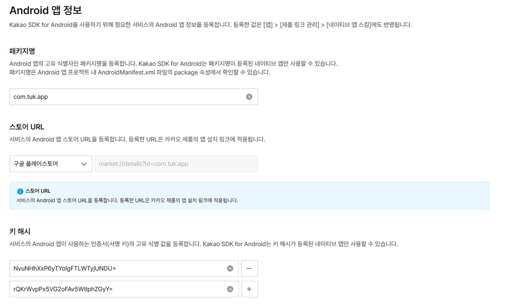

### 테스트 🧪
릴리스 APK 로 운영 서버 카카오 로그인 성공.

### 남은 과제
키스토어 파일과 비밀번호를 서로 다른 곳에 백업(잃으면 나눠준 앱을 업데이트할 수 없음). 대화 중 비밀번호가 보이는 캡처가 오간 적이 있어 앞으로는 가리고 공유.

---

## 23. 릴리스(R8) 빌드 실기기 검증 🧪

### 배경/문제
Flutter 릴리스는 코드 축소(R8)가 켜져 있어 카카오 SDK·Firebase 처럼 리플렉션을 쓰는 라이브러리가 **릴리스에서만** 깨질 수 있다.

### 구현/해결 내용
폰의 개발 빌드는 서명이 달라 덮어 설치 불가(`INSTALL_FAILED_UPDATE_INCOMPATIBLE`) → 지우고 릴리스(59.8MB) 설치, 운영 서버로 확인.

### Before / After
| 확인 | 결과 |
|---|---|
| 첫 화면, logcat FATAL/AndroidRuntime | 0건 |
| dev 로그인(로고 길게) | 안 열림 |
| 카카오 로그인(운영) | 성공 |
| 프로필·친구 불러오기, 한가해요 켜기/끄기(wss) | 정상 |
| 친구 ⋯ 메뉴 3항목 | 정상 |
| 툭 던지기·푸시 실사용 | **미확인**(운영엔 상대 계정 필요) |

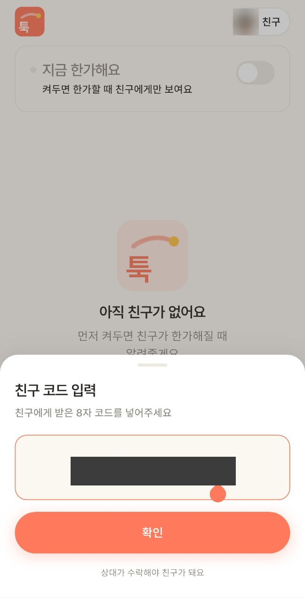

### 테스트 🧪
위 표.

### 남은 과제
첫 친구와 툭·푸시, Crashlytics 첫 보고.

---

## 24. 앱 전체 한글 줄바꿈 (keepWords) 🐞 ⚙️

### 배경/문제
릴리스 화면에서 "알려줄/게요", "검색으/로는"(사용자 지적, "다른 곳에도 있을 수 있으니 앱 전체 확인 필요"). Flutter 는 한글을 글자마다 줄을 나눌 수 있는 곳으로 본다(CSS `word-break: keep-all` 없음).

### 선정 이유
문제 문장을 하나씩 고치면 다음 화면에서 또 생긴다 → **앱의 모든 `Text` 를 한 번에** 감싸고 규칙으로 남김. 서버에서 오는 글자(닉네임·장소·토스트)도 포함.

### 구현/해결 내용
일괄 변환 스크립트로 `Text(` 첫 인자를 `keepWords(…)` 로. `keepWords` 는 한글 인접 자리에만 U+2060(WORD JOINER)을 끼우고 이모지 옆은 건너뜀(👍🏻 같은 조합 이모지 보호). `TextSpan` 2곳은 손으로(`5c65e74`).

### Before / After
| 홈 Before | 홈 After | 친구 Before | 친구 After |
|---|---|---|---|
| 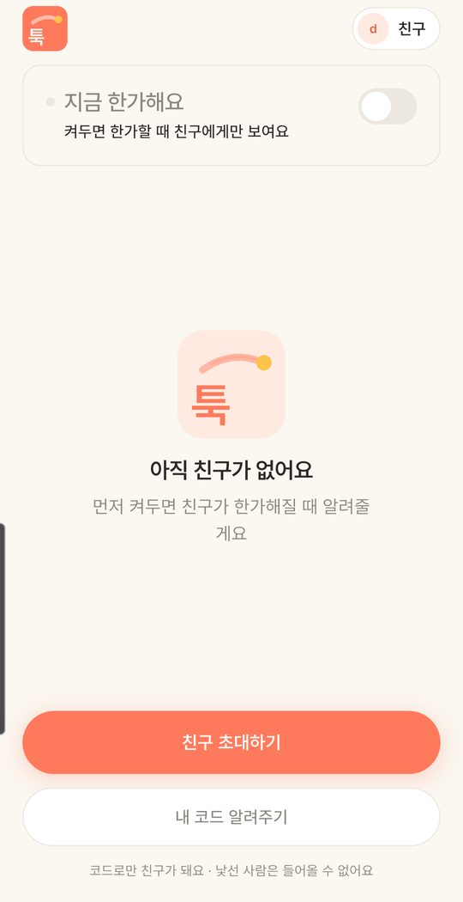 |  | 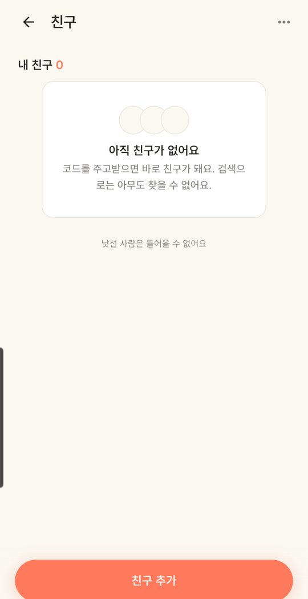 | 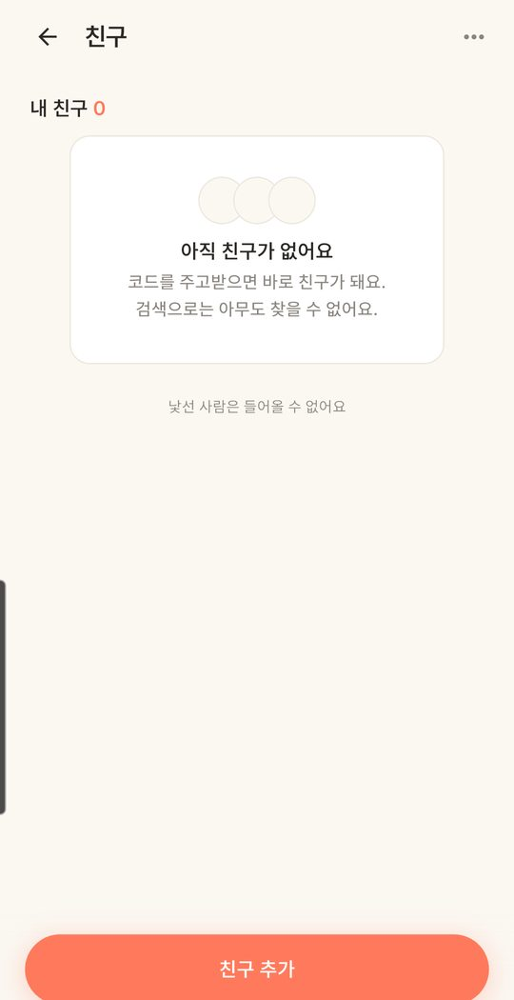 |

| 수치 | 값 |
|---|---|
| 적용한 `Text` | **184곳** |
| analyze 에러 | 첫 변환 9개(주석 속 쉼표를 인자 구분으로 읽음) → 되돌리고 주석 건너뛰게 수정 후 4개(`const` 안) → 손으로 **0** |

### 테스트 🧪
`keep_words_test.dart` 에 "한글 없으면 그대로", "이모지 옆은 안 끼움" 추가, 앱 테스트 56 통과, 실기기 홈·친구 화면 확인.

### 남은 과제
새 `Text` 도 `keepWords` 로 감쌀 것(`keep_words.dart` 주석).

---

## 25. 활동에 PC방 추가 + Flyway V5 제약 이름 함정 🆕 🐞

### 배경/문제
한가함 켜기·툭 던지기 활동에 PC방 추가 요청. 활동은 앱 enum, 서버 enum, 푸시 문구 표, **DB 검사 조건** 네 곳에 있다. 검사 조건을 이름으로 지우는 V5 를 만들었더니 테스트가 실패했다.

### 선정 이유
원인 — 로컬 DB 는 Flyway 도입 **전**에 Hibernate 가 만들어 제약 이름이 `flashes_activity_check`, 운영은 V1 으로 만들어 `ck_flash_activity`. 같은 제약이 DB 마다 이름이 달랐다 → 이름 대신 `pg_constraint` 에서 **내용으로 찾아** 지우는 방식으로.

### 구현/해결 내용
`Activity.PC_ROOM`, `ActivityLabel` "PC방", 앱 `pcRoom('PC_ROOM','PC방','🎮')`(노래방 다음, 아무거나 앞), V5 `DO $$ … pg_get_constraintdef(oid) LIKE '%activity%' … $$`(서버 `d4be448`, 앱 `5c65e74`). 옛 앱은 모르는 값을 "아무거나"로 표시.

### Before / After
| 시트 Before | 시트 After | 받는 쪽 홈 |
|---|---|---|
| 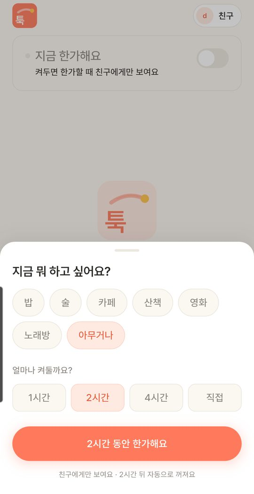 | 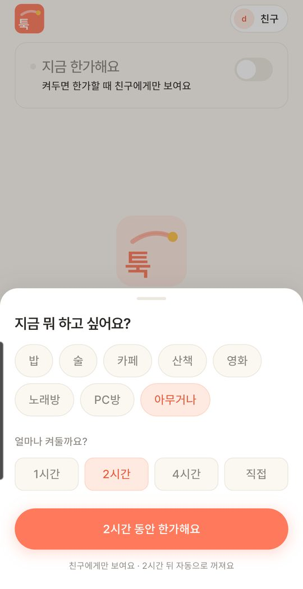 | 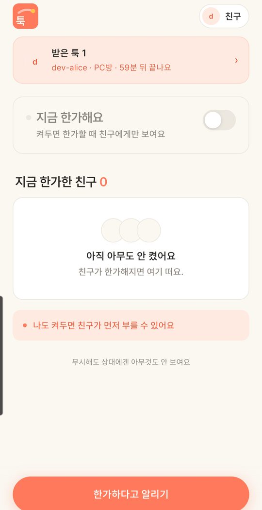 |

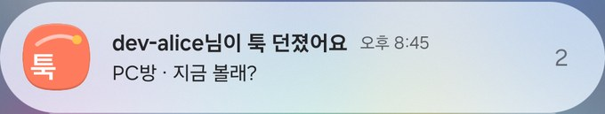

| 수치 | Before (이름으로 DROP) | After (내용으로 DROP) |
|---|---|---|
| 서버 테스트 | 137개 중 **13개 실패**(컨텍스트 로드 실패) | 137개 **통과** |

### 테스트 🧪
서버 137, 앱 56. 운영 배포 후 **운영 앱에서 PC방으로 한가함 켜기 성공**(롤백됐다면 옛 서버가 `PC_ROOM` 을 거부했을 것). 10-12 로컬에서 PC방 툭 → FCM "PC방 · 지금 볼래?" 확인.

### 남은 과제
없음. 교훈 — 마이그레이션은 환경마다 다른 이름에 기대지 않는다.

---

## 26. A7 DB 외부 백업 (암호화 → Backblaze B2) 🆕 🧭 🧪

### 배경/문제
매일 04:00 백업이 **같은 서버 디스크**에만 있었다. 서버가 통째로 사라지면 원본과 백업이 같이 사라진다. 친구들이 실제로 쓰기 시작해 다시 만들 수 없는 데이터가 생겼다.

### 선정 이유
| 대안 | 판단 |
|---|---|
| **Backblaze B2** | 10GB 무료, 카드 불필요, 버킷 전용 키 → 채택(사용자 선택) |
| Cloudflare R2 | 10GB 무료, 활성화에 카드 등록 필요 |
| 개인 Google Drive | 15GB, 서버 OAuth 연결이 번거롭고 개인 드라이브에 운영 데이터가 섞임 |

올리기 전에 `age` 로 암호화(개인정보 포함), **서버엔 공개 키만** 두고 복호화 개인 키는 운영자가 따로 보관(서버를 잃어도 풀 수 있고, 서버가 털려도 지난 백업은 못 품).

### 구현/해결 내용
`ops/backup/tuk-db-backup` — `pg_dump -Fc` → 검증 → 서버 14일 보관 → `age -r 공개키` → `rclone copyto` B2 → **올라간 크기 = 로컬 크기 대조** → 30일 지난 사본 삭제. 비밀은 `/etc/tuk/backup-offsite.env`(root 600) 한 곳, rclone 설정 파일 없이 환경 변수. 처리방침에 Backblaze(미국) 추가(서버 `9d99450`, `33932fb`).

### Before / After
| 실행 결과 | B2 에서 받아 임시 DB 복원 → 운영과 비교 |
|---|---|
| 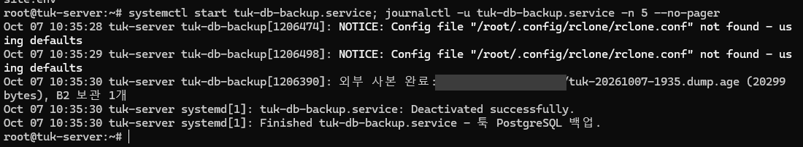 | 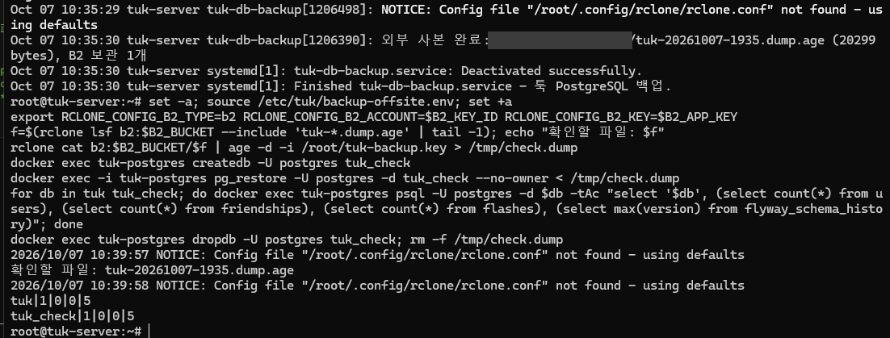 |

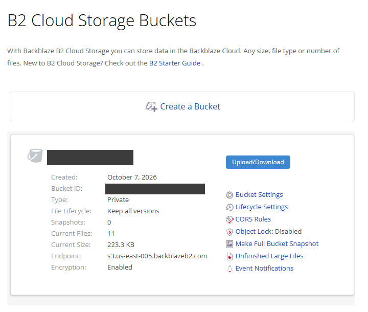

| 수치 | 값 |
|---|---|
| 백업 크기 | 약 20KB/일 (20,299 bytes) |
| 보관 | 서버 14일 + B2 30일 |
| 복원 비교 (users / friendships / flashes / Flyway) | 운영 `1 / 0 / 0 / 5` = 복원본 `1 / 0 / 0 / 5` |
| 추가 비용 | 0원 |

### 테스트 🧪
서버에서 수동 실행 → "외부 사본 완료" → B2 에서 받아 복호화 → 임시 DB `tuk_check` 에 `pg_restore` → 운영과 행 수·DB 버전 일치 → 임시 DB·파일 삭제.

### 남은 과제
복호화 개인 키를 비밀번호 관리자로 옮기고 서버에서 `shred`(10-12 기준 미완). 백업 스크립트는 배포가 자동 설치하지 않음(고치면 `scp` + `install`).

---

## 27. 서버·백업 모니터링 (UptimeRobot · healthchecks.io) 🆕 🧭

### 배경/문제
서버나 DB 가 멈춰도 친구가 말해 줘야 알았고, 매일 백업이 조용히 실패하거나 **아예 안 돌아도** 복구하려는 날 처음 알게 된다.

### 선정 이유
감시 방향이 둘이라 도구도 둘.
| 대상 | 방식 | 도구 |
|---|---|---|
| 서버·DB | 밖에서 5분마다 찔러 봄(`/actuator/health` 는 앱·DB·Redis 모두 정상일 때만 200) | UptimeRobot(무료) |
| 백업 | 끝날 때 신호를 보내고, **신호가 안 오면 알림**(데드맨 스위치) — "아예 안 돌았다"를 잡으려면 이 방식뿐 | healthchecks.io(무료) |

### 구현/해결 내용
UptimeRobot HTTP 모니터 5분 간격, 메일 알림. healthchecks 체크 Period 1일 + Grace 1시간. 백업 스크립트에 `ping_hc` — 성공 시 핑, 실패 시 `/fail`(ERR trap), `HC_PING_URL` 이 없으면 예전 동작. rclone 안내(NOTICE) 숨김(서버 `e551357`).

### Before / After
| UptimeRobot 설정 | healthchecks 초록 | 핑 추가 후 실행 |
|---|---|---|
| 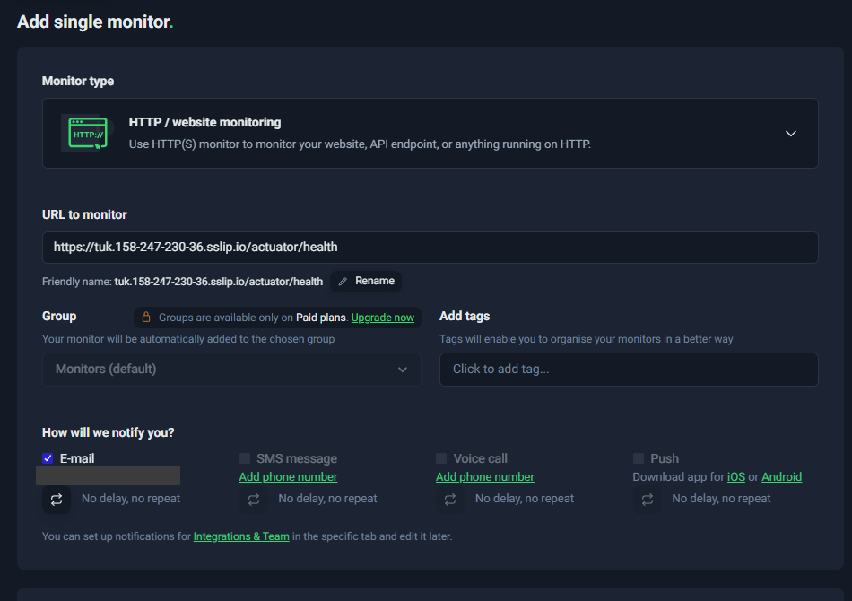 | 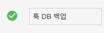 | 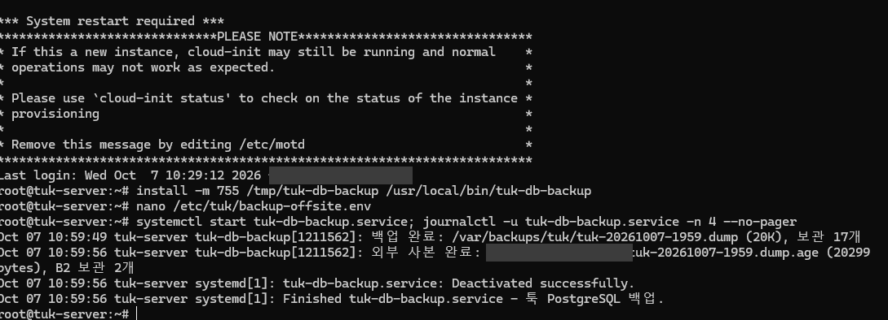 |

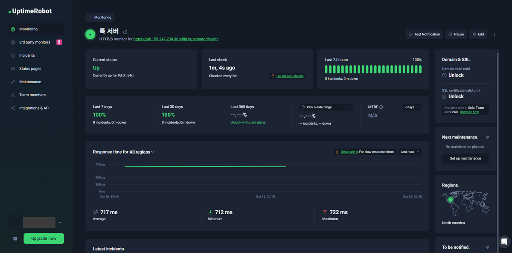

| 수치 | 값 |
|---|---|
| 서버 감지 간격 | 5분 |
| 백업 실패 알림 | 즉시 / 미실행 알림 25시간 |
| 추가 비용 | 0원 |

### 테스트 🧪
UptimeRobot Up 확인, 백업 수동 실행 → healthchecks 마지막 핑 갱신·초록. 실패 경로(`/fail`)는 일부러 실패시켜 보지 않음(확인 필요).

### 남은 과제
배포 재시작 중 Down→Up 가짜 경보 가능(알고 무시). apt 업데이트 후 "System restart required" → 한가한 시간 재부팅.

---

## 28. 백업 스크립트가 Windows 줄 끝(CRLF)으로 저장됨 🐞

### 배경/문제
백업 스크립트(`ops/backup/tuk-db-backup`)에 healthchecks.io 알림을 넣으려고 Windows 에서 스크립트로 고쳤는데, 저장하면서 줄 끝이 Windows 식(`\r\n`)으로 바뀌었다. Linux 의 bash 는 이런 파일을 실행하지 못한다. 서버에 그대로 올렸다면 매일 04:00 백업이 실패했을 것이다.

### 구현/해결 내용
서버로 보내기 전에 `git diff` 경고("CRLF will be replaced by LF")로 발견 → `sed -i 's/\r$//'` 로 되돌리고 `bash -n` 문법 확인(서버 `e551357`).

### Before / After
| | Before | After |
|---|---|---|
| 파일 안 `\r` | 줄마다 있음(git 경고로 확인) | **0개** |
| `bash -n` | — | 통과 |
| 서버 실행 | (보내기 전에 막음) | "외부 사본 완료", healthchecks 초록 |

### 테스트 🧪
`grep -c $'\r'` = 0, `bash -n` 통과, 서버에서 `systemctl start tuk-db-backup.service` 정상 완료.

### 남은 과제
재발 방지로 서버 리포에 `.gitattributes`(`ops/** text eol=lf`)를 두는 것을 검토(아직 안 함).

---

## 29. 테스트 현황 🧪

| | 시작(09-29 끝) | 끝(10-07) | 늘어난 것 |
|---|---|---|---|
| 서버 | 125 | **137** | 탈퇴 통합 테스트(`AccountDeletionServiceTest`), 초대 코드 제한(`InviteCodeAttemptLimiterTest`), 친구 끊기·신청 취소, 장소·시간 changed 플래그·같은 값 무시, 모든 푸시 문구에 "번개" 없음 |
| 앱 | 47 | **56** | `update_checker_test`(3), `keep_words_test`(이모지·한글 없음 포함) 등 |

시작 값은 [FEATURE_NOTES_2026-09-22_09-29](FEATURE_NOTES_2026-09-22_09-29.md) 끝 기준. analyze 는 기존 info 11개 외 새 이슈 없음.

---

## 경력기술서용 요약

형식: **문제 → 한 행동 → 결과(수치)**.

### 오류 해결
- 카카오맵 업데이트로 장소 ID 딥링크가 깨짐 → 후보 링크 4종을 adb 로 실기기에 직접 던져 비교, 이름+좌표 검색 링크로 교체 → 역·카페 모두 정상 오픈.
- 앱을 백그라운드로 내려도 STOMP 연결이 남아 서버가 FCM 을 보내지 않음(새 툭 알림 유실 가능) → 앱 생명주기에 맞춰 연결 해제·재연결·재조회 → 백그라운드 FCM 수신 실기기 확인.
- 첫 친구가 생겨도 앱 재시작 전까지 빈 화면에 머묾 → 친구 수를 친구 목록 변경에 동기화 → 수락 직후 재시작 없이 홈 전환.
- 서버 푸시·오류 문구에 옛 제품명 잔존 → 문구 교체 + 모든 푸시 종류를 검사하는 테스트로 재발 방지.
- 포그라운드 알림 탭 무반응, 알림 탭 시 같은 화면 중복 → payload 확장 + 화면 자기등록(OpenRoutes) 방식 → 탭 시 기존 화면으로 복귀, 뒤로 1회에 홈.
- Flutter 의 한글 글자 단위 줄바꿈("알려줄/게요") → WORD JOINER 를 끼우는 keepWords 를 일괄 변환으로 앱 전체 적용 → **184곳**, analyze 에러 9 → 0, 조합 이모지 보호 테스트.
- DB 제약 이름이 환경마다 달라 마이그레이션 실패 → 이름 대신 `pg_constraint` 내용으로 찾아 교체 → 테스트 **13개 실패 → 137개 통과**, 운영 반영 확인.
- 백업 스크립트가 CRLF 로 저장돼 Linux 에서 실행 불가 위험 → 배포 전 diff 경고로 발견해 LF 로 복구 → `\r` 0개, 서버 실행 정상.

### 신규 기능 · 설계
- 약속 시간 없이 마감된 모임이 즉시 사라짐 → 리마인드·마감 연장을 기각하고 "보이는 기간"만 서버 한 곳(MeetupLifecycle)에서 계산 → 성사된 모임 **6시간** 유지, 경계 테스트 포함 서버 테스트 116개 통과.
- 장소·시간 변경을 방에 들어가야만 알 수 있음 → 처음 정함/바꿈 구분 알림(본인 제외, 같은 값 무시, WebSocket/FCM 라우팅) → 실기기 4경로 확인.
- 계정 탈퇴 부재 → CASCADE 없는 스키마에서 자식→부모 벌크 삭제를 한 트랜잭션으로 → 실제 DB 통합 테스트, **삭제 한 줄을 빼면 실패하는 것까지 검증**.
- 친구 관계 정리 수단 부재 → "거절이 드러나지 않게" 관계 삭제·보낸 신청 취소만 제공(받은 신청 거절 API 는 의도적으로 없음) → 상태 코드별(403/400/404) 테스트.
- 초대 코드 무차별 대입 가능 → Redis INCR+EXPIRE 로 틀린 시도만 계수 → **10분 10회 초과 시 429**.
- 알림만 보고 어느 모임인지 모름 / 방은 "바꿨어요"를 모름 → 알림에 모임 종류 접두 + Flyway V4 변경 플래그 → 같은 값 재저장은 완전 무시.
- 스토어 없이 APK 직접 배포 → 의견 보내기(버전·기기 자동 첨부), Crashlytics(무료), 서버 json 기반 업데이트 안내(같은 버전 1회, minBuild 미만만 매번)를 직접 구현.
- 8월에 멈춘 인트로가 실제 앱과 다름 → 사실과 다른 문장 2개 수정 + 모임방 컷 추가로 5컷→6컷.

### 운영 · 인프라
- 백업이 운영 서버 디스크에만 존재 → age 공개키 암호화 후 Backblaze B2 로 외부 사본(크기 대조), 복호화 키는 서버 밖 보관 → **B2 에서 받아 임시 DB 복원, 운영과 행 수·DB 버전 일치**, 추가 비용 0원.
- 장애·백업 실패를 사용자 제보로만 알 수 있음 → UptimeRobot(5분, health 는 DB·Redis 포함) + healthchecks.io 데드맨 스위치 → 서버 다운 5분 내, 백업 실패 즉시·미실행 25시간 내 메일.
- 릴리스 빌드에서만 생기는 함정 → 코드 기반 점검으로 6개 발견(에뮬레이터 주소 기본값, 디버그 서명, R8 등) → 릴리스 키·카카오 키 해시 등록 후 R8 빌드로 운영 실기기 검증(오류 로그 0건).

---

## 이번 작업으로 수정·생성한 파일

| 리포 | 파일 | 무엇 |
|---|---|---|
| tuk-app | `docs/FEATURE_NOTES_2026-09-30_10-07.md` | 이 문서 |
| tuk-app | `docs/images/` | 캡처 추가(이 문서가 쓰는 것만) |

기능 코드 커밋은 각 항목에 적힌 커밋 해시 참고.
