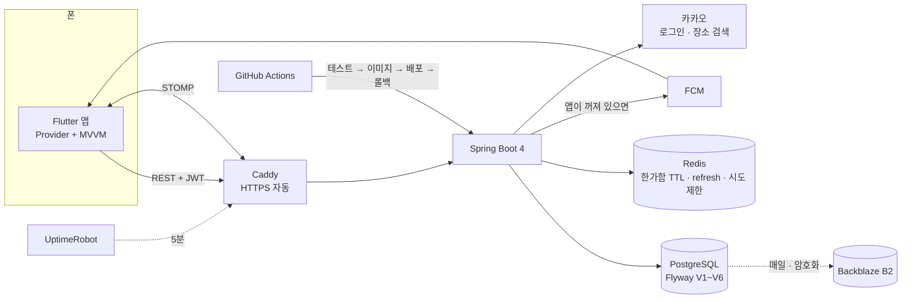

# 툭 (Tuk) — 전체 정리

> 친한 친구끼리 **거절 걱정 없이 "지금 볼래?"를 던지는** 즉흥 만남 앱.
> 혼자 기획 · 백엔드 · 앱 · 운영까지 만들어 실제 서버에 올리고 친구들에게 배포했다.
> 이 문서는 입구다. 자세한 내용은 각 줄의 링크(기간별 정리본)로 이어진다.

| | |
|---|---|
| 기간 | 2026-07-03 ~ 10-07 (기능 개발) |
| 리포 | 백엔드 [tuk-server](https://github.com/pyosunyoung/tuk-server) · 앱 [tuk-app](https://github.com/pyosunyoung/tuk-app) |
| 규모 | 커밋 148개(기능·버그 수정 79) · Java/Dart 파일 208개 |
| 테스트 | 서버 **149** · 앱 **61** |
| 운영 | Vultr 서울 VM · Docker Compose · Caddy 자동 HTTPS · GitHub Actions 배포/자동 롤백 · 암호화 외부 백업 · 서버/백업 감시 |
| 배포 | Android 릴리스 APK(서명 · R8)를 친구들에게 직접 배포 |

---

## 1. 무엇을 왜 만들었나

단톡방에 "오늘 저녁 누구 시간 돼?"를 던지고 읽씹당하면 민망하고, 개인톡으로 하나하나 물으면 거절시키는 것 같아 미안하다.
툭은 이 부담을 없애는 데 집중했다 — **지금 한가한 친구만 보이고, 한 탭으로 부르고, 거절은 아무에게도 보이지 않는다.**

| 화면 | 하는 일 |
|---|---|
| 지금 한가해요 | 켜두면 친구에게만 보인다. 시간이 지나면 알아서 꺼진다 |
| 툭 던지기 | 친구 모두 또는 골라서, 지금 또는 예약. 한가한 친구가 표시된다 |
| 받은 툭 | 합류하기 하나뿐. 안 누르고 지나쳐도 보낸 사람에겐 아무것도 안 보인다 |
| 모임방 | 모이면 약속 시간·장소만 정한다. 장소는 검색 → 지도 앱으로, 이야기는 카톡으로 |
| 친구 | 초대 코드로만. 검색 기능이 없어 모르는 사람은 들어올 수 없다 |

## 2. 구조

- 같은 사건을 **접속 중이면 WebSocket, 아니면 FCM** 으로 보낸다(커밋 뒤에만 — 롤백되면 알림도 없다)
- 모임이 언제까지 보이는지 같은 규칙은 **서버 한 곳**에만 두고, 앱은 내려받은 값만 따른다

## 3. 원칙이 코드가 된 곳

| 원칙 | 코드 |
|---|---|
| **거절이 보이지 않는다** | 받은 사람 상태는 `PENDING`/`JOINED` 둘뿐(`DECLINED` 없음). 받은 친구 신청을 지우는 "거절" API 도 만들지 않았다. 탈퇴·친구 끊기는 상대에게 조용히 |
| **재촉하지 않는다** | "아직 안 정했어요" 리마인드 없음, 새 버전 안내는 한 번만, 빨간색을 쓰지 않음 |
| **알아서 꺼진다** | 한가함은 Redis TTL, 툭은 만료 스위퍼. 단 합류 마감 ≠ 모임 종료 — 성사된 모임은 남긴다 |
| **닫힌 그룹** | 대상은 서버가 친구 관계를 다시 확인, 초대 코드 무차별 대입은 10분 10회로 막음 |

## 4. 부딪힌 문제 (골라서)

| 문제 | 한 일 | 결과 | 자세히 |
|---|---|---|---|
| 앱을 내려도 서버가 "접속 중"으로 봐서 **새 툭 알림을 놓칠 수 있었다** | 앱 생명주기에 맞춰 연결을 끊고 다시 붙이며 재조회 | 백그라운드 FCM 수신 확인 | [09-22~29](FEATURE_NOTES_2026-09-22_09-29.md) 13 |
| 모임 수명 규칙에서 **같은 자리 버그가 세 번** | 규칙을 서버 `MeetupLifecycle` 한 곳으로, 앱은 `visibleUntil` 만 따름 | 경계 테스트 포함 서버 116 통과 | [09-22~29](FEATURE_NOTES_2026-09-22_09-29.md) 11 |
| 동시 401 에 refresh 가 겹쳐 세션이 끊김 | single-flight refresh + Redis Lua 원자 rotation | 실제 Redis 동시 요청에서 교체는 정확히 1번(비원자 구현이면 8요청에 토큰 8개). 앱은 동시 401 3개에 refresh 1번 | [앱 07~08월](FEATURE_NOTES_2026-07-30_08-18.md) · [서버 07월](https://github.com/pyosunyoung/tuk-server/blob/main/docs/FEATURE_NOTES_2026-07-03_07-28_backend.md) |
| 콜드스타트 토글이 서버는 꺼짐인데 **"켜짐"으로 표시** | 화면 상태를 서버 값에서만 읽게 | 재현 캡처로 전/후 확인 | [09-15~18](FEATURE_NOTES_2026-09-15_09-18.md) 4 |
| 탈퇴 시 외래키 위반 위험(CASCADE 없음) | 자식 → 부모 벌크 삭제를 한 트랜잭션으로 | **삭제 한 줄을 빼면 실패하는** 실제 DB 테스트 | [09-30~10-07](FEATURE_NOTES_2026-09-30_10-07.md) 5 |
| 제약 이름이 DB 마다 달라 마이그레이션 실패 | 이름 대신 `pg_constraint` 내용으로 찾아 교체 | 테스트 13 실패 → 137 통과 | [09-30~10-07](FEATURE_NOTES_2026-09-30_10-07.md) 25 |
| Flutter 가 한글을 글자 단위로 줄바꿈 | WORD JOINER 를 끼우는 `keepWords` 를 일괄 변환으로 | **184곳**, analyze 9 → 0 | [09-30~10-07](FEATURE_NOTES_2026-09-30_10-07.md) 24 |
| 카카오맵 업데이트로 장소 링크가 깨짐 | 후보 링크 4종을 실기기에 직접 던져 비교 | 이름+좌표 검색 링크로 교체 | [09-22~29](FEATURE_NOTES_2026-09-22_09-29.md) 12 |

## 5. 운영

| 영역 | 한 일 | 자세히 |
|---|---|---|
| 배포 | Docker Compose + Caddy(Let's Encrypt 자동), `TZ=Asia/Seoul` 고정 | [OPS 09-02~10](https://github.com/pyosunyoung/tuk-server/blob/main/docs/OPS_NOTES_2026-09.md) |
| CI/CD | push → 테스트(PG·Redis 컨테이너) → GHCR 이미지 → SSH 배포 → health 180초 → **실패 시 자동 롤백**. 서버에서 빌드하지 않음(2GB VM) | [09-15~18](FEATURE_NOTES_2026-09-15_09-18.md) 5~8 |
| 보안 | 배포 키는 배포 스크립트만 실행, SSH 비밀번호 금지(비밀번호 실패 하루 5,855 → 0), 운영에서 Swagger·dev 로그인 차단 | [09-15~18](FEATURE_NOTES_2026-09-15_09-18.md) 8 · 10 |
| 백업 | 매일 `pg_dump` → `age` 공개 키로 암호화 → B2(30일), **복호화 키는 서버 밖**. B2 에서 받아 복원해 운영과 일치 확인 | [09-30~10-07](FEATURE_NOTES_2026-09-30_10-07.md) 26 |
| 감시 | UptimeRobot 5분(health 는 DB·Redis 포함) + healthchecks.io(백업이 안 돌면 알림) | [09-30~10-07](FEATURE_NOTES_2026-09-30_10-07.md) 27 |
| 배포본 | 릴리스 키 서명 + 카카오 키 해시, 스토어 대신 업데이트 안내·Crashlytics·의견 보내기 | [09-30~10-07](FEATURE_NOTES_2026-09-30_10-07.md) 17~23 |

## 6. 타임라인

| 기간 | 한 일 | 정리본 |
|---|---|---|
| 07-03 ~ 07-28 | 백엔드 MVP — 인증(JWT · refresh rotation), 친구, 한가함, 툭, STOMP, FCM | [서버 07월](https://github.com/pyosunyoung/tuk-server/blob/main/docs/FEATURE_NOTES_2026-07-03_07-28_backend.md) |
| 07-30 ~ 08-27 | 앱 MVP + 앱이 필요로 한 서버 API(계약서 · 초대 코드 · 내가 던진 툭) | [앱 07~08월](FEATURE_NOTES_2026-07-30_08-18.md) · [서버 08월](https://github.com/pyosunyoung/tuk-server/blob/main/docs/FEATURE_NOTES_2026-07-30_08-27_backend.md) |
| 08-30 ~ 09-10 | 카카오 로그인, 이름 통일(bungae → tuk), FCM, 앱 아이콘, 배포 준비(Flyway · Docker · Caddy) | [앱](FEATURE_NOTES_2026-08-30_09-10.md) · [서버 OPS](https://github.com/pyosunyoung/tuk-server/blob/main/docs/OPS_NOTES_2026-09.md) |
| 09-15 ~ 09-18 | **운영 배포**, CI/CD, SSH 강화, 지도 보기, 장소 검색 | [09-15~18](FEATURE_NOTES_2026-09-15_09-18.md) |
| 09-22 ~ 09-29 | 카톡 공유 카드, 용어 정리, 약속 시간, 모임 수명 규칙, 변경 알림 | [09-22~29](FEATURE_NOTES_2026-09-22_09-29.md) |
| 09-30 ~ 10-07 | 탈퇴·친구 끊기, 알림 다듬기, 인트로, **릴리스 APK**, 외부 백업·모니터링 | [09-30~10-07](FEATURE_NOTES_2026-09-30_10-07.md) |

시간순 원본 기록은 [DEV_LOG](DEV_LOG.md) — 잘된 것뿐 아니라 **잘못 짚은 진단과 그 정정**도 남겼다.

## 7. 아직 아닌 것

- **실사용 규모가 작다.** 10-22~25에 지인 3명과 테스트 목적으로 사용했다(툭 9, 합류 12, 서버 에러 0). 받은 의견 중 2건을 1.0.1 로 반영했다. 장기 지표(리텐션 등)는 아직 없다
- **iOS 는 실기기 검증 전**(Mac 없음). 코드는 있지만 푸시 등은 확인하지 못했다
- **서버 한 대.** WebSocket 브로커·스케줄러가 단일 인스턴스 전제다(다중 서버로 갈 때 바꿀 곳은 서버 CLAUDE.md 에 적어 둠)
- 도메인이 임시(`sslip.io`), 친구를 끊은 사이의 합류 전 초대 정리 등 작은 과제가 남아 있다
